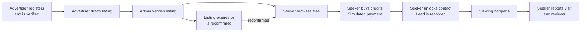
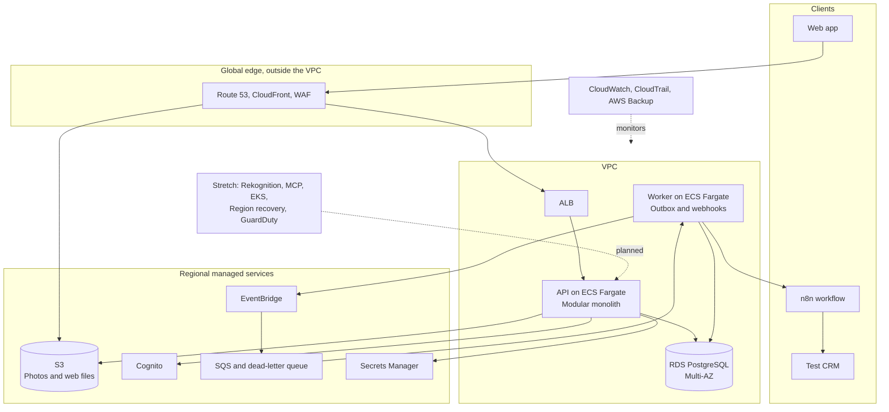
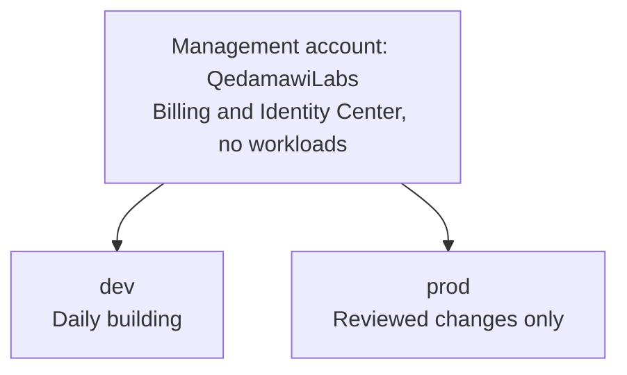
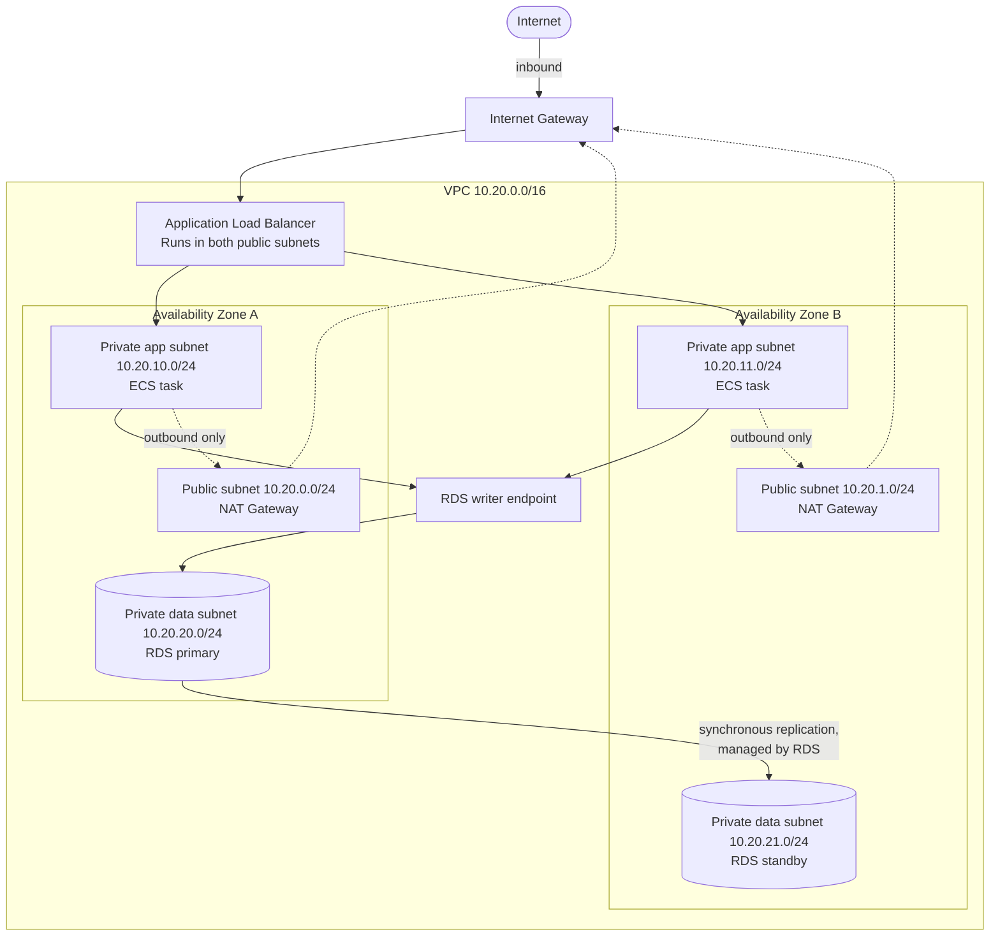
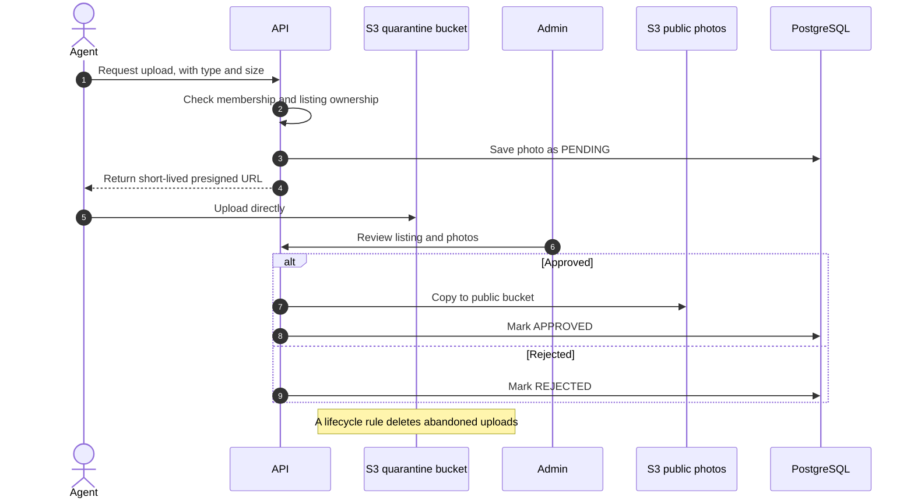
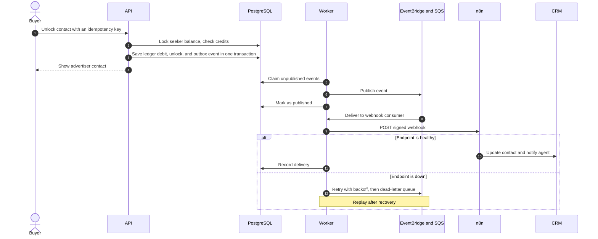
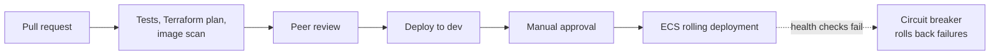
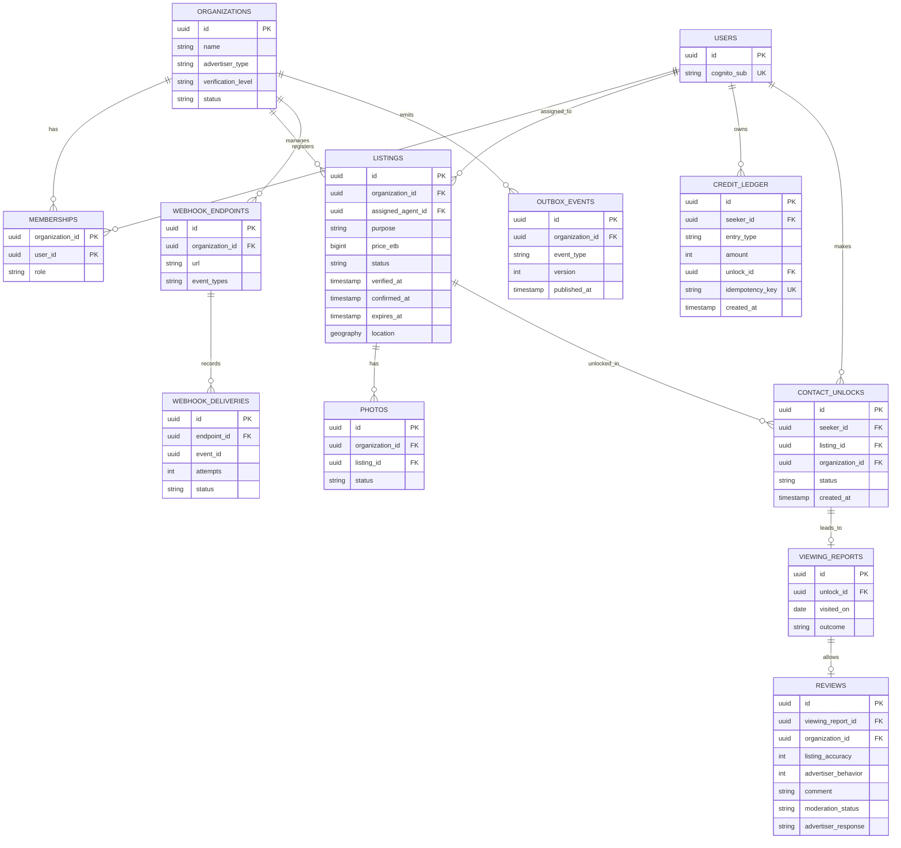
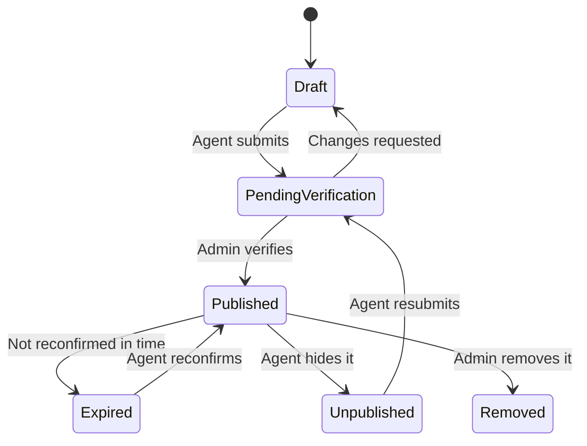

# Architecture

This document explains how TraceHome works and why it's designed this way. Every choice
below is a proposal, so challenge it. If evidence changes a decision, update this file.

## What we're designing for

**Problem to validate:** people searching for a home in Addis Ababa rely on scattered listings and
brokers, and it's hard to tell which listings are genuine and current. Interview at least five
renters, buyers, owners, or brokers to test this.

**Customers:** seekers looking for homes, and three kinds of advertisers: individual owners,
independent brokers, and registered agencies. Each advertiser gets a verification level that seekers
can see.

### Core business workflow

The whole architecture exists to serve this workflow.

Verification and reconfirmation are what make the name TraceHome honest. A listing shows who
verified it and when it was last confirmed as available.

### Business rules

These rules came from product discovery. Validate them in interviews, especially whether seekers
will pay.

| Area | Rule |
|---|---|
| Advertisers | Owners, brokers, and agencies. Brokers need more checks. Agencies can have several members. |
| Browsing | Free for everyone, including verification status |
| Contact access | Seekers buy credit packages. One credit unlocks one listing's advertiser contact. |
| Repeat access | Reopening a contact you've already unlocked is free |
| Refunds | Credit returned if the listing was unavailable, fraudulent, duplicated, or had invalid contacts |
| Payments | Simulated during the hackathon. A real provider comes after reviewing rules, refunds, and disputes. |
| Advertiser pricing | Agencies and brokers on subscriptions. Owners may get free or low-cost options. Not built in the hackathon. |
| Review eligibility | The seeker unlocked the contact **and** reported a viewing |
| Review content | Separate scores for listing accuracy and advertiser behavior, plus optional text |
| Review fairness | Advertisers can respond or dispute, and abusive reviews are moderated |
| Rating display | Show an overall rating only after a minimum number of reviews |
| Voice feedback | Planned for the first public release, with consent, moderation, and retention rules |
| Commission | Later, and only if TraceHome becomes part of the transaction |

**Payment leakage:** advertisers might put phone numbers in descriptions or photos to bypass
contact credits. Listing review must check for this, and repeat offences affect verification.

### Quality targets

These are design targets for a future always-on production system. Our demo environment runs only
for testing and presentations, so it **can't claim** 99.9% monthly availability. What we can do is
test the mechanisms behind that target and report what we measured.

| Quality | Design target | Where the number comes from |
|---|---|---|
| API availability | 99.9% a month, about 43.8 minutes of downtime | Assumed for a business marketplace; confirm with agencies |
| Search speed | 95% of requests under 300 ms in the Region | Assumed; measure in the load test |
| AZ failure | No committed data lost | RDS Multi-AZ synchronous replication |
| Region failure | Under 2 hours to recover, up to 1 hour of data lost | Assumed; **not proven unless the stretch drill runs** |
| Security | Encrypted in transit and at rest, with tenant isolation | Protects agency and buyer data |
| Deployments | Failed releases roll back automatically | Reduces deployment risk |

**Capacity estimate:** 5,000 daily users making 20 requests each is about 1.2 requests a second on
average, and about 12 at peak. We'll load test to 100. The lesson is to size first: this load
doesn't justify microservices or production Kubernetes.

## System overview

Solid boxes are must-ship. Stretch components join later without changing the core.

**One complete integration, not ten shallow ones.** TraceHome is a real estate product first. The
unlock-to-CRM path proves the integration design. Because n8n connects to other tools through its
own connectors, that same path can reach more systems later.

## Application modules

The modular monolith only counts if the boundaries are real. A module owns its tables, and other
modules call its interface rather than querying them directly.

| Module | Owns |
|---|---|
| Identity and access | Users, sign-in, roles |
| Advertisers | Owners, brokers, agencies, memberships, verification |
| Listings | Listings, status, verification, expiry |
| Search | Filters by area, price, and type |
| Media | Upload authorization, photo records |
| Credits | Credit ledger, simulated purchases, refunds |
| Contacts | Contact unlocks, leads, viewing reports |
| Reputation | Reviews, advertiser responses, disputes, rating calculations |
| Integrations | Outbox, webhook endpoints, delivery attempts |

## Accounts and network

Two workload accounts keep experiments away from the demo environment. Setup is limited to half a
day. If it runs over, continue with the accounts you have, and record the change.

The next diagram shows the corrected production design. Both tasks use the **same** RDS writer
endpoint. The standby receives replicated data, but the application never connects to it directly.

| Resource | Purpose | Direction |
|---|---|---|
| Internet Gateway | Connects the VPC to the internet | Both |
| ALB | Receives application traffic and sends it to healthy tasks | Inbound |
| NAT Gateway | Lets private resources start outbound connections | Outbound only |
| S3 gateway endpoint | Private, no-charge route to S3 | Outbound to S3 |
| App subnets | Run ECS tasks | No inbound from the internet |
| Data subnets | Run RDS, with no internet route | From app only |

Security groups chain: CloudFront to ALB, ALB to app, app to database.

### How tasks reach their dependencies

| Dependency | `prod`, private tasks | `dev`, no NAT Gateway |
|---|---|---|
| ECR image pull | NAT, plus the S3 gateway endpoint for image layers | Task's public IP |
| CloudWatch Logs, Secrets Manager | NAT | Task's public IP |
| External webhooks | NAT | Task's public IP |
| RDS | Inside the VPC | Inside the VPC |

In `dev`, tasks run in public subnets with public IPs, and their security group accepts inbound
traffic only from the ALB. That's cheaper, and less isolated. Before choosing this, compare it
with interface endpoints, which still wouldn't provide access to external webhooks.

| Setting | `dev` | `prod` |
|---|---|---|
| ECS tasks | 1 small task | 2 or more across AZs, plus worker |
| Database | Single-AZ | Multi-AZ |
| NAT Gateway | None | One per AZ |
| WAF | Off | On |

## Key flows

### Photo upload

Photos go straight to S3, so large files never pass through the API.

**Stretch:** add Rekognition to flag unsafe images. It can't prove that a property exists or that
the uploader owns it, so human verification stays either way.

### Contact unlock to CRM

The API saves the change and its event in one database transaction, so a crash can't lose the
event. This is the **transactional outbox** pattern.

**Details to get right:**

- A crash between publishing and marking as published causes a duplicate. So delivery is **at
  least once**, and every event carries a stable ID that consumers use to ignore repeats.
- Use `FOR UPDATE SKIP LOCKED` so that multiple workers don't claim the same event.
- Include a version number in each event, because event formats change over time.
- Only use events for work that can happen later. Spending a credit stays synchronous.

### Credit ledger

Credits are money-like, so they need stronger rules than ordinary data.

- **Append-only ledger:** purchases, spends, and refunds are new rows. Never edit or delete them.
- **One unlock per seeker and listing:** a unique constraint, so a retry can't charge twice.
- **No double spending:** lock the seeker's balance row inside the transaction before spending.
- **Idempotency keys:** a repeated purchase or unlock request returns the first result.
- **Traceable refunds:** each refund points to the unlock it reverses.
- **Reconciliation:** the balance must always equal the sum of ledger entries, and a scheduled
  check alerts if it doesn't.

When a real payment provider arrives, its signed callbacks will add purchases through this same
idempotent path.

### Code to production

GitHub Actions uses OIDC for short-lived AWS access, so GitHub stores no AWS keys.

## Data

PostgreSQL is the only application database. It's simpler to secure, back up, and explain, so we
removed DynamoDB until a measured requirement justifies it.

| Data | Store | Why |
|---|---|---|
| Advertisers, users, listings | RDS PostgreSQL | Relationships and transactions |
| Outbox, webhook deliveries, idempotency keys | RDS PostgreSQL | Same transaction and backup as business data |
| Credit ledger, unlocks, reviews | RDS PostgreSQL | Transactions and constraints protect money-like data |
| Area search | PostgreSQL indexes on sub-city and neighborhood | Enough for now; PostGIS map search comes later |
| Photos and web files | S3 | Durable and cheap |
| Secrets | Secrets Manager | Encryption, audit, and rotation |

**Location:** many Addis Ababa properties may not have a simple street address. The hackathon uses
sub-city and neighborhood. Store an optional map pin now so that map search can be added later.

### Listing lifecycle

### Tenant isolation

Agency data is the most important boundary in this system, so we use several layers.

1. **Tenant context:** the API takes the user from the verified token, then checks their membership.
   Never trust an organization ID sent by the client.
2. **Application check:** each module confirms the user may perform the action.
3. **Row-Level Security:** policies filter tenant tables in PostgreSQL.
4. **Safe pooling:** use `SET LOCAL` inside a transaction, so that tenant context can't leak to the
   next request on a pooled connection.
5. **Limited database role:** the app uses a non-owner role. Enable `FORCE ROW LEVEL SECURITY`,
   because table owners and superusers can otherwise bypass policies.
6. **Worker access:** cross-tenant background work uses a separate, narrowly scoped role.
7. **Composite foreign keys:** use `(organization_id, listing_id)` so that a photo or contact unlock can't
   point to another tenant's listing.
8. **Automated tests:** prove that Agency A can't read or change Agency B's private records.

Questions to settle in the schema design: Can one user belong to several agencies? Can independent
owners publish? What happens to listings when an agency is suspended?

## Decisions and tradeoffs

A service name isn't a decision. Each row starts from a requirement and ends with how we'll prove it.

| Requirement | Decision | Rejected | Tradeoff accepted | How we'll prove it |
|---|---|---|---|---|
| Limit the impact of mistakes | Separate `dev` and `prod` accounts | One account, full landing zone | Setup time | Dev role can't change prod |
| Keep costs low, with the services we need | `us-east-1`, pending a latency test | Europe, Cape Town | Likely slower dynamic requests from Ethiopia | Latency measurements |
| Run a containerized monolith across AZs with little server management | ECS Fargate | EC2, EKS, Lambda | Less control, higher compute unit cost | Stop a task and measure replacement |
| Repeatable, reviewable infrastructure | Terraform, with CloudFormation bootstrap | CloudFormation only | Learning curve, state needs protection | A teammate rebuilds `dev` |
| Transactions and relational data | RDS PostgreSQL | Aurora, DynamoDB | Writes scale vertically | Run real queries and load test |
| Area and filter search for 20,000 listings | PostgreSQL indexes; PostGIS later | OpenSearch | Basic relevance, no map search yet | `EXPLAIN ANALYZE` and p95 results |
| Credits can't be lost or spent twice | Append-only ledger in PostgreSQL transactions | A balance field alone, DynamoDB | Stricter code and tests | Concurrent unlock and retry tests |
| Test monetization without payment risk | Simulated purchases | Real provider now | No real revenue yet | Ledger reconciles after every test |
| Three developers ship one product | Modular monolith | Microservices | Modules deploy together | Module boundary tests |
| Don't lose events when a process crashes | Outbox, EventBridge, SQS | Direct calls, Kinesis | Eventual delivery and duplicates | Kill the worker, then replay |
| Deliver to slow endpoints safely | SQS and ECS worker | Sending during the request, Lambda | We own retries and SSRF defenses | Stop n8n, then replay |
| Protect the API from large uploads | Presigned S3 upload | Upload through the API | Extra upload states | Reject a large or wrong-type file |
| Serve agencies at low cost | Shared tables with Row-Level Security | One database per tenant | Tenants share capacity | Cross-tenant tests |
| Avoid storing passwords | Cognito with application authorization | Custom authentication | Migration is harder later | Token and role tests |
| Roll back failed releases | ECS rolling deployment with circuit breaker | Blue/green for now | Old and new versions overlap briefly | Deploy a bad image |
| Keep the production design affordable | Start and stop environments | Weakening the design | Not always online | Actual cost report |

**Honest note:** for a real startup on this budget, a fully serverless design could cost much
less while idle. We chose containers, a VPC, and RDS partly because the learning goals require
them. Say that plainly in interviews.

## Security

| Layer | Controls |
|---|---|
| Identity | MFA, Identity Center, OIDC, one least-privilege role per service |
| Edge | CloudFront, Shield Standard, WAF rate limits |
| Network | Private subnets, chained security groups, no SSH |
| Application | Token validation, tenant and ownership checks, input validation |
| Data | Encryption at rest, TLS, Secrets Manager, private buckets |
| Detection | CloudTrail and CloudWatch alarms first; GuardDuty and Config if time allows |

| Threat | Defense |
|---|---|
| One tenant reads another's data | The eight tenant isolation layers above |
| Fake listings | Human verification, reconfirmation, reporting, and audit history |
| Malicious file upload | Size and type limits, private quarantine, and approval before publishing |
| Webhook sent to an internal address (SSRF) | See the rules below |
| Bypassing credits with contact details in listings | Listing review checks text and photos; repeat offences reduce verification |
| Fake or abusive reviews | Only eligible seekers can review; moderation, responses, and disputes |
| Credit fraud or double spending | Locked balances, unique unlocks, idempotency, reconciliation |
| Advertiser contact details exposed | Shown only to seekers who unlocked them, with the advertiser's consent |
| Forged or replayed webhook | Signature over ID, timestamp, and body; receivers reject stale timestamps |
| Leaked credentials | No long-lived keys, plus secret scanning |

**SSRF rules:** checking the URL text isn't enough. Require HTTPS, resolve the host, block private,
loopback, link-local, and metadata addresses, connect to the IP you validated so DNS rebinding
can't change it, re-check every redirect or disable redirects, and limit outbound network access.

## Reliability tests

Each test records the **expected result, actual result, evidence, and recovery time**. Run these
only against your own system.

| Test | Expected result |
|---|---|
| Stop an API task under load | ALB avoids it, and ECS replaces it |
| Force RDS failover under load | Brief write errors, then recovery through the same endpoint |
| Deploy a bad image | Circuit breaker rolls it back |
| Delete test data, then restore | Data returns; recovery time and data loss are measured |
| Two unlocks at once with one credit left | Exactly one succeeds |
| Retry the same unlock request | One unlock, one charge |
| Review without a reported viewing | Rejected |
| Stop the worker after an unlock | Event stays in the outbox, then publishes after restart |
| Deliver the same event twice | The CRM updates only once |
| Stop the n8n endpoint for hours | Retries continue, then DLQ, then successful replay |
| Agency A requests Agency B's data | The API denies it, and the database hides it |
| Load test to 100 requests a second | ECS scales, and limits are documented |

**Scale in this order:** CloudFront cache, ECS tasks, query tuning, RDS Proxy, read replicas,
ElastiCache, a bigger database, and only then split a service. Each step adds complexity, so
wait for metrics to justify it.

## Regional recovery, documented but not yet built

Pilot light is our intended strategy: run nothing in `us-west-2` except copied data. A real plan must
answer where the database comes from, how images and container images are replicated, where secrets
and encryption keys come from, how Terraform state stays reachable, how DNS changes, how to prevent
two Regions from accepting writes, and how to verify the result. Don't claim these targets until a
drill proves them.

## Lessons from other systems

Use the reference diagram as a standard for layered presentation, not as a list of services. It's
a video platform, while our hard problems are trust, tenants, and integrations.

**Adopt:** clear layers, async pipelines with DLQs, and automated security response.

**Don't copy:** WAF and CloudFront in a subnet, NAT on an inbound path, the EKS control plane in
your subnet, or Aurora connected to an RDS standby.

**On our final diagram:** use official AWS icons, number the main path, keep edge services outside
the VPC, show two AZs, and mark components as Built, Tested, or Planned.

## Stretch design notes

| Item | Design rule |
|---|---|
| MCP | Thin service over the same secured API, read-only first; test every client you claim to support |
| Rekognition | Flags unsafe images; never treat it as proof that a listing is genuine |
| Public partner API | API keys identify callers and support quotas, but they aren't authorization, so also validate OAuth or JWT scopes |
| Social and CRM connectors | Check current provider terms, approvals, and costs first |

## Verify during the build

We haven't tested these in your account yet:

- How CloudFront reaches the ALB securely
- Current Fargate, NAT, RDS, and logging prices in the AWS Pricing Calculator
- SES production access, if email is used, because sandbox mode only sends to verified addresses
- A CRM test account that suits the n8n workflow
