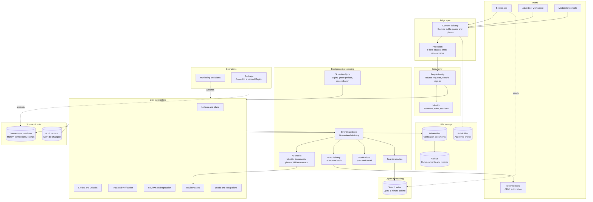
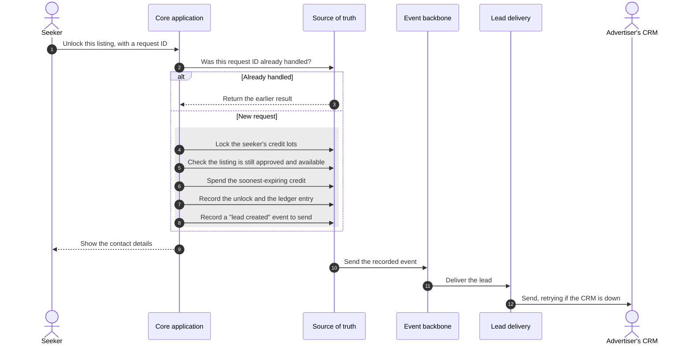
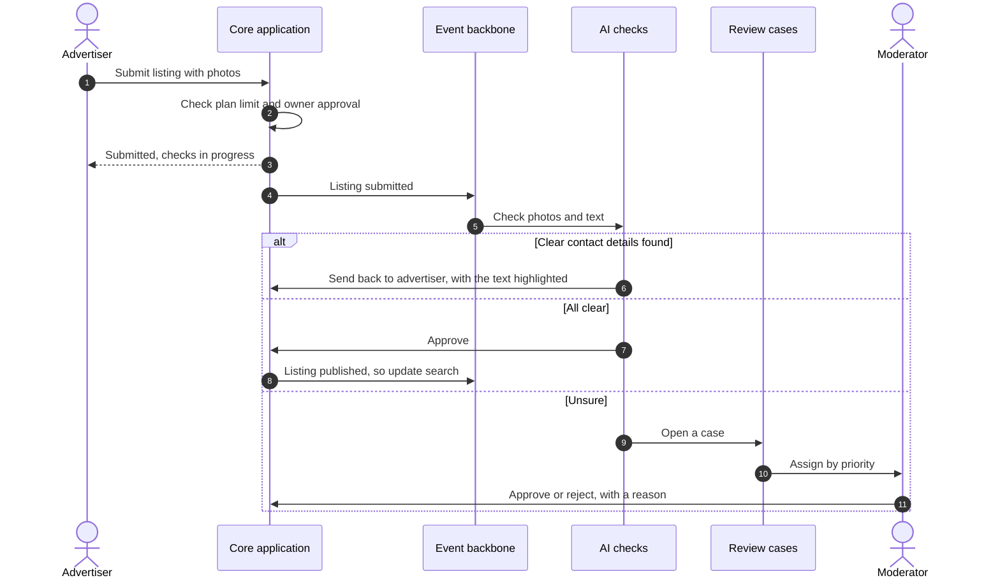
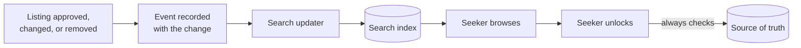

# Architecture

This document turns the agreed requirements into a design. We build it in two stages:

1. **Logical architecture:** the parts of the system and how they work together, without naming
   any technology. *(This stage.)*
2. **AWS architecture:** each logical part mapped to AWS services, with a reason for every choice.
   *(Next stage.)*

Separating the stages keeps the reasoning honest. If a part can't be justified without naming a
product, it probably isn't needed.

## Design principles

These nine principles guide every design choice. Each one protects specific business rules we
agreed in the requirements, listed here in full.

| Principle | What it means in practice | Business rules it protects |
|---|---|---|
| **1. One trusted source of truth for money and permissions** | Credits, unlocks, reviews, plan limits, and access rights are checked and changed together, in one place, as one all-or-nothing step | • A seeker can't spend more credits than they have • A credit is never spent twice, even when a request is retried • A seeker never pays twice to unlock the same listing • A seeker's balance always equals the sum of their credit history • An expired bonus credit can't be spent • Contact details are visible only to seekers who unlocked them • An advertiser never exceeds their plan's listing or agent limit • A review exists only after an unlock and a reported viewing • One seeker leaves at most one review per unlock • An advertiser never sees another advertiser's private data |
| **2. Lists and copies may lag, but every action checks the source of truth** | Search results and cached pages may be slightly out of date. When someone acts, such as unlocking a contact, the system checks the current record. | • Only approved listings appear in search; a removed listing disappears within 1 minute • A broker's listing is public only while the owner's approval is valid |
| **3. Background work is guaranteed, never lost** | Work that can wait, such as sending leads, is delayed safely and retried until it succeeds | • Every unlock produces a lead for the advertiser, even if their CRM is offline • Every decision's record is archived for long-term keeping |
| **4. Automate clear cases, send doubtful ones to a person** | Automation decides when it's confident; otherwise a moderator decides | • Approving a fraudster is worse than rejecting an honest advertiser • AI checks decide clear cases; people decide doubtful ones • Refunds follow precise rules; doubtful ones go to a person • Clear hidden contact details go back to the advertiser; unclear ones go to a moderator |
| **5. The public marketplace and the private workspace are designed differently** | Browsing is public, heavy, and fine slightly stale. The workspace is private, smaller, and must always be correct. | • TraceHome is two products: a public marketplace and a private advertiser workspace |
| **6. Personal data is kept separate, so it could move later** | Names, phone numbers, and documents are stored apart from everything else | • Everything runs on AWS for now, but personal data may need to move to Ethiopia if the law requires it |
| **7. Correctness beats availability when they conflict** | If the system can't be sure a credit is safe to spend, it refuses rather than risk a mistake | • Quality priority: correctness, then security, browsing availability, durability, speed, and cost |
| **8. Every decision leaves a record that can't be changed** | Credit changes, verifications, and moderation decisions are recorded when they happen, and never edited | • Every automated or human decision is recorded, and the record can't be changed • Every purchase, spend, and refund is permanently recorded |
| **9. Pay for what's used; keep idle cost low** | Prefer parts that cost little when nobody is using them | • TraceHome runs within a small budget |

## The logical architecture

### What each part does, and why it exists

| Part | Responsibility | Why it exists |
|---|---|---|
| Content delivery | Serves public pages and photos from copies close to users | Browsing must stay available, and fast on slow mobile networks |
| Protection | Blocks attacks and limits request rates | Scraping and abuse resistance |
| Request entry | One front door for every request | One place to check sign-in and route requests |
| Identity | Accounts, roles, and sessions that expire within 5 minutes | Advertisers never see each other's data, and removed agents lose access within 5 minutes |
| Core application | All business rules | Modules of one application, not separate services, so the team can understand and change it |
| Transactional database | The source of truth for money, permissions, and listings | Money and permission rules need one all-or-nothing place (principle 1) |
| Audit records | Every credit change and decision | P8 |
| Search index | A copy of approved listings, built for searching | Fast browsing; it may lag behind the database (principle 2) |
| Public files | Approved listing photos | Served to anyone, through content delivery |
| Private files | Verification documents | Never public; encrypted, with strict access (principle 6) |
| Archive | Documents and records kept for years | Rarely read, so cheaper storage is appropriate |
| Event backbone | Carries "something happened" messages, and keeps them until handled | Guaranteed background work (principle 3) |
| AI checks | Identity, documents, photos, and hidden contact details | Automated decisions with confidence levels (principle 4) |
| Review cases | One queue for every doubtful decision | One shared queue for all seven kinds of review case (principle 4) |
| Lead delivery | Sends leads to CRMs and automation tools, retrying when they're down | Every unlock must produce a lead for the advertiser |
| Notifications | SMS and email | Reminders, alerts, and confirmations |
| Scheduled jobs | Bonus expiry, listing expiry, grace periods, balance checks | Time-based rules |
| Monitoring | Notices problems before users report them | Observability |
| Backups | Restorable copies, also kept in a second Region | Restore lost data within 1 hour; survive a Region failure using copied backups |

## Core application modules

The core is one application with clear internal boundaries. Each module owns its data, and other
modules use it only through its defined actions.

| Module | Owns | Must keep instantly true |
|---|---|---|
| Accounts and advertisers | Users, advertisers, members, roles | Removed agents lose access within 5 minutes |
| Listings and plans | Listings, photos, plans, subscriptions | Plan limits when publishing |
| Trust and verification | Verification levels, owner approvals | Only valid approvals allow public listings |
| Credits and unlocks | Credit lots, ledger, unlocks | Credits are never overspent, spent twice, or spent after expiry; no listing is unlocked twice; contacts go only to seekers who unlocked them |
| Reviews and reputation | Viewing reports, reviews, responses | Reviews only after an unlock and a reported viewing; one review per unlock |
| Review cases | Cases, assignments, decisions | Every decision is recorded |
| Leads and integrations | Leads, connections to external tools | Every unlock creates a lead |

## Where work happens

The most important design boundary: what happens **while the user waits**, and what happens
**in the background**.

| While the user waits | In the background |
|---|---|
| Browsing and searching | Updating the search index |
| Unlocking a contact and spending a credit | Delivering the lead to the advertiser's CRM |
| Creating or editing a listing | AI checks on photos, text, and documents |
| Writing a review | Notifications |
| Moderator decisions | Expiry and grace period jobs |
| Signing in | Archiving old documents and records |
| | Copying backups to the second Region |

**The rule:** a user waits only for work that must be instantly true. Everything else goes to the
background, where it's guaranteed but can be delayed.

## Key flows

### Unlocking a contact

Everything inside the box happens as one all-or-nothing step. If any part fails, nothing changes.

**Why the event is recorded in the same step:** if the system crashed after spending the credit
but before recording the event, the advertiser would never get the lead, breaking the rule that
every unlock produces a lead. Saving the event with the unlock means a crash can't separate them. A background process
then sends it.

### Publishing a listing

### Search staying up to date

Search may be up to 1 minute behind. Unlocking always checks the source of truth, so a seeker can
never pay for a listing that was just removed.

## Data classes

Each kind of data needs different protection. This table drives encryption, access, and storage
choices in the next stage.

| Class | Examples | Who can see it | Kept for |
|---|---|---|---|
| Public | Approved listings, photos, review summaries | Anyone | While the listing is live |
| Internal | Plans, case queues, metrics | TraceHome staff | As needed |
| Personal | Names, phone numbers, email addresses | The person, and seekers who unlocked them | While the account exists, then by policy |
| Sensitive | ID checks, ownership documents | Moderators with a reason; every access recorded | By law, pending legal advice |
| Financial | Credit lots, ledger | The seeker, finance, and auditors | Years; never changed |
| Audit | Decisions and access records | Auditors | Years; never changed |

## Questions to answer before mapping to AWS

Answer these yourself first. They test whether the design is clear to you.

1. Why does unlocking a contact happen while the user waits, but delivering the lead doesn't?
2. Why is the search index allowed to be wrong for a minute, but the credit balance never is?
3. Why is the core one application with modules, and not seven separate services?
4. What happens to a lead if the advertiser's CRM is offline when the seeker unlocks the contact?
5. Why are public photos and verification documents stored separately?
