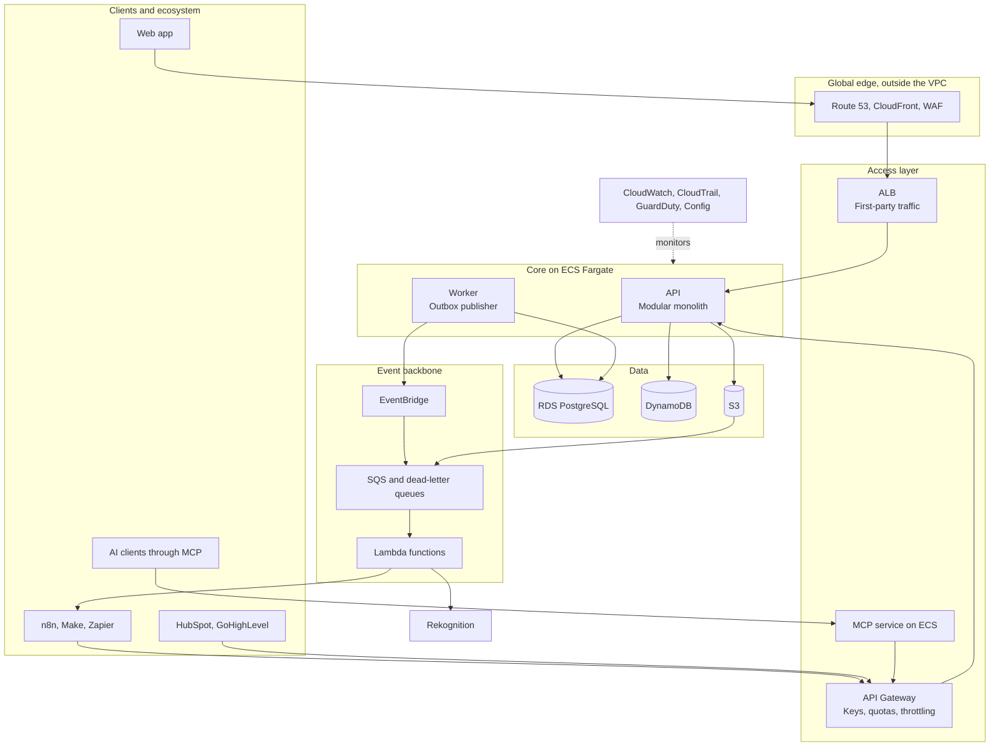
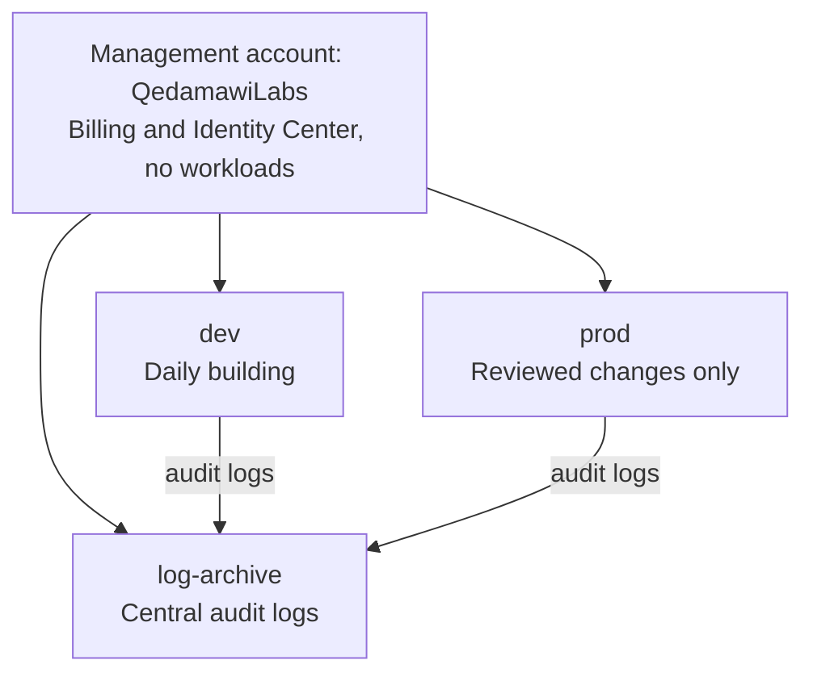
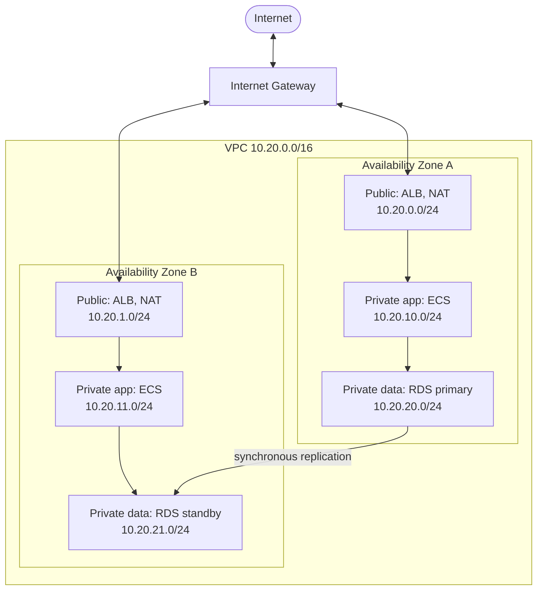
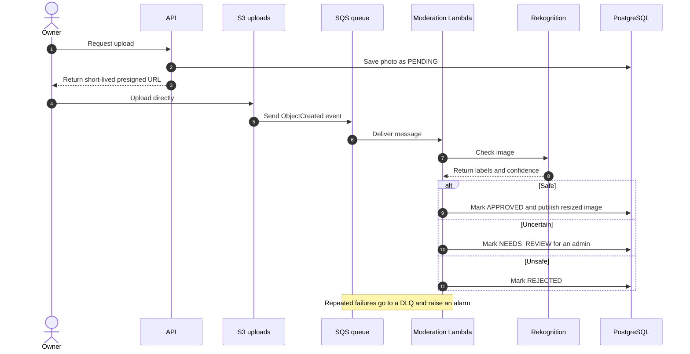
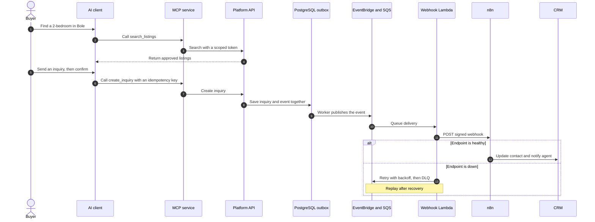
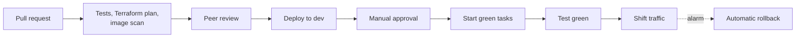
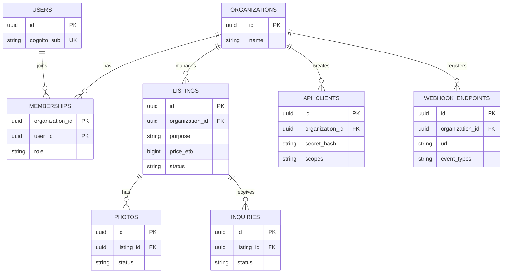

# Architecture

This document explains how TraceHome works and why it's designed this way. Every choice
below is a proposal, so challenge it. If evidence changes a decision, update this file.

## What we're designing for

**Problem to validate:** people searching for a home in Addis Ababa rely on scattered listings and
brokers, and it's hard to tell which listings are genuine and current. Interview at least five
renters, buyers, owners, or brokers to test this.

| Quality | Target |
|---|---|
| API availability | 99.9% a month |
| Search speed | 95% of requests under 300 ms in the Region |
| Moderation speed | 95% of photos within 60 seconds |
| AZ failure | No committed data lost |
| Region failure | Under 2 hours to recover, up to 1 hour of data lost |
| Security | Encrypted in transit and at rest, with tenant isolation |
| Deployments | No user-visible downtime, automatic rollback |

**Capacity estimate:** 5,000 daily users making 20 requests each is about 1.2 requests a second on
average, and about 12 at peak. We'll load test to 100. The lesson is to size first: this load
doesn't justify microservices or production Kubernetes.

## System overview

**Four contracts:** instead of building one integration per product, we build a REST API, webhooks,
an MCP server, and provider connectors. Once the API and webhooks exist, automation tools can reach
hundreds of other apps.

## Accounts and network

Each tier accepts traffic only from the tier before it: CloudFront to ALB, ALB to app, app to
database. S3 and DynamoDB gateway endpoints keep that traffic inside AWS.

| Setting | `dev` | `prod-ha` |
|---|---|---|
| ECS tasks | 1 small API task | 2 or more API tasks across AZs, plus worker |
| Database | Single-AZ | Multi-AZ |
| NAT Gateway | None | One per AZ |
| WAF | Off | On |
| Deployment | Rolling | Blue/green |

`dev` is deliberately less available so that it stays cheap. `prod-ha` is the design standard.

## Key flows

### Photo upload and moderation

Photos go straight to S3, so large files never pass through the API.

### Inquiry to CRM

The API saves the change and its event in one database transaction, so a crash can't lose the
event. This is the **transactional outbox** pattern.

Delivery is at least once, so every consumer must be idempotent.

### Code to production

GitHub Actions uses OIDC for short-lived AWS access, so GitHub stores no AWS keys.

## Data

| Data | Store | Why |
|---|---|---|
| Tenants, users, listings, inquiries, outbox | RDS PostgreSQL | Relationships and transactions |
| Photos and web files | S3 | Durable and cheap |
| Delivery logs, idempotency, quotas | DynamoDB | Simple keys and fast conditional writes |
| Secrets | Secrets Manager | Encryption, audit, and rotation |

Add `organization_id` from the first migration, because retrofitting tenant isolation is risky.

## Decisions and tradeoffs

These are the answers you'll defend in the Q&A and in interviews.

| Decision | Why | Rejected | Tradeoff accepted | Revisit when |
|---|---|---|---|---|
| Separate AWS accounts | Strongest isolation; protects logs | One account | More setup | Team needs account automation |
| `us-east-1`, pending a day-2 latency test | Low cost and broad services | Europe, Cape Town | Slower dynamic requests from Ethiopia | Tests show a better Region |
| ECS Fargate for production | No servers or cluster fee, suits one team | EC2, EKS | Less portable, higher compute price | Many teams need a shared platform |
| Terraform, with CloudFormation bootstrap | Reviewable plans and portable skills | CloudFormation only | Learning curve; state needs protection | It threatens the deadline |
| RDS PostgreSQL | Transactions, relationships, and PostGIS | Aurora, DynamoDB | Writes scale vertically | Targets are missed |
| PostgreSQL search | Enough for this size, no sync work | OpenSearch | Basic relevance | Search targets are missed after tuning |
| Modular monolith | Simple to deploy for three people | Microservices | Modules deploy together | Metrics justify a split |
| Outbox, EventBridge, SQS | Doesn't lose events, separates failures | Direct calls, Kinesis | Eventual consistency, duplicates | Ordered streaming is needed |
| Presigned upload and async moderation | Scales, and protects the API | Upload through API | Photos aren't instantly visible | Pipeline needs more steps |
| Shared tables with Row-Level Security | Lowest cost, with two isolation layers | One database per tenant | Tenants share capacity | A customer needs stronger isolation |
| API Gateway for partners, ALB for our apps | Built-in quotas, and isolates noisy clients | One path for everyone | Two paths to operate | The paths can merge |
| SQS and Lambda for webhooks | Full control, and teaches the patterns | Direct sends, hosted service | We own retries and SSRF defenses | Upkeep exceeds a vendor's price |
| Thin MCP service over the public API | No special privileges | MCP in the core API, AgentCore Gateway | We track protocol changes | A managed gateway becomes better |
| Contracts before native connectors | Quick reach, unaffected by approvals | Native connector for each provider | Early setup isn't one-click | Tenants request a provider |
| Cognito, with app-level authorization | Avoids storing passwords | Custom auth | Migration is harder later | Sign-in needs change |
| Blue/green deployment | Test before traffic moves, and roll back fast | Canary, CodeDeploy | Doubles tasks briefly | Traffic supports canaries |
| Pilot light recovery | Low idle cost | Warm standby | Recovery takes human time | Business needs faster recovery |
| Start and stop environments | Keeps production design affordable | Weaken the design | Not always online | Real users arrive |

**Honest note:** for a real startup on this budget, a fully serverless design could cost much
less while idle. We chose containers, a VPC, and RDS partly because the learning goals require
them. Say that plainly in interviews.

## Security

| Layer | Controls |
|---|---|
| Identity | MFA, Identity Center, OIDC, one least-privilege role per service |
| Edge | CloudFront, Shield Standard, WAF rate limits |
| Network | Private subnets, chained security groups, no SSH |
| Application | Token validation, tenant and ownership checks, input validation |
| Data | KMS, TLS, Secrets Manager, private buckets |
| Detection | CloudTrail, GuardDuty, Config, Security Hub, image scanning |

| Threat | Defense |
|---|---|
| One tenant reads another's data | App checks, Row-Level Security, and automated tests |
| Harmful or fake listings | Moderation, human review, and audit logs |
| Webhook sent to an internal address (SSRF) | HTTPS only; block private and metadata addresses, including after DNS and redirects |
| Forged or replayed webhook | Signature over ID, timestamp, and body; reject stale timestamps |
| Prompt injection in listing text | Treat it as data; tools keep the same limits |
| AI client takes an unwanted action | Narrow scopes, confirmation, idempotency, and audit logs |
| Noisy API client | Per-client quotas |
| Leaked credentials | No long-lived keys, plus secret scanning and GuardDuty |

## Reliability tests

Run these only against your own system, and record the expected result, actual result, and recovery time.

| Test | Expected result |
|---|---|
| Stop an API task under load | ALB avoids it, and ECS replaces it |
| Force RDS failover under load | Brief write errors, then recovery |
| Deploy a bad image | Automatic rollback |
| Delete test data, then restore | Data returns; RTO and RPO are measured |
| Stop the n8n endpoint | Retries, DLQ, then successful replay |
| Make the moderation function fail | Photos wait; nothing is lost |
| Load test to 100 requests a second | ECS scales, and limits are documented |
| Flood the API with one client | That client is throttled, others are fine |
| Region failover, stretch goal | Restore in `us-west-2` and measure recovery |

**Scale in this order:** CloudFront cache, ECS tasks, query tuning, RDS Proxy, read replicas,
ElastiCache, a bigger database, and only then split a service. Each step adds complexity, so
wait for metrics to justify it.

## Lessons from other systems

Use it as a standard for layered presentation, not as a list of services. It's a video platform,
while our hard problems are trust, tenants, and integrations.

**Adopt:** clear layers, async pipelines with DLQs, and automated security response.

**Don't copy:** WAF and CloudFront in a subnet, NAT on an inbound path, the EKS control plane in
your subnet, or Aurora connected to an RDS standby.

**On our final diagram:** use official AWS icons, number the main path, keep edge services outside
the VPC, show two AZs, and mark components as Built, Tested, or Planned.

## Provider limits

Check current terms before building. These rules change often.

| Provider | Plan for |
|---|---|
| WhatsApp | Per-message pricing and limits on general-purpose AI assistants; build a property-specific bot |
| Facebook, Instagram | Business assets only, and possibly App Review |
| LinkedIn | Publishing can require partner approval |
| TikTok | Reported audit requirements |
| X | Paid API access |
| HubSpot, GoHighLevel | OAuth, scopes, and provider rate limits |

## Verify during the build

We haven't tested these in your account yet:

- CloudFront VPC origins, or a public ALB with restricted access
- API Gateway's private connection to the ALB, which may require an NLB
- CloudFront flat-rate plans and bundled WAF features
- Bedrock model access, Region, and pricing
- SES production access, because sandbox mode only sends to verified addresses
- Current MCP authorization requirements, and each AI client you claim to support
