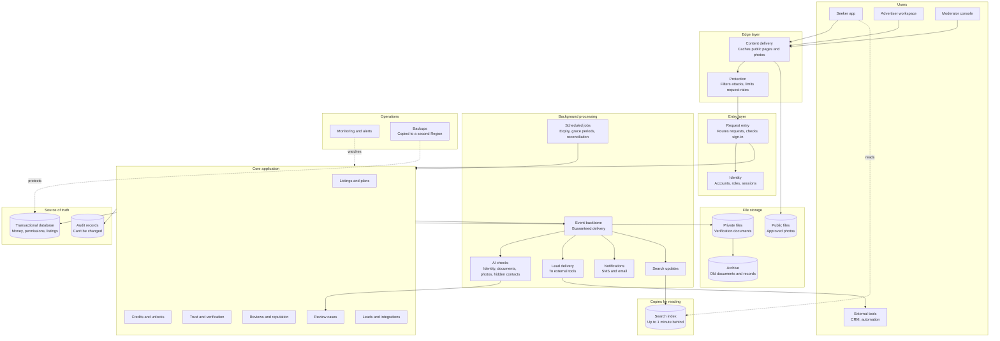
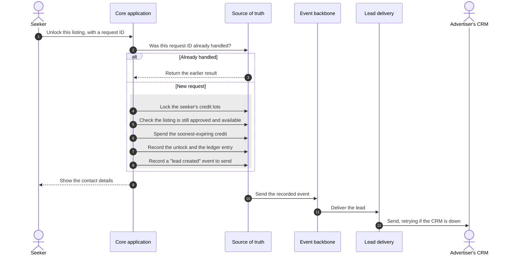
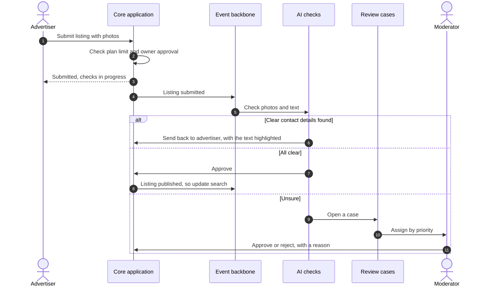
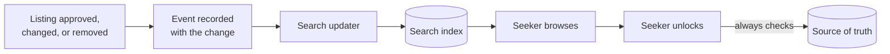
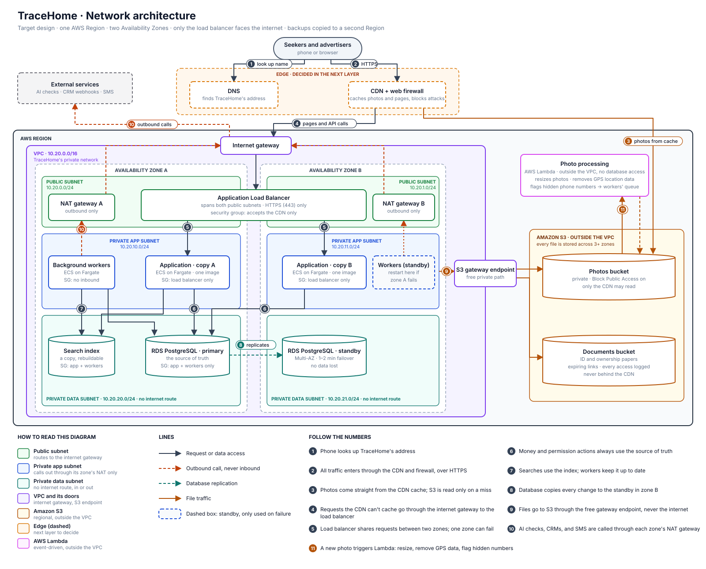

# Architecture

This document turns the agreed requirements into a design. We build it in two stages:

1. **Logical architecture:** the parts of the system and how they work together, without naming
   any technology. *(Done.)*
2. **AWS architecture:** each logical part mapped to AWS services, with a reason for every choice.
   *(In progress: network, compute, data, and edge are decided.)*

Separating the stages keeps the reasoning honest. If a part can't be justified without naming a
product, it probably isn't needed.

## Design principles

These nine principles guide every design choice. Each one protects specific business rules we
agreed in the requirements, listed here in full.

| Principle | What it means in practice | Business rules it protects |
|---|---|---|
| **1. One trusted source of truth for money and permissions** | Credits, unlocks, reviews, plan limits, and access rights are checked and changed together, in one place, as one all-or-nothing step | • A seeker can't spend more credits than they have<br>• A credit is never spent twice, even when a request is retried<br>• A seeker never pays twice to unlock the same listing<br>• A seeker's balance always equals the sum of their credit history<br>• An expired bonus credit can't be spent<br>• Contact details are visible only to seekers who unlocked them<br>• An advertiser never exceeds their plan's listing or agent limit<br>• A review exists only after an unlock and a reported viewing<br>• One seeker leaves at most one review per unlock<br>• An advertiser never sees another advertiser's private data |
| **2. Lists and copies may lag, but every action checks the source of truth** | Search results and cached pages may be slightly out of date. When someone acts, such as unlocking a contact, the system checks the current record. | • Only approved listings appear in search; a removed listing disappears within 1 minute<br>• A broker's listing is public only while the owner's approval is valid |
| **3. Background work is guaranteed, never lost** | Work that can wait, such as sending leads, is delayed safely and retried until it succeeds | • Every unlock produces a lead for the advertiser, even if their CRM is offline<br>• Every decision's record is archived for long-term keeping |
| **4. Automate clear cases, send doubtful ones to a person** | Automation decides when it's confident; otherwise a moderator decides | • Approving a fraudster is worse than rejecting an honest advertiser<br>• AI checks decide clear cases; people decide doubtful ones<br>• Refunds follow precise rules; doubtful ones go to a person<br>• Clear hidden contact details go back to the advertiser; unclear ones go to a moderator |
| **5. The public marketplace and the private workspace are designed differently** | Browsing is public, heavy, and fine slightly stale. The workspace is private, smaller, and must always be correct. | • TraceHome is two products: a public marketplace and a private advertiser workspace |
| **6. Personal data is kept separate, so it could move later** | Names, phone numbers, and documents are stored apart from everything else | • Everything runs on AWS for now, but personal data may need to move to Ethiopia if the law requires it |
| **7. Correctness beats availability when they conflict** | If the system can't be sure a credit is safe to spend, it refuses rather than risk a mistake | • Quality priority: correctness, then security, browsing availability, durability, speed, and cost |
| **8. Every decision leaves a record that can't be changed** | Credit changes, verifications, and moderation decisions are recorded when they happen, and never edited | • Every automated or human decision is recorded, and the record can't be changed<br>• Every purchase, spend, and refund is permanently recorded |
| **9. Pay for what's used; keep idle cost low** | Prefer parts that cost little when nobody is using them | • TraceHome runs within a small budget |

## The logical architecture



### What each part does, and why it exists

| Part | Responsibility | Why it exists |
|---|---|---|
| Content delivery | Serves public pages and photos from copies close to users | Browsing must stay available, and fast on slow mobile networks |
| Protection | Blocks attacks and limits request rates | Scraping and abuse resistance |
| Request entry | One front door for every request | One place to check sign-in and route requests |
| Identity | Accounts, roles, and sessions that expire within 5 minutes | Advertisers never see each other's data, and removed agents lose access within 5 minutes |
| Core application | All business rules | Modules of one application, not separate services, so the team can understand and change it |
| Transactional database | The source of truth for money, permissions, and listings | Money and permission rules need one all-or-nothing place (principle 1) |
| Audit records | Every credit change and decision | P8 |
| Search index | A copy of approved listings, built for searching | Fast browsing; it may lag behind the database (principle 2) |
| Public files | Approved listing photos | Served to anyone, through content delivery |
| Private files | Verification documents | Never public; encrypted, with strict access (principle 6) |
| Archive | Documents and records kept for years | Rarely read, so cheaper storage is appropriate |
| Event backbone | Carries "something happened" messages, and keeps them until handled | Guaranteed background work (principle 3) |
| AI checks | Identity, documents, photos, and hidden contact details | Automated decisions with confidence levels (principle 4) |
| Review cases | One queue for every doubtful decision | One shared queue for all seven kinds of review case (principle 4) |
| Lead delivery | Sends leads to CRMs and automation tools, retrying when they're down | Every unlock must produce a lead for the advertiser |
| Notifications | SMS and email | Reminders, alerts, and confirmations |
| Scheduled jobs | Bonus expiry, listing expiry, grace periods, balance checks | Time-based rules |
| Monitoring | Notices problems before users report them | Observability |
| Backups | Restorable copies, also kept in a second Region | Restore lost data within 1 hour; survive a Region failure using copied backups |

## Core application modules

The core is one application with clear internal boundaries. Each module owns its data, and other
modules use it only through its defined actions.

| Module | Owns | Must keep instantly true |
|---|---|---|
| Accounts and advertisers | Users, advertisers, members, roles | Removed agents lose access within 5 minutes |
| Listings and plans | Listings, photos, plans, subscriptions | Plan limits when publishing |
| Trust and verification | Verification levels, owner approvals | Only valid approvals allow public listings |
| Credits and unlocks | Credit lots, ledger, unlocks | Credits are never overspent, spent twice, or spent after expiry; no listing is unlocked twice; contacts go only to seekers who unlocked them |
| Reviews and reputation | Viewing reports, reviews, responses | Reviews only after an unlock and a reported viewing; one review per unlock |
| Review cases | Cases, assignments, decisions | Every decision is recorded |
| Leads and integrations | Leads, connections to external tools | Every unlock creates a lead |

## Where work happens

The most important design boundary: what happens **while the user waits**, and what happens
**in the background**.

| While the user waits | In the background |
|---|---|
| Browsing and searching | Updating the search index |
| Unlocking a contact and spending a credit | Delivering the lead to the advertiser's CRM |
| Creating or editing a listing | AI checks on photos, text, and documents |
| Writing a review | Notifications |
| Moderator decisions | Expiry and grace period jobs |
| Signing in | Archiving old documents and records |
| | Copying backups to the second Region |

**The rule:** a user waits only for work that must be instantly true. Everything else goes to the
background, where it's guaranteed but can be delayed.

## Key flows

### Unlocking a contact

Everything inside the box happens as one all-or-nothing step. If any part fails, nothing changes.



**Why the event is recorded in the same step:** if the system crashed after spending the credit
but before recording the event, the advertiser would never get the lead, breaking the rule that
every unlock produces a lead. Saving the event with the unlock means a crash can't separate them. A background process
then sends it.

### Publishing a listing



### Search staying up to date



Search may be up to 1 minute behind. Unlocking always checks the source of truth, so a seeker can
never pay for a listing that was just removed.

## Data classes

Each kind of data needs different protection. This table drives encryption, access, and storage
choices in the next stage.

| Class | Examples | Who can see it | Kept for |
|---|---|---|---|
| Public | Approved listings, photos, review summaries | Anyone | While the listing is live |
| Internal | Plans, case queues, metrics | TraceHome staff | As needed |
| Personal | Names, phone numbers, email addresses | The person, and seekers who unlocked them | While the account exists, then by policy |
| Sensitive | ID checks, ownership documents | Moderators with a reason; every access recorded | By law, pending legal advice |
| Financial | Credit lots, ledger | The seeker, finance, and auditors | Years; never changed |
| Audit | Decisions and access records | Auditors | Years; never changed |

## Questions to answer before mapping to AWS

Answer these yourself first. They test whether the design is clear to you.

1. Why does unlocking a contact happen while the user waits, but delivering the lead doesn't?
2. Why is the search index allowed to be wrong for a minute, but the credit balance never is?
3. Why is the core one application with modules, and not seven separate services?
4. What happens to a lead if the advertiser's CRM is offline when the seeker unlocks the contact?
5. Why are public photos and verification documents stored separately?

---

# Stage 2: AWS architecture

Each part of the logical architecture is mapped to AWS here, one layer at a time, following a
request from the seeker's phone down to the data.

```text
DNS → CDN at the edge → firewall → load balancer → compute → database and files
           all inside a network: VPC, subnets, gateways
```

**Target versus build.** For every layer we describe two things:

- **Target design:** what TraceHome needs to meet its requirements with real users.
- **Development build:** what we actually run now, within a budget of about $30. Every difference
  is a conscious choice with a reason, and we know how to switch it on later.

## Network

### The rule

Nothing inside the VPC can be reached from the internet. Users reach TraceHome only through
CloudFront, which connects to a private load balancer over a private path (a VPC origin). Every
part accepts traffic only from the part directly in front of it.

The diagram shows the **target design**: what we present and defend. The development build is a
smaller version of it, described at the end of this section.



*Open the image on its own for full size. The source is [docs/network-architecture.svg](docs/network-architecture.svg).*

### How to read the diagram

**Colors**

| Color | Meaning |
|---|---|
| Green | **Public subnet.** Routes to the internet gateway. Only the NAT gateways live here |
| Blue | **Private app subnet.** The internal load balancer, the application, and the workers. Calls out through its own zone's NAT gateway; only CloudFront can reach the load balancer |
| Teal | **Private data subnet.** The database and search index. No internet route at all, in or out |
| Purple | **The VPC and its doors.** The internet gateway and the S3 gateway endpoint are the only ways in or out |
| Amber | **Amazon S3.** A regional service outside the VPC |
| Pink | **AWS Lambda.** Event-driven functions outside the VPC |
| Orange | **Edge.** Route 53, CloudFront, and AWS WAF, on AWS's global network in front of the Region |
| Grey dashed outline | **Availability Zone.** A separate data center in the same Region |
| Dashed box | **Standby.** Used only when something fails |

**Lines:** solid dark lines are requests and data access, dashed red lines are outbound calls
(never inbound), the dashed teal line is database replication, and amber lines are file traffic.
**SG** means security group: the only traffic each part accepts.

**Following the numbers**

| # | What happens | Why it's designed this way |
|---|---|---|
| ① | Route 53 answers the phone's lookup with CloudFront's address | Users never see AWS internals, only a domain name |
| ② | All traffic arrives at CloudFront over HTTPS, and AWS WAF checks every request | CloudFront is close to users, and attacks are filtered before they reach the Region |
| ③ | Photos come straight from CloudFront's cache | Most browsing traffic never reaches our servers, which is fast and cheap |
| ④ | Requests CloudFront can't cache reach the internal load balancer through a VPC origin | The load balancer has no public address at all, so no one can bypass the firewall |
| ⑤ | The load balancer shares requests between two copies of the application in two zones | If one zone fails, the other copy keeps serving |
| ⑥ | The application and workers read and write the source of truth | Every money and permission action checks here |
| ⑦ | Searches go to the search index; workers keep it up to date | Heavy browsing never slows down the source of truth |
| ⑧ | The database copies every change to a standby in zone B | If zone A fails, the standby takes over in 1–2 minutes with no lost data |
| ⑨ | Files go to S3 through the free gateway endpoint | No NAT charges for the largest traffic, and files never cross the internet |
| ⑩ | Calls to AI checks, CRMs, and SMS go out through each zone's NAT gateway | Private parts can call out, but nothing outside can start a connection in |
| ⑪ | A new photo in the photos bucket triggers a Lambda function that resizes it, removes GPS location data, and flags hidden phone numbers | Short, event-driven work that never touches the source of truth. Runs outside the VPC, so no NAT cost |

**What's deliberately in one zone:** the background workers and the search index. Work waits
safely in the queue, and the index can be rebuilt from the source of truth, so a zone failure only
delays them.

### Where each part lives

| Part | Where it lives | Who can reach it |
|---|---|---|
| Load balancer | Private app subnets, in two zones (internal) | Only CloudFront, through the VPC origin |
| NAT gateway | Public subnet | Nothing can start a connection to it from outside |
| Application | Private app subnets | Only the load balancer |
| Background workers | Private app subnets | No one. They pull work from a queue; nothing calls into them |
| Database | Private data subnets | Only the application and the workers |
| Search index | Private data subnets | Only the application and the indexer |
| Files | Outside the VPC. S3 is a regional service, not part of a subnet | See below |

**Visible to the public is not the same as open to the public.** Both buckets stay private, with
Block Public Access turned on:

- Photos reach users through CloudFront, and only CloudFront has permission to read the public files
  bucket.
- Verification documents never go through CloudFront. A reviewer gets a link that expires after a few
  minutes, and every access is recorded.

Keeping the two buckets apart limits the blast radius: one wrong permission setting can expose
only listing photos, which are public anyway, never identity documents.

### Three layers of subnets

| Layer | Contains | Route to the internet |
|---|---|---|
| Public | NAT gateways only | Directly, through the internet gateway |
| Private app | Internal load balancer, application, background workers | Outbound only, through the NAT gateway |
| Private data | Database, search index | None. Data can't leave by any internet path |

The data layer has no route to the internet at all. Even if an attacker got into the database
server, it couldn't send data out directly.

### Address plan (proposed)

| Range | Use |
|---|---|
| `10.20.0.0/16` | The whole VPC: about 65,000 addresses, room to grow, and unlikely to clash if we connect another network later |
| `10.20.0.0/24`, `10.20.1.0/24` | Public subnets, zones A and B |
| `10.20.10.0/24`, `10.20.11.0/24` | Private app subnets, zones A and B |
| `10.20.20.0/24`, `10.20.21.0/24` | Private data subnets, zones A and B |

### Security groups: "only from X" rules

Each part allows traffic only from the security group in front of it, not from an IP range, so
the rules keep working when containers change addresses.

| Security group | Allows in | From |
|---|---|---|
| Load balancer | HTTPS (443) | CloudFront's VPC origin only |
| Application | The application port | The load balancer's security group only |
| Workers | Nothing | No one |
| Database | The database port | The application and workers security groups only |
| Search index | The search port | The application and workers security groups only |

### Calls going out

The application and workers must call services outside the VPC, without being reachable from
outside.

| Destination | Path | Why |
|---|---|---|
| S3 (photos, documents) | S3 gateway endpoint | Free, and photo traffic is the largest. Traffic stays inside AWS |
| AI checks, CRM webhooks, SMS | NAT gateway | The only way out to the internet for private subnets. Replies come back; new connections from outside can't come in |
| Other AWS services (queues, secrets, logs) | NAT gateway for now | An interface endpoint costs about $7 a month per zone. We add one when traffic or security justifies it |

**Not used here, and why.** VPC peering and Transit Gateway connect one network to another (VPC to
VPC, or VPC to an office datacenter). They don't give a private subnet a way out to the internet
or to AWS services, so they don't solve this problem.

### One zone or two

High availability matters most for the parts the user waits on. Parts behind a queue, or parts
that can be rebuilt, can live in one zone.

| Part | Target design | Why |
|---|---|---|
| Load balancer | Two zones | AWS requires at least two zones for an Application Load Balancer |
| Application | Two zones | Browsing must keep working if one zone fails |
| Database | Multi-AZ: a standby in the second zone | Correctness comes first. Failover takes about 1–2 minutes with no lost data |
| Background workers | One zone | Work waits safely in the queue. If the zone fails, workers restart elsewhere and catch up. Leads may arrive late, but are never lost |
| Search index | One node | It's a copy. If it's lost, we rebuild it from the source of truth |
| NAT gateway | One per zone | So losing a zone doesn't stop outbound calls in the other |
| Files | Automatic | S3 already stores every file across at least three zones |

### Target versus development build

| | Target design | Development build | What we accept |
|---|---|---|---|
| Database | Multi-AZ | Single zone, with automated backups | A zone failure means restoring from backup |
| NAT | One NAT gateway per zone (about $32 a month each) | One small NAT instance (about $3 a month) | Outbound calls stop if it fails, which only delays background work |
| Application | Two or more copies across two zones | One copy | Short downtime during deployments or failures |
| Load balancer | Two zones | Two zones | Required by AWS, so no difference |

**For the presentation:** "This is the architecture TraceHome needs. For the demo we run a cheaper
version, and we switch on Multi-AZ when there are real users."

## Compute

### The decision

| Workload | Runs on | Scales on |
|---|---|---|
| The application (marketplace and workspace) | **ECS on Fargate**, two or more tasks across two zones | Request load from the load balancer |
| Background workers | **ECS on Fargate**, same container image, separate ECS service | Number of jobs waiting in the queue |
| Photo processing | **AWS Lambda**, outside the VPC | Automatic, one run per uploaded photo |

### What each option makes us responsible for

| Option | We manage | AWS manages | Verdict |
|---|---|---|---|
| EC2 | Operating system patches, security agents, scaling instances, disks, capacity, plus everything below | Hardware and the hypervisor | Rejected. Our effort would go to running servers, not the product |
| ECS on Fargate | Container image, task size, task definition, health checks, scaling rules, an IAM role per task | Servers, operating system, patching, placing containers | **Chosen** for the application and workers |
| Lambda | Function code and its settings | Everything else, including scaling to zero | **Chosen** for photo processing only |

ECS and Fargate are two different things. **ECS** is the orchestrator: it keeps the right number of
tasks running, replaces unhealthy ones, and rolls out deployments. **Fargate** is the compute those
tasks run on, so there are no servers for us to manage.

### Why not Lambda for the main application

- **Database connections.** Every Lambda copy opens its own connection. A traffic spike could open
  hundreds of them and overload the source of truth.
- **Cold starts.** A modular application is large and loads slowly, so the first request after a
  quiet period would be slow.
- **Wrong shape.** Lambda suits small, single-purpose functions. Splitting the application to fit
  Lambda would undo our decision to keep it as one modular application.

### Which jobs go where

**The rule:** a job that needs TraceHome's business rules runs in a worker container. A short job
that reacts to an AWS event and never touches the source of truth can be a Lambda function.

| Job | Runs on | Why |
|---|---|---|
| Lead delivery, retries, failed deliveries | ECS worker | Uses the outbox and ledger rules, and may retry for a long time |
| Updating the search index | ECS worker | Reads the source of truth continuously |
| Bonus credit expiry, ledger reconciliation | ECS worker, started on a schedule | Changes money, so it must use the same tested ledger code as unlocking |
| Review case automation and AI checks | ECS worker | Writes review cases and trust levels |
| Photo processing | Lambda | Triggered by an upload. Resizes the photo, removes GPS location data, and sends any detected phone numbers to the workers' queue |

**Why the workers share the application's container image:** there's one build and one copy of the
business rules, so a worker can never disagree with the application about how credits work. They
run as separate ECS services, so each scales on its own signal.

**The cost of using Lambda too:** a second way to deploy, log, and grant permissions. We accept it
because it's limited to one clear job that fits Lambda well.

### Target versus development build

| | Target design | Development build | What we accept |
|---|---|---|---|
| Application | Two or more tasks across two zones | One task | Short downtime during deployments or failures |
| Workers | Regular Fargate | Fargate Spot, up to about 70% cheaper | A worker can be interrupted. Safe, because jobs wait in the queue and are retried |
| Running time | Always on | Started for working sessions and the demo, then torn down | The system isn't available between sessions |

**Budget rule:** AWS Budgets alerts at $10, $25, and $50 are set up before anything is deployed.
Run around the clock, the development build would cost about $80–90 a month, more than our credits.

## Data: the source of truth

### The decision

The source of truth is **PostgreSQL on Amazon RDS**: Multi-AZ in the target design, single zone in
the development build.

### Why relational, not NoSQL

"Our data is related" is not the real reason; DynamoDB can model relationships too. The real reason
is **guarantees**. Unlocking a contact must do four things together, or none of them:

1. Take one credit from the right lot (bonus credits first, oldest first)
2. Add an entry to the ledger
3. Record the unlock for this seeker and listing
4. Save the "lead created" event for background delivery (the outbox)

| Business rule | How PostgreSQL enforces it |
|---|---|
| All four steps happen, or none | **One transaction.** If any step fails, the others are undone |
| One unlock per seeker per listing | **A unique constraint** on (seeker, listing). Two taps at the same moment can't both succeed |
| A credit is never spent twice | **Row locks** on the credit lot while the transaction runs |
| A balance never goes negative | **A check constraint**, enforced even if the code has a bug |
| Every credit change can be explained | **Free-form SQL** for reconciliation and audits, without planning every query in advance |

DynamoDB could do this with transactions and conditional writes, but we'd build by hand what
PostgreSQL gives us for free. Its main strength, very large scale with predictable speed, doesn't
help at our size.

### Why RDS, not Aurora

| | RDS PostgreSQL | Aurora PostgreSQL |
|---|---|---|
| Storage | Disk attached to the instance | Six copies across three zones, grows automatically |
| Failover to another zone | About 1–2 minutes | About 30 seconds |
| Region failure | Restore from copied backups | Global Database: about 1 second of data loss, about a minute to recover |
| Smallest sensible size | About $13 a month | About $55 a month, plus storage and I/O |

We accepted downtime when a Region fails, a 1–2 minute zone failover meets our target, and searches
go to the search index, not the database. Aurora's strengths are real, but we don't need them yet.

**What would change it:** a need to recover from a Region failure within minutes, or reads that
outgrow one database. Moving is straightforward: create an Aurora read replica of the RDS
database, then promote it.

### Backups and recovery

Each recovery target in the requirements needs its own mechanism.

| Event | Target | How we meet it |
|---|---|---|
| A zone fails | Automatic, within minutes | The Multi-AZ standby takes over in about 1–2 minutes, with no data lost |
| Data deleted by mistake | Back within 1 hour, losing at most 5 minutes of data | **Point-in-time recovery.** RDS keeps daily snapshots and uploads transaction logs about every 5 minutes, so we can restore to any second up to about 5 minutes ago |
| The whole Region fails | Hours to a day | **Cross-Region backup replication** copies snapshots and transaction logs to a second Region. Terraform rebuilds the network and compute there, then we restore the database |

**Three things to remember:**

1. **Multi-AZ is not a backup.** A mistaken delete reaches the standby within milliseconds.
   Multi-AZ protects against a zone failing, not against mistakes.
2. **A restore creates a new database.** We restore to a new instance, check it, then point the
   application at it. For a small database this takes roughly 15–30 minutes.
3. **An untested backup is only a hope.** We test a restore before the demo and record how long it
   really took.

| Other data | Protection |
|---|---|
| Photos and documents (S3) | **Versioning** undoes accidental deletes and overwrites; **cross-Region replication** to the second Region |
| Search index | Not backed up. Rebuilt from the database |
| Queued jobs | Not backed up. The outbox in the database is the real record; jobs are re-created from it |
| The backups themselves | Locked against deletion with AWS Backup Vault Lock, so stolen credentials can't wipe them |

### Target versus development build

| | Target design | Development build | What we accept |
|---|---|---|---|
| Database | Multi-AZ | Single zone, automated backups kept 7 days, point-in-time recovery on | A zone failure means restoring from backup |
| Cross-Region copies | Database backups and S3 files | One database backup copy, to practise Region recovery | Less S3 protection for made-up data |
| Backup lock | AWS Backup Vault Lock | Not used | Fine for made-up data |
| Tearing down | Not applicable | **Always take a final snapshot** before deleting the database | Without it, the data is gone |

## Region

| | Region | Why |
|---|---|---|
| Development build | **us-east-1** (N. Virginia), backups copied to **us-west-2** (Oregon) | Lowest prices, every service available, and the most documentation. Speed for users in Ethiopia doesn't matter with made-up data |
| Production, later | **To decide by measurement** | Candidates: af-south-1 (Cape Town), me-central-1 (UAE), and eu-central-1 (Frankfurt) |

**Why measure instead of choosing the nearest Region on the map:** internet traffic from Addis Ababa
follows undersea cables, often through Djibouti towards Europe or the Gulf, so the nearest Region
isn't always the fastest. Before launch we'd measure latency from Addis Ababa to each candidate,
and compare prices (Cape Town and UAE cost more than us-east-1), service availability, and the
legal advice on data localization.

## Edge: DNS, CDN, and firewall

### The path of a request

```text
Phone asks "where is tracehome.com?"
  → Route 53 answers with an alias record pointing to CloudFront
  → The phone connects to the nearest CloudFront location over HTTPS
      (CloudFront shows the ACM certificate; the phone checks it)
  → AWS WAF checks the request
  → Cached? CloudFront answers immediately
  → Not cached? CloudFront forwards it over a private path (VPC origin) to the internal load balancer
```

### CloudFront: what is cached, and for how long

| Content | Cached for | Why |
|---|---|---|
| App files (JavaScript, CSS) | A year | Each build gets new file names, so old copies are never served by mistake |
| Listing photos | A long time | A changed photo gets a new address, so cached copies never go stale |
| Public listing pages and search results | **60 seconds at most** | A removed listing must disappear within 1 minute; the cache time follows that business rule |
| Credit balance, unlock results, contact details, workspace, leads | **Never** | They depend on who is asking |
| Verification documents | **Never through CloudFront** | Expiring links straight from S3 |

**The rule:** if a response depends on who is asking, it is never cached. Those requests still
pass through CloudFront for the firewall and HTTPS, but go straight to the application.

**Why the default is "don't cache":** a single mistake could cache one seeker's balance page and
show it to another. We turn caching on only for public paths.

**The search index holds public listing data only.** Balances, contacts, and other personal or
financial data are never copied there.

### The private load balancer

CloudFront reaches the load balancer through a **VPC origin**: a private connection into our
private subnets. The load balancer has no public address, so:

- nothing in the VPC can be reached from the internet, and
- no one can skip the firewall by calling the load balancer directly.

The VPC still has an internet gateway, but it's used only for outbound calls through the NAT
gateways.

### AWS WAF: the first layer, not the only one

WAF sees HTTP requests. It can't tell whether a review is honest or an account is fake. It slows
automated abuse cheaply; TraceHome's business rules stop what gets through.

| Threat | WAF (layer 1) | TraceHome's rules (layer 2, the real defense) |
|---|---|---|
| Contact harvesting | Rate limits on listing and unlock requests; Bot Control blocks known scrapers | Every contact costs a credit; a limit on unlocks per account |
| Fake accounts | Account creation fraud prevention; CAPTCHA on sign-up | Phone confirmation by one-time code; bonus credits once per phone number; trust levels |
| Review attacks | Rate limits on posting reviews | Only seekers who unlocked a contact and reported a viewing can review; unusual patterns become review cases |
| Scraping public listings | Bot Control and rate limits | Acceptable to a degree; the data is public |
| SQL injection, cross-site scripting | AWS managed rule sets | Parameterized queries in the code |
| DDoS | AWS Shield Standard, free and automatic on CloudFront | — |

### Route 53 and certificates

| Part | What it does |
|---|---|
| Route 53 hosted zone | Holds TraceHome's DNS records |
| Alias record | Points the domain to CloudFront. Works on the bare domain (tracehome.com), where a CNAME isn't allowed, and alias queries to AWS resources are free |
| ACM certificate | Proves the site really is TraceHome and enables HTTPS. Free, and renewed automatically |
| DNS validation | ACM proves we own the domain by checking a DNS record it asks us to add. Route 53 can add it automatically |

**Where certificates are created:** the certificate CloudFront uses must be created in
**us-east-1**, wherever the application runs, because CloudFront is a global service managed from
there. A certificate for a load balancer is created in the load balancer's own Region.

### Target versus development build

| | Target design | Development build | What we accept |
|---|---|---|---|
| Domain | Our own domain in Route 53 | CloudFront's default address (`something.cloudfront.net`), which already has a valid certificate | A less friendly address for the demo |
| WAF | Managed rules, IP reputation, rate limits, Bot Control, fraud prevention on sign-up | Managed rules and rate limits only | Weaker bot defense for made-up data |
| Caching | As in the table above | The same | No difference |
