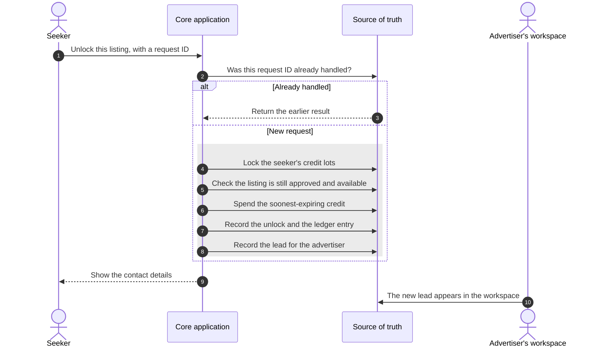
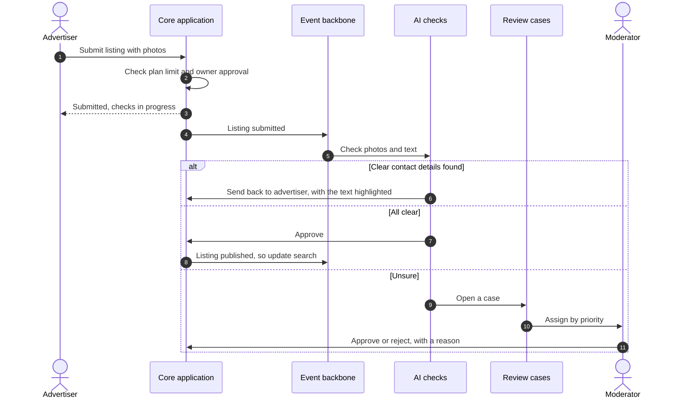
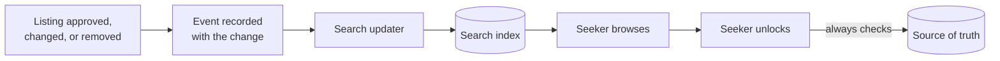
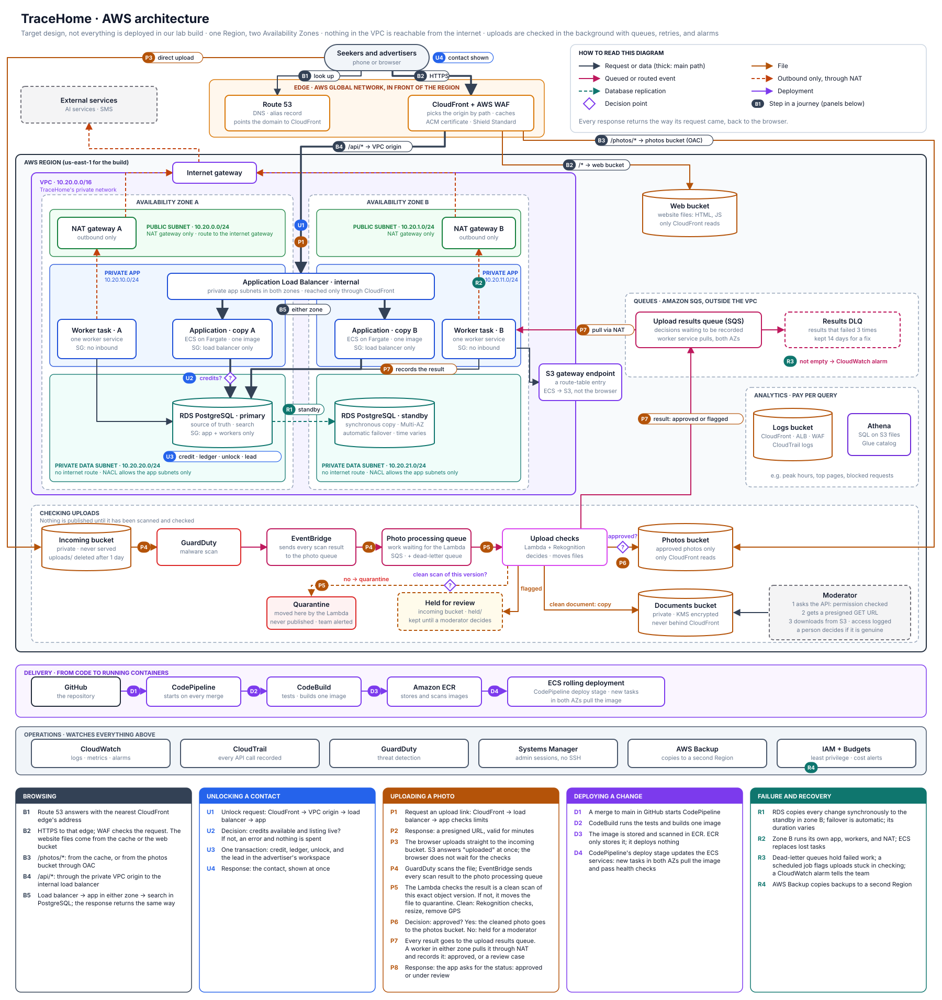
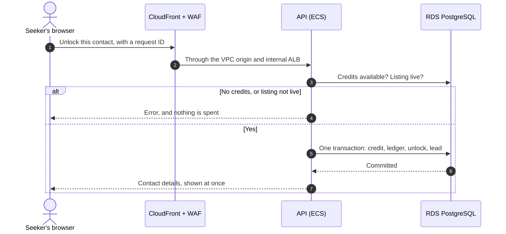
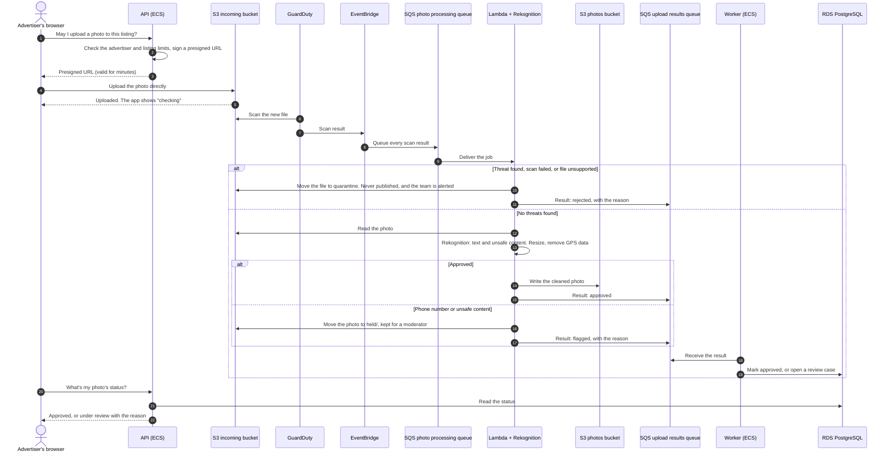
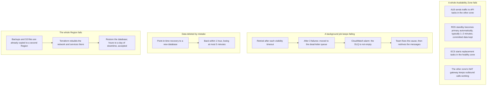

# Architecture

This document turns the agreed requirements into a design. We build it in two stages:

1. **Logical architecture:** the parts of the system and how they work together, without naming
   any technology. *(Done.)*
2. **AWS architecture:** each logical part mapped to AWS services, with a reason for every choice.
   *(In progress: network, compute, data, edge, background processing, delivery, and operations are decided.)*

Separating the stages keeps the reasoning honest. If a part can't be justified without naming a
product, it probably isn't needed.

## Design principles

These nine principles guide every design choice. Each one protects specific business rules we
agreed in the requirements, listed here in full.

| Principle | What it means in practice | Business rules it protects |
|---|---|---|
| **1. One trusted source of truth for money and permissions** | Credits, unlocks, reviews, plan limits, and access rights are checked and changed together, in one place, as one all-or-nothing step | • A seeker can't spend more credits than they have<br>• A credit is never spent twice, even when a request is retried<br>• A seeker never pays twice to unlock the same listing<br>• A seeker's balance always equals the sum of their credit history<br>• An expired bonus credit can't be spent<br>• Contact details are visible only to seekers who unlocked them<br>• An advertiser never exceeds their plan's listing or agent limit<br>• A review exists only after an unlock and a reported viewing<br>• One seeker leaves at most one review per unlock<br>• An advertiser never sees another advertiser's private data<br>• Every unlock produces a lead in the advertiser's workspace |
| **2. Lists and copies may lag, but every action checks the source of truth** | Search results and cached pages may be slightly out of date. When someone acts, such as unlocking a contact, the system checks the current record. | • Only approved listings appear in search; a removed listing disappears within 1 minute<br>• A broker's listing is public only while the owner's approval is valid |
| **3. Background work is guaranteed, never lost** | Work that can wait, such as checking uploaded photos, is delayed safely and retried until it succeeds | • Every upload is checked before it is published, even if a check fails the first time<br>• Every decision's record is archived for long-term keeping |
| **4. Automate clear cases, send doubtful ones to a person** | Automation decides when it's confident; otherwise a moderator decides | • Approving a fraudster is worse than rejecting an honest advertiser<br>• AI checks decide clear cases; people decide doubtful ones<br>• Refunds follow precise rules; doubtful ones go to a person<br>• Clear hidden contact details go back to the advertiser; unclear ones go to a moderator |
| **5. The public marketplace and the private workspace are designed differently** | Browsing is public, heavy, and fine slightly stale. The workspace is private, smaller, and must always be correct. | • TraceHome is two products: a public marketplace and a private advertiser workspace |
| **6. Personal data is kept separate, so it could move later** | Names, phone numbers, and documents are stored apart from everything else | • Everything runs on AWS for now, but personal data may need to move to Ethiopia if the law requires it |
| **7. Correctness beats availability when they conflict** | If the system can't be sure a credit is safe to spend, it refuses rather than risk a mistake | • Quality priority: correctness, then security, browsing availability, durability, speed, and cost |
| **8. Every decision leaves a record that can't be changed** | Credit changes, verifications, and moderation decisions are recorded when they happen, and never edited | • Every automated or human decision is recorded, and the record can't be changed<br>• Every purchase, spend, and refund is permanently recorded |
| **9. Pay for what's used; keep idle cost low** | Prefer parts that cost little when nobody is using them | • TraceHome runs within a small budget |

## The logical architecture


### What each part does, and why it exists

| Part | Responsibility | Why it exists |
|---|---|---|
| Content delivery | Serves public pages and photos from copies close to users | Browsing must stay available, and fast on slow mobile networks |
| Protection | Blocks attacks and limits request rates | Scraping and abuse resistance |
| Request entry | One front door for every request | One place to check sign-in and route requests |
| Identity | Accounts, roles, and sessions that expire within 5 minutes | Advertisers never see each other's data, and removed agents lose access within 5 minutes |
| Core application | All business rules | Modules of one application, not separate services, so the team can understand and change it |
| Transactional database | The source of truth for money, permissions, and listings | Money and permission rules need one all-or-nothing place (principle 1) |
| Audit records | Every credit change and decision | P8 |
| Search index | A copy of approved listings, built for searching | Fast browsing; it may lag behind the database (principle 2) |
| Public files | Approved listing photos | Served to anyone, through content delivery |
| Private files | Verification documents | Never public; encrypted, with strict access (principle 6) |
| Archive | Documents and records kept for years | Rarely read, so cheaper storage is appropriate |
| Event backbone | Carries "something happened" messages, and keeps them until handled | Guaranteed background work (principle 3) |
| AI checks | Identity, documents, photos, and hidden contact details | Automated decisions with confidence levels (principle 4) |
| Review cases | One queue for every doubtful decision | One shared queue for all seven kinds of review case (principle 4) |
| Lead delivery | Sends leads to CRMs and automation tools, retrying when they're down | **After launch** (decision 70). At launch, the advertiser sees every lead in their workspace |
| Notifications | SMS and email | Reminders, alerts, and confirmations |
| Scheduled jobs | Bonus expiry, listing expiry, grace periods, balance checks | Time-based rules |
| Monitoring | Notices problems before users report them | Observability |
| Backups | Restorable copies, also kept in a second Region | Restore lost data within 1 hour; survive a Region failure using copied backups |

## Core application modules

The core is one application with clear internal boundaries. Each module owns its data, and other
modules use it only through its defined actions.

| Module | Owns | Must keep instantly true |
|---|---|---|
| Accounts and advertisers | Users, advertisers, members, roles | Removed agents lose access within 5 minutes |
| Listings and plans | Listings, photos, plans, subscriptions | Plan limits when publishing |
| Trust and verification | Verification levels, owner approvals | Only valid approvals allow public listings |
| Credits and unlocks | Credit lots, ledger, unlocks | Credits are never overspent, spent twice, or spent after expiry; no listing is unlocked twice; contacts go only to seekers who unlocked them |
| Reviews and reputation | Viewing reports, reviews, responses | Reviews only after an unlock and a reported viewing; one review per unlock |
| Review cases | Cases, assignments, decisions | Every decision is recorded |
| Leads and integrations | Leads; connections to external tools after launch | Every unlock creates a lead, in the same transaction |

## Where work happens

The most important design boundary: what happens **while the user waits**, and what happens
**in the background**.

| While the user waits | In the background |
|---|---|
| Browsing and searching | Updating the search index |
| Unlocking a contact and spending a credit | Delivering the lead to the advertiser's CRM (after launch) |
| Creating or editing a listing | AI checks on photos, text, and documents |
| Writing a review | Notifications |
| Moderator decisions | Expiry and grace period jobs |
| Signing in | Archiving old documents and records |
| | Copying backups to the second Region |

**The rule:** a user waits only for work that must be instantly true. Everything else goes to the
background, where it's guaranteed but can be delayed.

## Key flows

### Unlocking a contact

Everything inside the box happens as one all-or-nothing step. If any part fails, nothing changes.



**Why the lead is recorded in the same step:** if the system crashed after spending the credit
but before recording the lead, the advertiser would never get it, breaking the rule that every
unlock produces a lead. Saving the lead with the unlock means a crash can't separate them, and no
background work is needed.

**After launch, sending leads to an advertiser's CRM:** the same transaction will also record a
"lead created" event (the **outbox**). A background process then sends it to the CRM, retrying if
the CRM is down. Because the event is saved with the unlock, a crash can't lose it.

### Publishing a listing



### Search staying up to date



Search may be up to 1 minute behind. Unlocking always checks the source of truth, so a seeker can
never pay for a listing that was just removed.

**Update from stage 2:** at launch, search runs inside PostgreSQL itself, so it isn't behind at
all. The separate search index stays in this logical design as the option we add when measurements
show PostgreSQL search is no longer enough.

## Data classes

Each kind of data needs different protection. This table drives encryption, access, and storage
choices in the next stage.

| Class | Examples | Who can see it | Kept for |
|---|---|---|---|
| Public | Approved listings, photos, review summaries | Anyone | While the listing is live |
| Internal | Plans, case queues, metrics | TraceHome staff | As needed |
| Personal | Names, phone numbers, email addresses | The person, and seekers who unlocked them | While the account exists, then by policy |
| Sensitive | ID checks, ownership documents | Moderators with a reason; every access recorded | By law, pending legal advice |
| Financial | Credit lots, ledger | The seeker, finance, and auditors | Years; never changed |
| Audit | Decisions and access records | Auditors | Years; never changed |

## Questions to answer before mapping to AWS

Answer these yourself first. They test whether the design is clear to you.

1. Why does unlocking a contact happen while the user waits, but checking an uploaded photo doesn't?
2. Why is the search index allowed to be wrong for a minute, but the credit balance never is?
3. Why is the core one application with modules, and not seven separate services?
4. How does the advertiser get the lead if background work is down when the seeker unlocks the contact?
5. Why are public photos and verification documents stored separately?

---

# Stage 2: AWS architecture

Each part of the logical architecture is mapped to AWS here, one layer at a time, following a
request from the seeker's phone down to the data.

```text
DNS → CDN at the edge → firewall → load balancer → compute → database and files
           all inside a network: VPC, subnets, gateways
```

**Target versus build.** For every layer we describe two things:

- **Target design:** what TraceHome needs to meet its requirements with real users.
- **Development build:** what we actually run now, within a budget of about $30. Every difference
  is a conscious choice with a reason, and we know how to switch it on later.

## The architecture at a glance

One main diagram shows the whole target design. **Read the top from top to bottom**, the way a
request travels: the browser, the edge, then inside the VPC the public, app, and data subnets. The
**parts below** are background work and operations, and each reads left to right.



*Open the image on its own for full size. The source is [docs/architecture.svg](docs/architecture.svg).*

| Part | What it does | Main services |
|---|---|---|
| Edge | Receives every request, answers from cache when it can, filters attacks, and picks the origin by path | Route 53, CloudFront, AWS WAF, ACM; the web bucket for the website's files |
| Serving requests | Runs the application and holds the source of truth, inside the VPC across two zones | Internal ALB, ECS on Fargate (API and workers), RDS PostgreSQL Multi-AZ, NAT gateways, S3 gateway endpoint |
| Queues | Carries upload results from the checks to the workers | SQS upload results queue and its dead-letter queue |
| Checking uploads | Scans and checks every upload before anything is published | S3, GuardDuty, EventBridge, SQS, Lambda, Rekognition |
| Analytics | Answers business questions from logs, without touching the database | S3 logs bucket, Glue Data Catalog, Athena |
| Delivery | Turns a code change into running containers | GitHub, CodePipeline, CodeBuild, ECR, Terraform |
| Operations | Watches everything above | CloudWatch, CloudTrail, GuardDuty, Systems Manager, AWS Backup, IAM, Budgets |

### How the parts talk to each other

The parts never call each other directly. Every crossing goes through a **named door**, drawn on
the edge of the VPC or labelled on the line:

| Door | Connects | What goes through it |
|---|---|---|
| CloudFront VPC origin | Edge → serving requests | Requests to the API. Every response goes back the same way, to the browser |
| Internet gateway and NAT | Serving requests → AWS APIs and the internet | Workers receiving from SQS, pulling container images, SMS and AI services. Outbound only |
| S3 gateway endpoint | Serving requests → S3 | The application and workers reading and writing files; image layers during a deployment |
| SQS upload results queue | Checking uploads → serving requests | Check results; the only way background results reach the database |
| Presigned URL | Browser → checking uploads | A short-lived link the API signs, so the browser uploads straight to S3 |

### The journeys

The same diagram is presented one journey at a time. Every journey starts at the browser, passes
its decision points, and ends with a response back to the browser. Responses aren't drawn as
separate lines: each one returns the way its request came. The presenter and the sequence diagrams
show them step by step.

| Journey | Image | Path |
|---|---|---|
| Browsing (B1–B5) | [architecture-browse.svg](docs/architecture-browse.svg) | Route 53 → CloudFront and WAF (cached answers end here) → VPC origin → ALB → API → PostgreSQL → response |
| Unlocking a contact (U1–U4) | [architecture-unlock.svg](docs/architecture-unlock.svg) | API → credits available? → one transaction (credit, ledger, unlock, lead) → contact back to the browser |
| Uploading a photo (P1–P8) | [architecture-upload.svg](docs/architecture-upload.svg) | Presigned URL → upload to the incoming bucket → malware scan: clean? → checks: approved? → photos bucket → result queue → database → status back to the browser |
| Deploying a change (D1–D4) | [architecture-deploy.svg](docs/architecture-deploy.svg) | GitHub → CodePipeline → CodeBuild → ECR → ECS rolling deployment |
| Failure and recovery (R1–R4) | [architecture-recovery.svg](docs/architecture-recovery.svg) | Zone failover, dead-letter queues and alarms, backups in a second Region |

**For the presentation:** an interactive version steps through each journey one step at a time,
with talking points and expected questions:
[docs/presenter.html](docs/presenter.html). Download or clone the repository and open the file in a
browser; it needs no server. Keys: → next step, ← back, 0–5 jump to a journey.

**For detailed questions:** [sequence diagrams](#key-flows-on-aws) show the unlock and upload
flows message by message, and the [reliability view](#reliability-view) shows what happens when
something fails.

### How to read the diagram

| Line | Meaning |
|---|---|
| Solid dark | A request or data, while the user waits. The response returns the same way |
| Rose | A message through a queue or an event, in the background |
| Amber | A file moving |
| Dashed red | Outbound only: a call out through NAT, never inbound |
| Dashed teal | Database replication to the standby |
| Purple | Deployment: from code to running containers |

Diamonds (◇) are decision points, and the numbered tags (B1, U2 …) are journey steps. Storage is
drawn as cylinders. Colored zones follow the network: green for public subnets,
blue for private app subnets, and teal for private data subnets. Each subnet shows its address
range, and each server shows its security group rule; the full rules are in the tables below.

## Network

### The rule

Nothing inside the VPC can be reached from the internet. Users reach TraceHome only through
CloudFront, which connects to a private load balancer over a private path (a VPC origin). Every
part accepts traffic only from the part directly in front of it.

The master diagram in [The architecture at a glance](#the-architecture-at-a-glance) shows this
network with everything else on top of it.

**Everything runs in both zones:** the load balancer, the API, the workers, and the database
(primary in one, standby in the other). ECS spreads each service's tasks across the zones.

### Where each part lives

| Part | Where it lives | Who can reach it |
|---|---|---|
| Load balancer | Private app subnets, in two zones (internal) | Only CloudFront, through the VPC origin |
| NAT gateway | Public subnet | Nothing can start a connection to it from outside |
| Application | Private app subnets | Only the load balancer |
| Background workers | Private app subnets | No one. They pull work from a queue; nothing calls into them |
| Database | Private data subnets | Only the application and the workers |
| Files | Outside the VPC. S3 is a regional service, not part of a subnet | See below |

**Visible to the public is not the same as open to the public.** Both buckets stay private, with
Block Public Access turned on:

- Photos reach users through CloudFront, and only CloudFront has permission to read the public files
  bucket.
- Verification documents never go through CloudFront. A reviewer gets a link that expires after a few
  minutes, and every access is recorded.

Keeping the two buckets apart limits the blast radius: one wrong permission setting can expose
only listing photos, which are public anyway, never identity documents.

### Three layers of subnets

| Layer | Contains | Route to the internet |
|---|---|---|
| Public | NAT gateways only | Directly, through the internet gateway |
| Private app | Internal load balancer, application, background workers | Outbound only, through the NAT gateway |
| Private data | Database | None. Data can't leave by any internet path |

The data layer has no route to the internet at all. Even if an attacker got into the database
server, it couldn't send data out directly.

### Address plan (proposed)

| Range | Use |
|---|---|
| `10.20.0.0/16` | The whole VPC: about 65,000 addresses, room to grow, and unlikely to clash if we connect another network later |
| `10.20.0.0/24`, `10.20.1.0/24` | Public subnets, zones A and B |
| `10.20.10.0/24`, `10.20.11.0/24` | Private app subnets, zones A and B |
| `10.20.20.0/24`, `10.20.21.0/24` | Private data subnets, zones A and B |

### Security groups: "only from X" rules

Each part allows traffic only from the security group in front of it, not from an IP range, so
the rules keep working when containers change addresses.

| Security group | Allows in | From |
|---|---|---|
| Load balancer | HTTPS (443) | CloudFront's VPC origin only |
| Application | The application port | The load balancer's security group only |
| Workers | Nothing | No one |
| Database | The database port | The application and workers security groups only |

### Network ACLs: a second layer for the data subnets

Security groups and network ACLs both filter traffic, but they work differently:

| | Security group | Network ACL |
|---|---|---|
| Attached to | A resource, such as a task or a database | A subnet |
| Remembers connections | **Yes (stateful).** Replies are allowed automatically | **No (stateless).** Replies need their own rule |
| Rules | Allow only | Allow and deny, checked in number order |

The data subnets get a network ACL that allows traffic only from the two app subnets, plus the
replies going back to them. If a security group is ever misconfigured, the data layer is still
closed. Other subnets keep the default network ACL.

### Calls going out

The application and workers must call services outside the VPC, without being reachable from
outside.

| Destination | Path | Why |
|---|---|---|
| S3 (photos, documents) | S3 gateway endpoint | Free, and photo traffic is the largest. Traffic stays inside AWS. A gateway endpoint is an entry in the private route tables, not a device that traffic passes through |
| AI services, SMS | NAT gateway | The only way out to the internet for private subnets. Replies come back; new connections from outside can't come in |
| SQS (upload results queue) | NAT gateway | With one NAT per zone, a NAT failure affects only one zone. An SQS interface endpoint (about $15 a month for two zones) is **optional hardening**, not part of the target |
| Container images (ECR) | NAT for the registry API; S3 gateway endpoint for image layers | Image layers are stored in S3, so most of the download is free |
| Other AWS services (secrets, logs) | NAT gateway | An interface endpoint costs about $7 a month per zone. We add one when traffic or security justifies it |

**Cost of the options** (us-east-1 estimates, fixed monthly charges only):

| Setup | About | Verdict |
|---|---|---|
| NAT only | $33 per NAT | No. S3 traffic would pay NAT charges for nothing |
| NAT + S3 gateway endpoint | The same; the gateway endpoint is free | **The baseline** |
| One NAT per zone | $66 | Target design |
| Add an SQS interface endpoint | +$15 | Optional hardening |
| One small NAT instance | $3 | Development build |

**Not used here, and why.** VPC peering and Transit Gateway connect one network to another (VPC to
VPC, or VPC to an office datacenter). They don't give a private subnet a way out to the internet
or to AWS services, so they don't solve this problem.

### One zone or two

High availability matters most for the parts the user waits on, but with ECS, running the workers
in both zones costs little more than running them in one.

| Part | Target design | Why |
|---|---|---|
| Load balancer | Two zones | AWS requires at least two zones for an Application Load Balancer |
| Application | Two zones | Browsing must keep working if one zone fails |
| Database | Multi-AZ: a standby in the second zone | Correctness comes first. The standby is a synchronous copy, so committed transactions survive; failover is automatic and typically takes 1–2 minutes |
| Background workers | Two zones | ECS runs a worker task in each zone. If one zone fails, the other keeps working; queued work waits safely meanwhile |
| NAT gateway | One per zone | So losing a zone doesn't stop outbound calls in the other |
| Files | Automatic | S3 already stores every file across at least three zones |

### Target versus development build

| | Target design | Development build | What we accept |
|---|---|---|---|
| Database | Multi-AZ | Single zone, with automated backups | A zone failure means restoring from backup |
| NAT | One NAT gateway per zone (about $32 a month each) | One small NAT instance (about $3 a month) | Outbound calls stop if it fails, which only delays background work |
| Application | Two or more copies across two zones | One copy | Short downtime during deployments or failures |
| Load balancer | Two zones | Two zones | Required by AWS, so no difference |

**For the presentation:** "This is the architecture TraceHome needs. For the demo we run a cheaper
version, and we switch on Multi-AZ when there are real users."

## Compute

### The decision

| Workload | Runs on | Scales on |
|---|---|---|
| The API service (marketplace and workspace) | **ECS on Fargate**, two or more tasks across two zones | Request load from the load balancer |
| The worker service | **ECS on Fargate**, same container image, separate ECS service, a task in each zone | Number of jobs waiting in the queues |
| Upload checks | **AWS Lambda**, outside the VPC | One run per queued file, fed by SQS |

### What each option makes us responsible for

| Option | We manage | AWS manages | Verdict |
|---|---|---|---|
| EC2 | Operating system patches, security agents, scaling instances, disks, capacity, plus everything below | Hardware and the hypervisor | Rejected. Our effort would go to running servers, not the product |
| ECS on Fargate | Container image, task size, task definition, health checks, scaling rules, an IAM role per task | Servers, operating system, patching, placing containers | **Chosen** for the application and workers |
| Lambda | Function code and its settings | Everything else, including scaling to zero | **Chosen** for photo processing only |

ECS and Fargate are two different things. **ECS** is the orchestrator: it keeps the right number of
tasks running, replaces unhealthy ones, and rolls out deployments. **Fargate** is the compute those
tasks run on, so there are no servers for us to manage.

### Why not Lambda for the main application

- **Database connections.** Every Lambda copy opens its own connection. A traffic spike could open
  hundreds of them and overload the source of truth.
- **Cold starts.** A modular application is large and loads slowly, so the first request after a
  quiet period would be slow.
- **Wrong shape.** Lambda suits small, single-purpose functions. Splitting the application to fit
  Lambda would undo our decision to keep it as one modular application.

### Which jobs go where

**The rule:** a job that needs TraceHome's business rules runs in a worker container. A short job
that reacts to an AWS event and never touches the source of truth can be a Lambda function.

| Job | Runs on | Why |
|---|---|---|
| Recording upload results | ECS worker, in both zones | Pulls the upload results queue, marks photos approved, and opens review cases. The Lambda function can't, because it has no database access |
| Bonus credit expiry, ledger reconciliation | ECS worker, started on a schedule | Changes money, so it must use the same tested ledger code as unlocking |
| Review case automation and AI checks | ECS worker | Writes review cases and trust levels |
| Upload checks | Lambda | Fed by an SQS queue with every malware scan result. Moves unsafe or unscannable files to quarantine. For photos: uses Rekognition to find text and unsafe content, resizes, removes GPS location data, and writes approved photos to the photos bucket. For documents: copies the clean file to the documents bucket. A flagged photo is moved to the `held/` prefix for a moderator. Always sends its result to the upload results queue |

**Why the workers share the application's container image:** there's one build and one copy of the
business rules, so a worker can never disagree with the application about how credits work. They
run as separate ECS services, so each scales on its own signal.

**The cost of using Lambda too:** a second way to deploy, log, and grant permissions. We accept it
because it's limited to one clear job that fits Lambda well.

### Target versus development build

| | Target design | Development build | What we accept |
|---|---|---|---|
| Application | Two or more tasks across two zones | One task | Short downtime during deployments or failures |
| Workers | A task in each zone, regular Fargate | One task on Fargate Spot, up to about 70% cheaper | A worker can be interrupted. Safe, because jobs wait in the queue and are retried |
| Running time | Always on | Started for working sessions and the demo, then torn down | The system isn't available between sessions |

**Budget rule:** AWS Budgets alerts at $10, $25, and $50 are set up before anything is deployed.
Run around the clock, the development build would cost about $80–90 a month, more than our credits.

## Data: the source of truth

### The decision

The source of truth is **PostgreSQL on Amazon RDS**: Multi-AZ in the target design, single zone in
the development build.

### Why relational, not NoSQL

"Our data is related" is not the real reason; DynamoDB can model relationships too. The real reason
is **guarantees**. Unlocking a contact must do four things together, or none of them:

1. Take one credit from the right lot (bonus credits first, oldest first)
2. Add an entry to the ledger
3. Record the unlock for this seeker and listing
4. Save the lead for the advertiser

| Business rule | How PostgreSQL enforces it |
|---|---|
| All four steps happen, or none | **One transaction.** If any step fails, the others are undone |
| One unlock per seeker per listing | **A unique constraint** on (seeker, listing). Two taps at the same moment can't both succeed |
| A credit is never spent twice | **Row locks** on the credit lot while the transaction runs |
| A balance never goes negative | **A check constraint**, enforced even if the code has a bug |
| Every credit change can be explained | **Free-form SQL** for reconciliation and audits, without planning every query in advance |

DynamoDB could do this with transactions and conditional writes, but we'd build by hand what
PostgreSQL gives us for free. Its main strength, very large scale with predictable speed, doesn't
help at our size.

### Why RDS, not Aurora

| | RDS PostgreSQL | Aurora PostgreSQL |
|---|---|---|
| Storage | Disk attached to the instance | Six copies across three zones, grows automatically |
| Failover to another zone | About 1–2 minutes | About 30 seconds |
| Region failure | Restore from copied backups | Global Database: about 1 second of data loss, about a minute to recover |
| Smallest sensible size | About $13 a month | About $55 a month, plus storage and I/O |

We accepted downtime when a Region fails, and a 1–2 minute zone failover meets our target. Aurora's
strengths are real, but we don't need them yet.

**What would change it:** a need to recover from a Region failure within minutes, or reads that
outgrow one database. Moving is straightforward: create an Aurora read replica of the RDS
database, then promote it.

### Search at launch

Search runs inside PostgreSQL, without a separate search service:

| Need | PostgreSQL feature |
|---|---|
| Search listing text | Full-text search, with a GIN index |
| Search by area or distance | PostGIS, with a spatial index |
| Filter by price, rooms, type | Ordinary indexes |

Results are never out of date, there's nothing extra to run or pay for, and there is no indexer.
**When it would change:** if search slows down the database, a read replica takes the search load
first. A separate search service (such as OpenSearch) comes only after that, when measurements
require it.

### Backups and recovery

Each recovery target in the requirements needs its own mechanism.

| Event | Target | How we meet it |
|---|---|---|
| A zone fails | Automatic, within minutes | The Multi-AZ standby takes over automatically, typically in 1–2 minutes; committed transactions are kept because the copy is synchronous |
| Data deleted by mistake | Back within 1 hour, losing at most 5 minutes of data | **Point-in-time recovery.** RDS keeps daily snapshots and uploads transaction logs about every 5 minutes, so we can restore to any second up to about 5 minutes ago |
| The whole Region fails | Hours to a day | **Cross-Region backup replication** copies snapshots and transaction logs to a second Region. Terraform rebuilds the network and compute there, then we restore the database |

**Three things to remember:**

1. **Multi-AZ is not a backup.** A mistaken delete reaches the standby within milliseconds.
   Multi-AZ protects against a zone failing, not against mistakes.
2. **A restore creates a new database.** We restore to a new instance, check it, then point the
   application at it. For a small database this takes roughly 15–30 minutes.
3. **An untested backup is only a hope.** We test a restore before the demo and record how long it
   really took.

| Other data | Protection |
|---|---|
| Photos and documents (S3) | **Versioning** undoes accidental deletes and overwrites; **cross-Region replication** to the second Region. The incoming bucket is not replicated, and a lifecycle rule deletes its objects after 1 day |
| Queued jobs | Not backed up. Each upload's status is in the database, so a lost check can be queued again from it |
| The backups themselves | Locked against deletion with AWS Backup Vault Lock, so stolen credentials can't wipe them |

### Storage classes and lifecycle

S3 has storage classes for data that is rarely read. Each TraceHome bucket gets the class its users
need:

| Data | Storage class | Why |
|---|---|---|
| Website files (web bucket) | S3 Standard | Served through CloudFront and cached at the edge |
| Approved photos | S3 Standard | Seekers expect photos instantly |
| Incoming uploads (`uploads/` prefix) | S3 Standard, deleted after 1 day | Only waiting for checks; never kept |
| Flagged photos (`held/` prefix in the incoming bucket) | S3 Standard, deleted after 30 days | Kept until a moderator approves or rejects them. A lifecycle rule filtered by prefix keeps them out of the 1-day rule |
| Verification documents, while needed | S3 Standard, strict access | Reviewers open them during checks |
| Verification documents, after the active period | S3 Glacier Deep Archive, then deleted on the legal deletion date | Kept only because the law may require it; cheapest storage, retrieval takes hours |
| CloudFront, load balancer, and CloudTrail logs (logs bucket) | S3 Standard for 90 days, then S3 Glacier Flexible Retrieval | Athena reads them for 90 days; after that they are rarely read but kept for years. Athena can't read objects in Glacier |
| Database backups | AWS Backup and RDS automated backups | Managed by the backup service, not moved by hand |

Lifecycle rules move objects between classes automatically. Glacier classes have minimum storage
periods and retrieval charges, so they are only for data we rarely expect to read. The exact
retention periods wait for legal advice.

### Target versus development build

| | Target design | Development build | What we accept |
|---|---|---|---|
| Database | Multi-AZ | Single zone, automated backups kept 7 days, point-in-time recovery on | A zone failure means restoring from backup |
| Cross-Region copies | Database backups and S3 files | One database backup copy, to practise Region recovery | Less S3 protection for made-up data |
| Backup lock | AWS Backup Vault Lock | Not used | Fine for made-up data |
| Tearing down | Not applicable | **Always take a final snapshot** before deleting the database | Without it, the data is gone |

## Region

| | Region | Why |
|---|---|---|
| Development build | **us-east-1** (N. Virginia), backups copied to **us-west-2** (Oregon) | Lowest prices, every service available, and the most documentation. Speed for users in Ethiopia doesn't matter with made-up data |
| Production, later | **To decide by measurement** | Candidates: af-south-1 (Cape Town), me-central-1 (UAE), and eu-central-1 (Frankfurt) |

**Why measure instead of choosing the nearest Region on the map:** internet traffic from Addis Ababa
follows undersea cables, often through Djibouti towards Europe or the Gulf, so the nearest Region
isn't always the fastest. Before launch we'd measure latency from Addis Ababa to each candidate,
and compare prices (Cape Town and UAE cost more than us-east-1), service availability, and the
legal advice on data localization.

## Edge: DNS, CDN, and firewall

### The path of a request

```text
Phone asks "where is tracehome.com?"
  → Route 53 answers with an alias record: the address of the nearest CloudFront edge location
      (Route 53's job ends here; it never carries the page or the photo)
  → The phone connects straight to that edge over HTTPS
      (CloudFront shows the ACM certificate; the phone checks it)
  → AWS WAF checks the request
  → Cached? CloudFront answers immediately
  → Not cached? CloudFront picks the origin by the request's path:
      /photos/*  → the photos bucket, read through Origin Access Control (OAC)
      /api/*     → a private path (VPC origin) to the internal load balancer → ECS → RDS
      everything else (the website's files) → the web bucket, through OAC
  → The response returns the same way. CloudFront keeps a copy when the content may be cached
```

### Route 53 and CloudFront: two different jobs

| | Route 53 | CloudFront |
|---|---|---|
| Like | A phone book | A front desk |
| Job | Answers "what is the address of tracehome.com?" | Receives every request, checks it, answers from cache or asks an origin |
| Carries traffic? | No, it only answers the lookup | Yes, every request and response |
| How often | Once; the browser remembers the answer for the record's TTL | Every request |

### CloudFront origins

CloudFront sends each request to one of three **origins**, chosen by **cache behaviors** that
match the path:

| Path | Origin | How CloudFront reaches it |
|---|---|---|
| `/api/*` | Internal Application Load Balancer | VPC origin, a private connection into the private app subnets |
| `/photos/*` | Photos bucket | Origin Access Control: the bucket policy allows only this distribution to read |
| Everything else | Web bucket: the website's HTML, JavaScript, and CSS | Origin Access Control |

The website is a **static frontend**: its files are built once, stored in the web bucket, and
cached at the edge. It calls the API for everything that changes. ECS runs only the API and the
workers. Both buckets stay private; no one can read them except through CloudFront.

### CloudFront: what is cached, and for how long

| Content | Cached for | Why |
|---|---|---|
| App files (JavaScript, CSS) | A year | Each build gets new file names, so old copies are never served by mistake |
| Listing photos | A long time | A changed photo gets a new address, so cached copies never go stale |
| Public listing pages and search results | **60 seconds at most** | A removed listing must disappear within 1 minute; the cache time follows that business rule |
| Credit balance, unlock results, contact details, workspace, leads | **Never** | They depend on who is asking |
| Verification documents | **Never through CloudFront** | Expiring links straight from S3 |

**The rule:** if a response depends on who is asking, it is never cached. Those requests still
pass through CloudFront for the firewall and HTTPS, but go straight to the application.

**Why the default is "don't cache":** a single mistake could cache one seeker's balance page and
show it to another. We turn caching on only for public paths.

**Search results contain public listing data only.** Balances, contacts, and other personal or
financial data are never part of a public response.

### The private load balancer

CloudFront reaches the load balancer through a **VPC origin**: a private connection into our
private subnets. The load balancer has no public address, so:

- nothing in the VPC can be reached from the internet, and
- no one can skip the firewall by calling the load balancer directly.

The VPC still has an internet gateway, but it's used only for outbound calls through the NAT
gateways.

### AWS WAF: the first layer, not the only one

WAF sees HTTP requests. It can't tell whether a review is honest or an account is fake. It slows
automated abuse cheaply; TraceHome's business rules stop what gets through.

| Threat | WAF (layer 1) | TraceHome's rules (layer 2, the real defense) |
|---|---|---|
| Contact harvesting | Rate limits on listing and unlock requests; Bot Control blocks known scrapers | Every contact costs a credit; a limit on unlocks per account |
| Fake accounts | Account creation fraud prevention; CAPTCHA on sign-up | Phone confirmation by one-time code; bonus credits once per phone number; trust levels |
| Review attacks | Rate limits on posting reviews | Only seekers who unlocked a contact and reported a viewing can review; unusual patterns become review cases |
| Scraping public listings | Bot Control and rate limits | Acceptable to a degree; the data is public |
| SQL injection, cross-site scripting | AWS managed rule sets | Parameterized queries in the code |
| DDoS | AWS Shield Standard, free and automatic on CloudFront | — |

### Route 53 and certificates

| Part | What it does |
|---|---|
| Route 53 hosted zone | Holds TraceHome's DNS records |
| Alias record | Points the domain to CloudFront. Works on the bare domain (tracehome.com), where a CNAME isn't allowed, and alias queries to AWS resources are free |
| ACM certificate | Proves the site really is TraceHome and enables HTTPS. Free, and renewed automatically |
| DNS validation | ACM proves we own the domain by checking a DNS record it asks us to add. Route 53 can add it automatically |

**Where certificates are created:** the certificate CloudFront uses must be created in
**us-east-1**, wherever the application runs, because CloudFront is a global service managed from
there. A certificate for a load balancer is created in the load balancer's own Region.

### Target versus development build

| | Target design | Development build | What we accept |
|---|---|---|---|
| Domain | Our own domain in Route 53 | CloudFront's default address (`something.cloudfront.net`), which already has a valid certificate | A less friendly address for the demo |
| WAF | Managed rules, IP reputation, rate limits, Bot Control, fraud prevention on sign-up | Managed rules and rate limits only | Weaker bot defense for made-up data |
| Caching | As in the table above | The same | No difference |

## Key flows on AWS

The sequence diagrams show each flow message by message, including the decision points and the
responses the user sees.

### The rule behind every flow

The user waits only for what must be correct now. Everything else goes through a durable queue with
retries. A message that keeps failing moves to a **dead-letter queue (DLQ)**, and an alarm tells
the team.

| Term | Meaning |
|---|---|
| Our two queues | The **photo processing queue** holds work waiting for the Lambda function. The **upload results queue** holds decisions waiting to be recorded in the database |
| SQS queue | Holds work until a worker finishes it. If a worker crashes, the message becomes visible again and is retried |
| Visibility timeout | How long a message stays hidden while one worker processes it. Must be at least 6 times the function or job timeout, or a second worker picks it up too |
| Dead-letter queue | Where a message goes after a set number of failed attempts (3 in our lab), so one broken message can't block the rest. Its retention is longer than the main queue's |
| Redrive | Moving messages from the DLQ back to the main queue after the problem is fixed |
| Partial batch failure | Lambda reports only the failed messages in a batch, so the successful ones aren't processed again |
| Idempotency | Doing the same work twice has the same effect as once. SQS standard queues deliver at least once, so every handler must be idempotent |

### Unlocking a contact



The whole journey happens while the seeker waits, and nothing runs in the background. The lead is
saved in the same transaction, so it appears in the advertiser's TraceHome workspace at once.
Sending leads to an advertiser's own CRM comes after launch, through an outbox and an SQS queue with
retries and a dead-letter queue (decision 70).

### Uploading a photo



Two kinds of response are easy to confuse: **"uploaded"** comes back from S3 straight away, but
**"approved"** comes only after the scan and the checks. A job that keeps failing moves to the
photo DLQ, and the photo stays unpublished: a failure is never treated as approval.

**Who moves the files:** GuardDuty only scans and reports, and EventBridge only routes events;
neither can move a file. EventBridge sends **every** scan result to the photo processing queue, and the Lambda
function makes every decision in one place: it moves unsafe or unscannable files to quarantine,
checks clean photos, and copies clean documents. A scheduled job catches what never arrives (see
below).

### Verification documents

A verification document (an ID or a title deed) enters the same way as a photo, but leaves
differently:

| Step | Photo | Verification document |
|---|---|---|
| Upload | Presigned URL → incoming bucket | The same |
| Malware scan | GuardDuty → EventBridge → SQS → Lambda | The same |
| The Lambda function's job | Rekognition checks, resize, remove GPS data | No photo checks; it copies the clean file |
| Where it goes | Photos bucket, served to everyone through CloudFront | **Documents bucket**: private, encrypted with KMS, never behind CloudFront |
| The result | Results queue → worker → photo marked approved, or a review case | Results queue → worker → **always a review case** for a moderator |
| Who can open it | Everyone | A moderator, through a short-lived presigned link from the API. Every access is recorded |

**Why the difference:** a photo is meant to be public, so the checks decide whether to publish it.
A document is meant to stay private, so the checks only decide whether it's safe to store. A person
then decides whether it's genuine (principle 4).

### Scheduled jobs

**EventBridge Scheduler** starts ECS tasks from the worker image for bonus credit expiry and
ledger reconciliation. Jobs that change money use the same tested ledger code as unlocking.

A **stuck-upload check** runs every 15 minutes. Any upload still "checking" after 30 minutes, for
example because a scan result never arrived, is flagged for the team, and the advertiser sees
"still checking" rather than a false approval.

### How the workers get their work

SQS never calls a worker. Each worker **pulls**:

1. It asks the queue for messages with **long polling**: SQS holds the request open for up to 20
   seconds and answers as soon as a message arrives.
2. SQS gives the message to **one** worker and hides it from the others for the visibility timeout.
3. The worker does the work, such as recording a photo's result in the database.
4. Only then does it **delete** the message. If the worker crashes first, the message reappears
   after the visibility timeout, and the other worker takes it.

Standard queues deliver **at least once**, so a message can rarely arrive twice. Every handler is
idempotent: setting a photo to approved twice leaves it approved, and a unique constraint stops a
second review case for the same photo. (With SQS → Lambda, the Lambda service does this polling
for us.)

### Flagged photos

A photo that fails the content checks is not copied to the photos bucket. The Lambda function
moves it to the `held/` prefix, a worker sets its status to "under review" and opens a review case,
and a moderator decides: approve (the photo is copied to the photos bucket) or reject (the
advertiser is told why).

## Reliability view



### Active-active and active-passive

| Part | Approach | Why |
|---|---|---|
| Application and workers | **Active-active**: tasks run in both zones at the same time | They are stateless, so any task can serve any request or message. Both zones do real work, and a zone failure needs no switchover |
| RDS PostgreSQL | **Active-passive**: the standby only copies until it takes over | Money needs one source of truth. Two databases accepting writes could spend the same credit twice |

The development build may run one task of each service to save money, and accepts that it does not
survive a zone failure.

## Delivery: from code to running service

```text
Push to GitHub → CodePipeline → CodeBuild: run tests, build the image, scan it → ECR → ECS rolling deployment
```

| Step | Service | What happens |
|---|---|---|
| D1 · Source | GitHub, connected to CodePipeline | A merge to the main branch starts the pipeline. The connection uses AWS CodeConnections, so no GitHub password or key is stored in AWS |
| D2 · Build | CodeBuild | Runs the tests and builds one container image for both the API and the workers. A failed test stops the pipeline |
| D3 · Store | Amazon ECR | Stores the image, tagged with the commit ID, and scans it for known vulnerabilities |
| D4 · Deploy | ECS rolling deployment | Starts new tasks, waits until they pass the load balancer's health checks, then stops the old ones. The deployment circuit breaker rolls back automatically if new tasks keep failing |

**Infrastructure** (the VPC, subnets, ECS services, RDS, queues, and buckets) is defined in
**Terraform** in the same repository, and changed through pull requests like the code. A database
migration runs as a one-off ECS task before the new version starts.

**Secrets are never in the image.** The database password lives in AWS Secrets Manager, and ECS
gives it to the task at start-up. (The security section will cover this in detail.)

| | Target design | Development build |
|---|---|---|
| Pipeline | CodePipeline + CodeBuild on every merge | The same: the cost is low, and it's worth practising |
| Deployment | Rolling, with health checks and automatic rollback | The same |
| Approval | A manual approval step before production | Not needed: there is only one environment |

## Operations and admin access

### Account-wide services

| Service | What it does for TraceHome |
|---|---|
| CloudWatch | Logs, metrics, and alarms: API errors and latency, failed unlocks, DLQs not empty, database connections, queue age |
| CloudTrail | Records every AWS API call in the account: who changed what, and when |
| GuardDuty | Detects threats across the account, and scans uploads for malware |
| Systems Manager | Admin sessions without SSH (see below) |
| AWS Backup | Copies database backups to a second Region; Vault Lock stops anyone deleting them |
| AWS Budgets | Cost alerts at $10, $25, and $50 |
| IAM | One role per workload, each with only the permissions it needs |

### How we reach the private system

There is **no bastion host, no SSH key, and no open port 22.**

| Task | How |
|---|---|
| Look inside a running container | **ECS Exec**, built on Systems Manager Session Manager. Every session is authenticated with IAM and recorded |
| Run a database migration | A **one-off ECS task** from the application image, inside the private app subnets |
| Query the database by hand | Only in an emergency, through ECS Exec, and the session is recorded |

**Why:** a bastion host is one more server to patch, and SSH keys can be stolen or copied. With
Session Manager, access is controlled by IAM and every session leaves a record.

## Analytics

**Athena runs SQL over files stored in S3.** There is no server, and it charges by the data each
query scans (about $5 per TB). So the question is which data to put in S3.

| Source | Use with Athena? | Why |
|---|---|---|
| CloudFront, load balancer, and WAF logs → logs bucket | **Yes, at launch** | Written to S3 once logging is turned on, almost free to query, and no load on the database |
| CloudTrail logs | Yes | Security questions, such as "who changed this security group?" |
| RDS snapshot export to S3 (Parquet) | Later | Business numbers such as unlocks per area: a nightly copy, never the live database |
| RDS primary | **No** | Analytics must never slow down unlocks (principle 7) |
| A read replica | Not with Athena | A replica serves SQL reports; it is a different tool |
| CloudWatch Logs | Not directly | CloudWatch Logs Insights queries those |

**Marketplace insights at launch:** CloudFront logs → logs bucket → **AWS Glue Data Catalog** (the
table definition) → **Athena**. Example questions: the busiest hours, the most-viewed pages, how
much traffic comes from phones, and what WAF blocked. Logs show traffic, not intent: reliable search
analytics (which areas seekers look for) come later, from structured search events the application
writes.

None of this is automatic. Each log type must have **logging turned on** (CloudFront standard logs,
ALB access logs, and WAF logging to the logs bucket), and each format needs a **table definition in
the Glue Data Catalog** before Athena can query it.

Logs contain IP addresses, which are personal data. They are kept only as long as the lifecycle
rules allow, and the build uses made-up traffic.

## Lessons from a reference architecture

We compared our design with a senior architect's layered AWS diagram for a video platform.

**What we adopted:**

- A separate incoming bucket, so unprocessed uploads are never served
- Malware scanning of uploads with GuardDuty
- SQS with dead-letter queues between events and the work they trigger
- Rekognition for checking images
- Admin access through Systems Manager instead of SSH
- Network ACLs on the data subnets as a second layer
- A management plane: CloudWatch, CloudTrail, GuardDuty
- One main diagram that reads top to bottom like a request, with background parts below and labelled lines

**What we deferred, and why:**

| Service | Why not yet |
|---|---|
| Kinesis, Apache Flink, Firehose, QuickSight | No real-time analytics need yet. Each adds cost and operations. Athena is adopted for log analytics (see Analytics) |
| Amazon Personalize | Recommendations come after we have real usage data |
| MediaConvert | TraceHome is photo-first. Revisit if video tours are added |
| ElastiCache (Redis) | Add when a measured caching or rate-limiting need appears. Never the authority for money |
| RDS read replicas | Search runs on PostgreSQL at launch. A read replica is the first step if search load grows |
| RDS Proxy | No Lambda function connects to our database |
| EFS | No shared file system is needed; files live in S3 |

**What we do differently on purpose:** WAF and CloudFront are drawn outside the Region, because
neither lives in a subnet. Availability Zones are shown, so it's visible what survives a zone
failure. The load balancer is internal, so the firewall can't be bypassed. And every journey ends at
the browser, not just with the request coming in.

