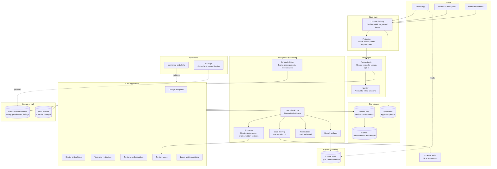
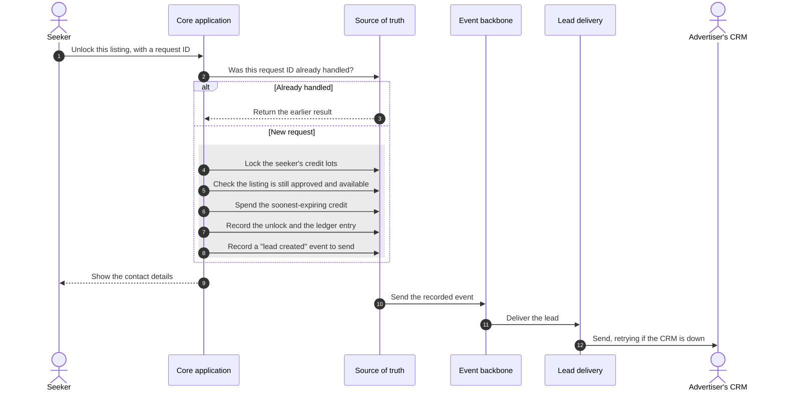
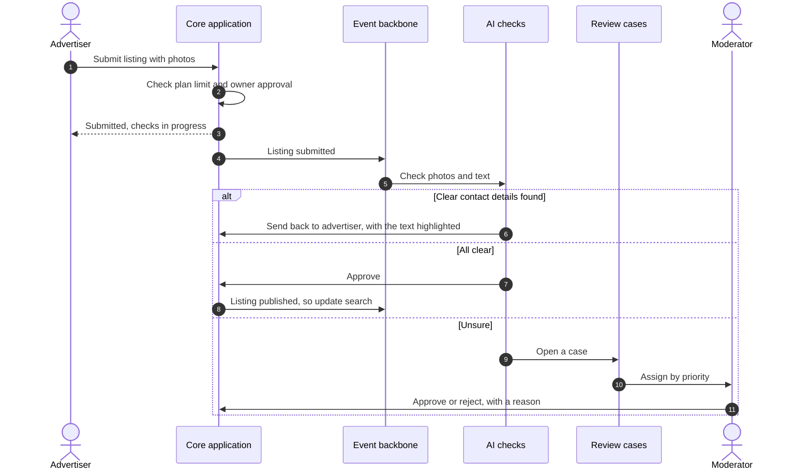
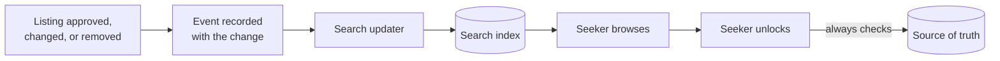

# Architecture

This document turns the agreed requirements into a design. We build it in two stages:

1. **Logical architecture:** the parts of the system and how they work together, without naming
   any technology. *(This stage.)*
2. **AWS architecture:** each logical part mapped to AWS services, with a reason for every choice.
   *(Next stage.)*

Separating the stages keeps the reasoning honest. If a part can't be justified without naming a
product, it probably isn't needed.

## Design principles

Every principle comes from a decision in [README.md](README.md) or
[REQUIREMENTS.md](REQUIREMENTS.md).

| # | Principle | Comes from |
|---|---|---|
| P1 | One trusted source of truth for money and permissions | Invariants 1–7 and 10–12 |
| P2 | Lists and copies may lag, but every action checks the source of truth | Invariants 8 and 9 |
| P3 | Eventual work is guaranteed, never lost | Invariant 13 and rule 14 |
| P4 | Automate clear cases, send doubtful ones to a person | Decisions 8, 15, 18, and 24 |
| P5 | The public marketplace and the private workspace have different needs | Decision 4 |
| P6 | Personal data is kept separate, so it could move later | Decision 13 |
| P7 | Correctness beats availability when they conflict | Decision 26 |
| P8 | Every decision leaves a record that can't be changed | Invariant 14 |
| P9 | Pay for what's used; keep idle cost low | Quality rank 6 |

## The logical architecture

### What each part does, and why it exists

| Part | Responsibility | Why it exists |
|---|---|---|
| Content delivery | Serves public pages and photos from copies close to users | Browsing must stay available and fast on mobile (quality ranks 3 and 5) |
| Protection | Blocks attacks and limits request rates | Scraping and abuse resistance |
| Request entry | One front door for every request | One place to check sign-in and route requests |
| Identity | Accounts, roles, and sessions that expire within 5 minutes | Invariants 12 and 15 |
| Core application | All business rules | Modules of one application, not separate services, so the team can understand and change it |
| Transactional database | The source of truth for money, permissions, and listings | Instant rules need one all-or-nothing place (P1) |
| Audit records | Every credit change and decision | P8 |
| Search index | A copy of approved listings, built for searching | Fast browsing; it may lag behind the database (P2) |
| Public files | Approved listing photos | Served to anyone, through content delivery |
| Private files | Verification documents | Never public; encrypted, with strict access (P6) |
| Archive | Documents and records kept for years | Rarely read, so cheaper storage is appropriate |
| Event backbone | Carries "something happened" messages, and keeps them until handled | Guaranteed background work (P3) |
| AI checks | Identity, documents, photos, and hidden contact details | Automated decisions with confidence levels (P4) |
| Review cases | One queue for every doubtful decision | Shared capability for seven case types (P4) |
| Lead delivery | Sends leads to CRMs and automation tools, retrying when they're down | Invariant 13 |
| Notifications | SMS and email | Reminders, alerts, and confirmations |
| Scheduled jobs | Bonus expiry, listing expiry, grace periods, balance checks | Time-based rules |
| Monitoring | Notices problems before users report them | Observability |
| Backups | Restorable copies, also kept in a second Region | Recovery targets and decision 28 |

## Core application modules

The core is one application with clear internal boundaries. Each module owns its data, and other
modules use it only through its defined actions.

| Module | Owns | Must keep instantly true |
|---|---|---|
| Accounts and advertisers | Users, advertisers, members, roles | Removed agents lose access within 5 minutes |
| Listings and plans | Listings, photos, plans, subscriptions | Plan limits when publishing |
| Trust and verification | Verification levels, owner approvals | Only valid approvals allow public listings |
| Credits and unlocks | Credit lots, ledger, unlocks | Invariants 1–6 |
| Reviews and reputation | Viewing reports, reviews, responses | Invariants 10 and 11 |
| Review cases | Cases, assignments, decisions | Every decision is recorded |
| Leads and integrations | Leads, connections to external tools | Every unlock creates a lead |

## Where work happens

The most important design boundary: what happens **while the user waits**, and what happens
**in the background**.

| While the user waits | In the background |
|---|---|
| Browsing and searching | Updating the search index |
| Unlocking a contact and spending a credit | Delivering the lead to the advertiser's CRM |
| Creating or editing a listing | AI checks on photos, text, and documents |
| Writing a review | Notifications |
| Moderator decisions | Expiry and grace period jobs |
| Signing in | Archiving old documents and records |
| | Copying backups to the second Region |

**The rule:** a user waits only for work that must be instantly true. Everything else goes to the
background, where it's guaranteed but can be delayed.

## Key flows

### Unlocking a contact

Everything inside the box happens as one all-or-nothing step. If any part fails, nothing changes.

**Why the event is recorded in the same step:** if the system crashed after spending the credit
but before recording the event, the advertiser would never get the lead, and invariant 13 would
break. Saving the event with the unlock means a crash can't separate them. A background process
then sends it.

### Publishing a listing

### Search staying up to date

Search may be up to 1 minute behind. Unlocking always checks the source of truth, so a seeker can
never pay for a listing that was just removed.

## Data classes

Each kind of data needs different protection. This table drives encryption, access, and storage
choices in the next stage.

| Class | Examples | Who can see it | Kept for |
|---|---|---|---|
| Public | Approved listings, photos, review summaries | Anyone | While the listing is live |
| Internal | Plans, case queues, metrics | TraceHome staff | As needed |
| Personal | Names, phone numbers, email addresses | The person, and seekers who unlocked them | While the account exists, then by policy |
| Sensitive | ID checks, ownership documents | Moderators with a reason; every access recorded | By law, pending legal advice |
| Financial | Credit lots, ledger | The seeker, finance, and auditors | Years; never changed |
| Audit | Decisions and access records | Auditors | Years; never changed |

## Questions to answer before mapping to AWS

Answer these yourself first. They test whether the design is clear to you.

1. Why does unlocking a contact happen while the user waits, but delivering the lead doesn't?
2. Why is the search index allowed to be wrong for a minute, but the credit balance never is?
3. Why is the core one application with modules, and not seven separate services?
4. What happens to a lead if the advertiser's CRM is offline when the seeker unlocks the contact?
5. Why are public photos and verification documents stored separately?
