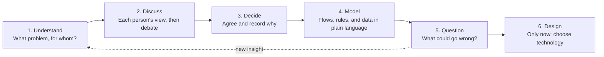

# TraceHome

A trusted property platform for selling and renting homes, starting in Addis Ababa.

**Team:** Getasil Desaleng, Seid Endris, Zerubabel Jember (Evangadi AWS, Group 9)

> **Status: AWS architecture design.** Requirements and the logical architecture are agreed. We're
> now mapping each part to AWS, one layer at a time. Network, compute, data, and edge are decided.

## Why this repository exists

We want to learn to think like solutions architects. That means understanding a problem fully
before choosing any technology. This repository holds our shared understanding of TraceHome, and
it changes as we learn.

| Document | Purpose |
|---|---|
| [README.md](README.md) | What TraceHome is, how we work, and the starting ideas to discuss |
| [REQUIREMENTS.md](REQUIREMENTS.md) | Problem, users, journeys, business rules, and quality requirements |
| [ARCHITECTURE.md](ARCHITECTURE.md) | How TraceHome is designed, and why |

## The idea in one paragraph

People looking for homes in Addis Ababa rely on scattered listings and brokers, and it's hard to
know which listings are genuine, current, and fairly described. TraceHome lets owners, brokers, and
agencies publish verified listings. Seekers can browse for free, pay to contact advertisers they're
serious about, and review what they find, so future seekers know whom to trust.

This is a hypothesis. We'll test it by talking to real seekers and advertisers.

## How we think

We work through every part of the system in this order, and we don't skip ahead to services.

### Discussion rules

1. **Think alone first.** Before a discussion, each member writes their own answer, without AI.
2. **Disagree with ideas, not people.** The aim is the best answer, not winning.
3. **Evidence beats opinion.** If we don't know, we find out from users, data, or experiments.
4. **Write down decisions.** Record what we decided, why, and what would make us change it.
5. **Everyone understands everything.** No part of TraceHome belongs to only one person.
6. **Use AI as a challenger.** Ask it to question our thinking, not to make our decisions.

## Starting ideas to discuss

Zerubabel leads the decisions and explains the reasoning to the team. Anyone can challenge a
decision with a better argument or new evidence. Decided items move to the decision log below.

| Topic | Idea | Reasoning | Status |
|---|---|---|---|
| Advertisers | Individual owners, independent brokers, and registered agencies | All three advertise homes today | To discuss |
| Seeker payment | Charge for credits once the marketplace has enough listings | Pay only when seriously interested | To discuss |
| Refunds | Credit returned for unavailable, fraudulent, duplicated, or unreachable listings | Seekers shouldn't pay for bad information | To discuss |
| Review eligibility | Only after unlocking a contact and reporting a viewing | Reviews must come from genuine interactions | To discuss |
| Review content | Listing accuracy and advertiser behavior are rated separately | One bad listing shouldn't define a whole advertiser | To discuss |
| Voice feedback | Wanted, but not in the first version | Adds consent, privacy, and moderation work | To discuss |
| Commission | Not now | We can't verify deals that happen off the platform | To discuss |
| Environment | One development environment only | Keep cost and complexity low while we learn | To discuss |

## Decision log

| # | Date | Decision | Reasoning | What would change it |
|---|---|---|---|---|
| 1 | 5 Nov | Support both renting and buying | Both are real needs in Addis Ababa | Interviews show one is far more urgent |
| 2 | 5 Nov | Renting drives volume and freshness; buying drives verification depth | Turns "both" into clear design priorities | Usage data shows a different pattern |
| 3 | 5 Nov | Serve both seekers and advertisers | Both sides have real pain | Interviews show one side has no real pain |
| 4 | 5 Nov | TraceHome is two products: a public marketplace and a private advertiser workspace | They differ in traffic, privacy, and scaling needs | The two sides turn out to share most needs |
| 5 | 5 Nov | Free for both sides at launch, with bonus credits | Solves cold start; both sides need a reason to join | Enough listings and seekers to start charging |
| 6 | 5 Nov | Contact unlocks use credits from day one, even while free | Stops contact harvesting, measures demand, avoids a rebuild | Credits cause too much friction |
| 7 | 5 Nov | Trust levels: phone confirmed, identity checked, licensed agency, ownership proven | Seekers can see exactly what was checked | Interviews show seekers value other signals |
| 8 | 5 Nov | Automated checks first; low-confidence results go to a person | Fast for clear cases, safe for doubtful ones | Automation proves unreliable or unavailable |
| 9 | 5 Nov | Brokers need the owner's approval for each property they advertise | Stops unauthorized and duplicate listings | Approval proves too hard for owners |
| 10 | 5 Nov | Document retention follows Ethiopian law, confirmed by legal advice before real users | Verification documents are sensitive personal data | The law or legal advice changes |
| 11 | 5 Nov | Approving a fraudster is worse than rejecting an honest advertiser | One fraud case damages trust in every listing | Supply becomes too small to keep seekers |
| 12 | 5 Nov | Everything runs on AWS for now, with made-up data | No local hosting option yet; real users aren't involved | Legal advice requires local storage before launch |
| 13 | 5 Nov | Keep personal data separate from other data, so it could move later | Makes a future move to local storage possible | Legal advice confirms that AWS storage is allowed |
| 14 | 5 Nov | The system tracks advertiser and listing trust separately; seekers see one summary, with details on request | Accurate records, simple experience | Seekers find the summary misleading |
| 15 | 5 Nov | AI-assisted checks decide clear cases; people decide doubtful ones | Fast, consistent, and safe for hard cases | AI accuracy proves too low |
| 16 | 5 Nov | Advertisers will pay a monthly plan, limited by listings and agents | Predictable for advertisers and for TraceHome | Advertisers prefer paying per listing |
| 17 | 5 Nov | Purchased credits never expire | Fair to seekers who paid | Unused credits become a financial burden |
| 18 | 5 Nov | Refunds follow precise rules; doubtful cases go to a person | Fast and fair for clear cases | Rules prove easy to abuse |
| 19 | 5 Nov | Detect contact details hidden in listing text and photos | Protects the credit model from bypass | Detection proves unreliable |
| 20 | 5 Nov | Bonus credits expire after 3 months and are spent before purchased credits | Encourages use and limits what TraceHome owes | Seekers find expiry unfair |
| 21 | 5 Nov | Downgrading pauses listings above the new limit; nothing is deleted | Advertisers keep their work and can upgrade again | Advertisers find pausing confusing |
| 22 | 5 Nov | Individual owners get a permanent free plan | Owners supply the most authentic listings | Brokers abuse it by posing as owners |
| 23 | 6 Nov | The free owner plan allows up to 4 active listings | Covers owners with a few properties, while limiting broker abuse | Abuse appears, or owners need more |
| 24 | 6 Nov | Clear hidden contact details go back to the advertiser automatically; unclear ones go to a moderator | Fast fixes for clear cases, moderators free for hard ones | Too many false flags annoy advertisers |
| 25 | 6 Nov | Instant rules for money and permissions; eventual but guaranteed delivery for leads and notifications | Mistakes with money and access can't be undone | Usage shows a rule is too strict or too loose |
| 26 | 7 Nov | Quality priority: correctness, security, browsing availability, durability, speed, cost | Tells us which quality wins when two conflict | Business priorities change |
| 27 | 7 Nov | Different availability and speed targets for each part of TraceHome | Spend effort where failure hurts most | Measurements show a target is wrong |
| 28 | 7 Nov | Region failure: accept downtime, with backups copied to a second Region | Data survives at very low cost | Revenue justifies faster recovery |
| 29 | 8 Nov | Only the load balancer faces the internet; application, workers, database, and search index are private | Smallest possible attack surface | None expected; this is standard practice |
| 30 | 8 Nov | Three subnet layers: public, private app, private data (no internet route) | Data can't leave by any internet path | A part needs a different kind of access |
| 31 | 8 Nov | Both file buckets stay private; photos go out through the CDN, documents through expiring links | Visible to the public isn't the same as open to the public | None expected |
| 32 | 8 Nov | S3 gateway endpoint for files, NAT for external calls, interface endpoints only when justified | Gateway endpoint is free; interface endpoints cost money per zone | Traffic or security needs justify more endpoints |
| 33 | 8 Nov | Two zones for the parts users wait on; one zone for queued or rebuildable parts | Pay for high availability only where failure hurts | Measurements show a part needs more |
| 34 | 8 Nov | We describe a target design and a cheaper development build, and state every difference | The budget can't pay for the target, and we say so openly | Real users arrive |
| 35 | 9 Nov | The application and workers run on ECS with Fargate, from one container image, as two services | No servers to manage; one copy of the business rules | Costs or limits make EC2 clearly better |
| 36 | 9 Nov | Lambda handles event-driven jobs that never touch the source of truth, starting with photo processing | Fits short, event-driven work; avoids database connection problems | A Lambda job starts needing business rules |
| 37 | 9 Nov | Workers scale on queue depth and run on Fargate Spot in the development build | Queued jobs survive interruptions, so the cheaper option is safe | Interruptions delay work too much |
| 38 | 9 Nov | The development build runs only when needed, with budget alerts set before the first deploy | Credits would run out in about a month if always on | More credits or a smaller build |
| 39 | 9 Nov | The source of truth is PostgreSQL on Amazon RDS, Multi-AZ in the target design | Money and permissions need transactions, constraints, and audit queries | Scale or access patterns outgrow one relational database |
| 40 | 9 Nov | Money and permission rules are also enforced inside the database: transactions, unique and check constraints, row locks | The database catches what a code bug misses | None expected |
| 41 | 9 Nov | RDS rather than Aurora | Aurora's strengths (fast Region recovery, read scaling) aren't needed yet | Recovery targets tighten, or reads outgrow one database |
| 42 | 9 Nov | Point-in-time recovery for mistakes; cross-Region copies of database backups and S3 files for Region failure; Multi-AZ isn't a backup | Each failure needs its own protection | Recovery targets change |
| 43 | 9 Nov | A restore is tested before the demo, and its real duration recorded | An untested backup is only a hope | None expected |
| 44 | 9 Nov | The development build runs in us-east-1, with backups copied to us-west-2 | Lowest prices, every service, made-up data only | Real users arrive |
| 45 | 9 Nov | The production Region is chosen by measured speed from Addis Ababa and by legal advice; candidates are Cape Town, UAE, and Frankfurt | The nearest Region on a map isn't always the fastest | Legal advice requires storage in Ethiopia |
| 46 | 9 Nov | CloudFront in front of everything: long cache for app files and photos, at most 60 seconds for public pages, never for personalized responses | Speed and cost, without ever showing one person's data to another | The 1-minute removal rule changes |
| 47 | 9 Nov | The load balancer is internal, in the private app subnets, reached through a CloudFront VPC origin; nothing in the VPC is reachable from the internet (updates decision 29) | The firewall can't be bypassed | VPC origins can't support a feature we need |
| 48 | 9 Nov | AWS WAF on CloudFront is the first layer of defense; business rules remain the main defense | WAF sees requests, not intent | Abuse patterns change |
| 49 | 9 Nov | Route 53 for DNS with alias records to CloudFront; ACM certificates (in us-east-1 for CloudFront), validated through DNS and renewed automatically | Free, automatic, and no expired certificates | None expected |
| 50 | 9 Nov | Development build uses the default cloudfront.net address and basic WAF rules; the domain is bought later | Saves cost while data is made up | The demo needs a real domain |

### Our edge over Telegram groups

- **For advertisers:** one place to manage listings, agents, follow-up, and integrations with their
  own tools.
- **For seekers:** every listing is verified and confirmed as available, and every advertiser has
  a track record. *(Proposed; still to confirm.)*

## Suggested out of scope, to discuss

- Taking part in property payments, contracts, or legal transfer
- Real payment processing; credit purchases will be simulated until we've checked the rules
- Real users' personal data; we'll use made-up data
- Ideas parked for later: voice feedback, AI assistants, messaging apps, social media publishing,
  and integrations beyond a simple lead hand-off

## Team rules

- Never put passwords, keys, or private files in this repository.
- Every change goes through a pull request that a teammate reviews.
- Don't merge anything you can't explain, including AI-generated work.
