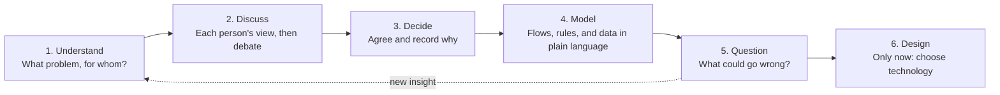

# TraceHome

A trusted property platform for selling and renting homes, starting in Addis Ababa.

**Team:** Getasil Desaleng, Seid Endris, Zerubabel Jember (Evangadi AWS, Group 9)

> **Status: discovery.** We're still understanding the problem, the users, and the business.
> No technology or AWS service has been chosen yet.

## Why this repository exists

We want to learn to think like solutions architects. That means understanding a problem fully
before choosing any technology. This repository holds our shared understanding of TraceHome, and
it changes as we learn.

| Document | Purpose |
|---|---|
| [README.md](README.md) | What TraceHome is, how we work, and the starting ideas to discuss |
| [REQUIREMENTS.md](REQUIREMENTS.md) | Problem, users, journeys, business rules, and quality requirements |

## The idea in one paragraph

People looking for homes in Addis Ababa rely on scattered listings and brokers, and it's hard to
know which listings are genuine, current, and fairly described. TraceHome lets owners, brokers, and
agencies publish verified listings. Seekers can browse for free, pay to contact advertisers they're
serious about, and review what they find, so future seekers know whom to trust.

This is a hypothesis. We'll test it by talking to real seekers and advertisers.

## How we think

We work through every part of the system in this order, and we don't skip ahead to services.

### Discussion rules

1. **Think alone first.** Before a discussion, each member writes their own answer, without AI.
2. **Disagree with ideas, not people.** The aim is the best answer, not winning.
3. **Evidence beats opinion.** If we don't know, we find out from users, data, or experiments.
4. **Write down decisions.** Record what we decided, why, and what would make us change it.
5. **Everyone understands everything.** No part of TraceHome belongs to only one person.
6. **Use AI as a challenger.** Ask it to question our thinking, not to make our decisions.

## Starting ideas to discuss

Nothing is agreed yet. These are Zerubabel's initial ideas, to open the first team discussion.
Challenge them, improve them, or replace them. Mark each one **Agreed** only after the team decides.

| Topic | Idea | Reasoning | Status |
|---|---|---|---|
| Advertisers | Individual owners, independent brokers, and registered agencies | All three advertise homes today | To discuss |
| Trust | Each advertiser has a verification level that seekers can see | Seekers need to know whom to trust | To discuss |
| Browsing | Free for everyone | People should see value before paying | To discuss |
| Seeker payment | Buy credits; one credit unlocks one listing's advertiser contact | Pay only when seriously interested | To discuss |
| Refunds | Credit returned for unavailable, fraudulent, duplicated, or unreachable listings | Seekers shouldn't pay for bad information | To discuss |
| Review eligibility | Only after unlocking a contact and reporting a viewing | Reviews must come from genuine interactions | To discuss |
| Review content | Listing accuracy and advertiser behavior are rated separately | One bad listing shouldn't define a whole advertiser | To discuss |
| Voice feedback | Wanted, but not in the first version | Adds consent, privacy, and moderation work | To discuss |
| Commission | Not now | We can't verify deals that happen off the platform | To discuss |
| Environment | One development environment only | Keep cost and complexity low while we learn | To discuss |

## Suggested out of scope, to discuss

- Taking part in property payments, contracts, or legal transfer
- Real payment processing; credit purchases will be simulated until we've checked the rules
- Real users' personal data; we'll use made-up data
- Ideas parked for later: voice feedback, AI assistants, messaging apps, social media publishing,
  and integrations beyond a simple lead hand-off

## Team rules

- Never put passwords, keys, or private files in this repository.
- Every change goes through a pull request that a teammate reviews.
- Don't merge anything you can't explain, including AI-generated work.
