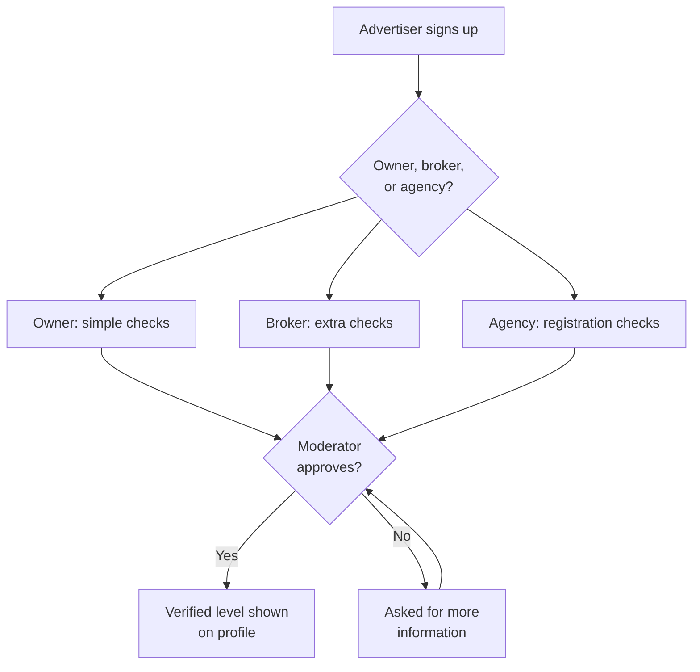
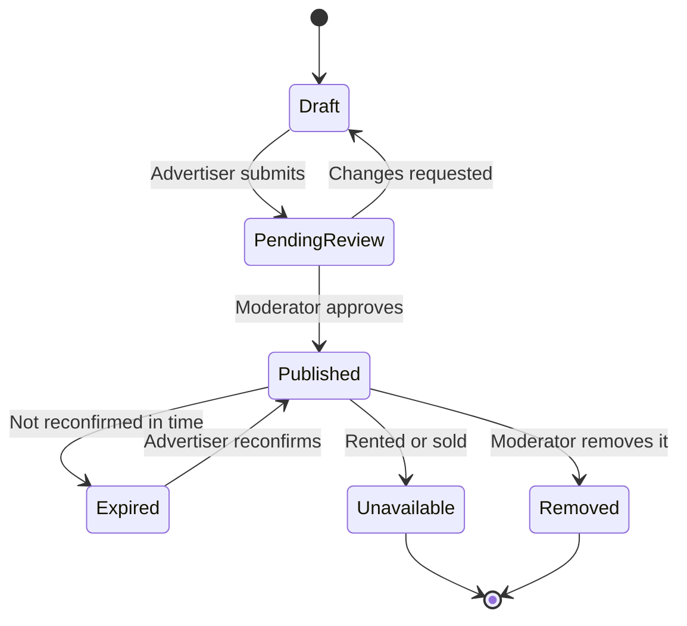
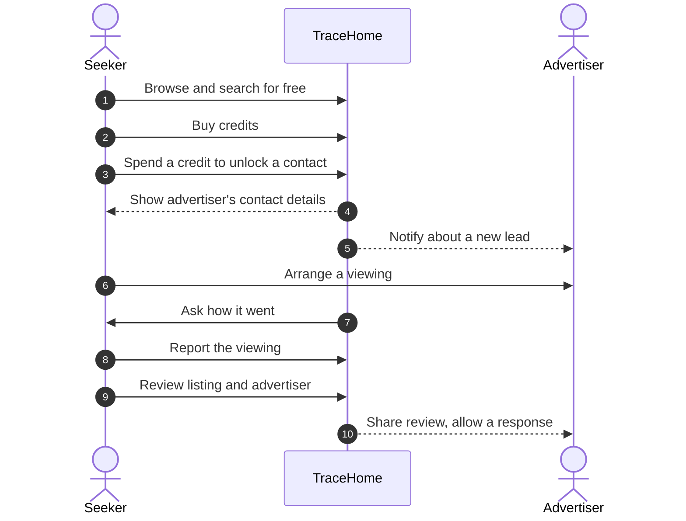
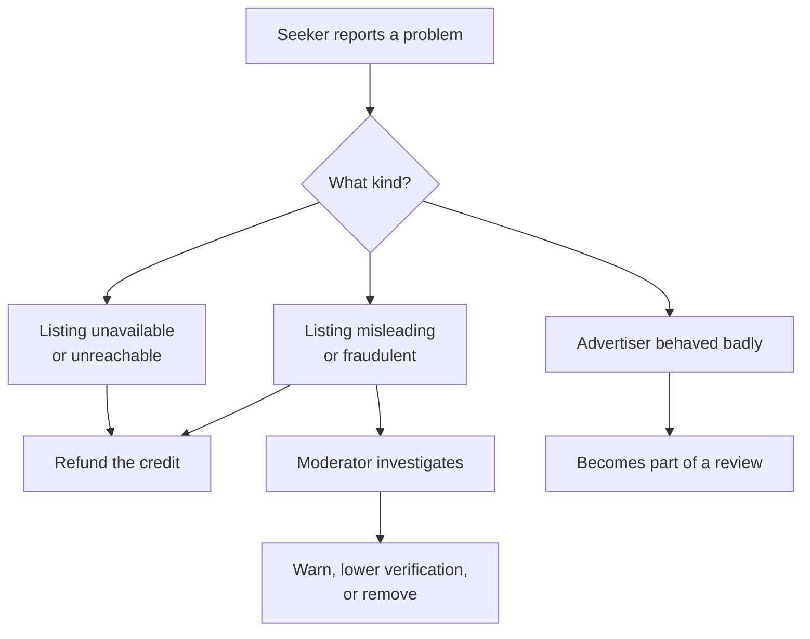
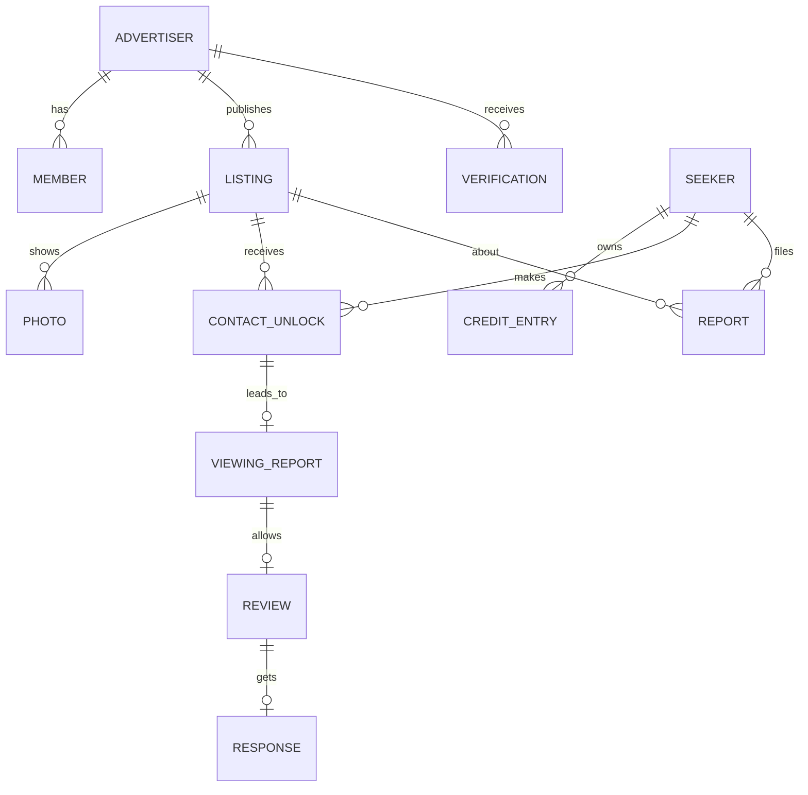

# Requirements

This document describes **what** TraceHome must do and **how well**, not how it's built. It
deliberately avoids naming technologies, so we can think about the problem without being anchored
to a solution.

Each section ends with questions for the team. Answer them alone first, then discuss together.

## 1. The problem

### Problem statement, to validate

Home seekers in Addis Ababa search Telegram groups, brokers, and word of mouth. They often find
listings that are outdated, misleadingly described, already taken, or posted by people who aren't
authorized to advertise them. They lose time, travel, and money, and they don't know whom to trust.

Advertisers have a matching problem: honest owners, brokers, and agencies struggle to stand out
from unreliable ones.

### What we need to learn

Interview at least five seekers and five advertisers. Record what you hear, not what you hoped to hear.

**Seekers**
- How do you search for a home today?
- What makes you distrust a listing or a broker?
- Tell us about a viewing that went badly. What happened?
- How do you check that a home is still available?
- Would you pay to contact an advertiser? When, and how much?

**Advertisers**
- How do you advertise today, and what does it cost?
- How many inquiries are serious?
- What would make seekers trust you more?
- Would you pay for a better way to reach serious seekers?
- What would you need from us to prove you're genuine?

### Questions for the team

- Is the main pain finding homes, trusting listings, or something we haven't seen yet?
- What will people use instead of TraceHome, and why would they switch?

## 2. Users and stakeholders

| User | Who they are | What they want |
|---|---|---|
| Seeker | Someone renting or buying a home | Genuine listings, honest advertisers, less wasted time |
| Individual owner | Rents or sells their own property | Serious seekers, simple listing, little effort |
| Independent broker | Advertises others' properties | More clients, a good reputation |
| Agency | A registered business with several agents | Manage team and listings, grow the brand |
| Agent | Works for an agency | Manage assigned listings and leads |
| Moderator | Works for TraceHome | Verify advertisers and listings, handle reports and disputes |
| External tools | An advertiser's CRM or automation tool | Receive new leads automatically |

### Questions for the team

- Which user matters most at launch, and why?
- Can one person be both a seeker and an advertiser?
- Can one person belong to several agencies?
- Should brokers need written permission from owners?

## 3. Value for each side

| User | Gets | Gives |
|---|---|---|
| Seeker | Free browsing, trust signals, refunds for bad listings | Credits for contacts, honest reviews |
| Owner | Reach serious seekers | Accurate listings, availability updates |
| Broker and agency | Leads, reputation, team tools | Subscription, verification, accurate listings |
| TraceHome | Revenue and a trusted marketplace | Verification, moderation, fair rules |

**The tension to resolve:** we charge both sides, so each side must clearly get more value than it
pays. If seekers can easily find the same contacts elsewhere, they won't pay.

## 4. Business model

### Initial ideas, to discuss

- Browsing is free.
- Seekers buy credit packages, and one credit unlocks one listing's advertiser contact.
- Reopening a contact you already unlocked costs nothing.
- Credits are refunded for listings that are unavailable, fraudulent, duplicated, or unreachable.
- Purchases are simulated until we've checked payment rules, refunds, and disputes.

### Open

| Question | Options to consider |
|---|---|
| Package sizes and prices | To be learned from interviews |
| Do credits expire? | Never, after months, or after a year |
| What do owners pay? | Free, pay per listing, or a small fee |
| What do brokers and agencies pay? | Subscription tiers, by number of listings or agents |
| Who decides refunds? | Automatic for clear cases, a moderator for others |
| How do we stop advertisers bypassing credits? | Detect contact details in listings, warnings, penalties |

## 5. Key journeys

These show the flow of the business, not of any technology.

### Advertiser joins and gets verified

### A listing's life

### A seeker finds a home

### Something goes wrong

### Questions for the team

- What exactly counts as a "reported viewing"? Can we trust it?
- How long can a listing stay published before it must be reconfirmed?
- What happens to unlocked contacts when a listing is removed?
- Should advertisers see who unlocked their contact?

## 6. Business rules

None of these rules is agreed yet. Change a status to **Agreed** only after the team decides.

| Area | Rule | Status |
|---|---|---|
| Verification | Every advertiser has a visible verification level | To discuss |
| Verification | Brokers need more checks than owners and agencies | To discuss; checks not defined |
| Listings | A listing must be approved before it's public | To discuss |
| Listings | Listings expire unless reconfirmed | To discuss; period open |
| Listings | Contact details mustn't appear in the listing itself | To discuss |
| Credits | One credit per listing contact, no repeat charge | To discuss |
| Credits | A credit can never be spent twice, or lost | To discuss |
| Credits | Every purchase, spend, and refund is permanently recorded | To discuss |
| Reviews | Only after an unlock and a reported viewing | To discuss |
| Reviews | Listing accuracy and advertiser behavior rated separately | To discuss |
| Reviews | Advertisers can respond and dispute | To discuss |
| Reviews | Overall rating shown only after enough reviews | To discuss; number open |
| Reviews | Abusive or defamatory reviews are moderated | To discuss |
| Privacy | Contact details are shown only to seekers who unlocked them | To discuss |
| Leads | Advertisers can receive leads in their own tools | To discuss |

## 7. Domain model

These are the main business concepts and how they relate. They aren't database tables.

| Concept | Meaning |
|---|---|
| Advertiser | An owner, broker, or agency that publishes listings |
| Member | A person acting for an advertiser, such as an agency's agent |
| Verification | A check TraceHome performed, and its result |
| Listing | A property offered for rent or sale |
| Credit entry | A permanent record of a purchase, spend, or refund |
| Contact unlock | A seeker paying to see one listing's advertiser contact; also a lead |
| Viewing report | A seeker's statement that a viewing happened, and its outcome |
| Review | Ratings of listing accuracy and advertiser behavior, with comments |
| Report | A complaint about a listing or advertiser |

### Questions for the team

- What other concepts are missing?
- Which concepts belong to an advertiser, and must stay private from other advertisers?
- Which records must never be changed or deleted?

## 8. Functional requirements

| Area | Requirement | Suggested version |
|---|---|---|
| Accounts | Seekers and advertisers can register and sign in | First |
| Advertisers | Advertisers choose a type and submit verification details | First |
| Advertisers | Agencies invite members and assign roles | First |
| Listings | Advertisers create, edit, submit, reconfirm, and close listings | First |
| Listings | Listings include photos, price, type, sub-city, and neighborhood | First |
| Moderation | Moderators approve or reject advertisers, listings, and reviews | First |
| Search | Anyone can browse and filter by area, price, type, and size | First |
| Credits | Seekers buy credits through a simulated payment | First |
| Credits | Seekers spend credits to unlock contacts and see their balance | First |
| Credits | Refunds are issued for eligible problems | First |
| Leads | Advertisers see who unlocked their listings | First |
| Leads | Advertisers can send new leads to an external tool automatically | First |
| Reviews | Eligible seekers report viewings and leave reviews | First |
| Reviews | Advertisers respond to reviews or dispute them | First |
| Reports | Anyone can report a problem with a listing or advertiser | First |
| Search | Map and radius search | Later |
| Feedback | Voice feedback | Later |
| Payments | Real payments | Later |
| Languages | Amharic interface | Later |

## 9. Quality requirements

These describe how well TraceHome must work. All of them, including the proposed numbers, are
to discuss.

| Quality | Requirement | How we'd check it |
|---|---|---|
| Correctness | A credit is never spent twice or lost, even with retries or crashes | Simultaneous and repeated requests |
| Reliability | A paid unlock always produces a lead for the advertiser, even if a connected tool is down | Make the tool unavailable, then recover |
| Isolation | One advertiser can never see another advertiser's private data | Try to access it as another advertiser |
| Privacy | Contact details reach only seekers who unlocked them | Access tests |
| Availability | Browsing works for most of the time; proposed 99.9% | Measure over time |
| Speed | Search feels instant; proposed 95% under 300 ms | Load testing |
| Recovery | Data can be restored after mistakes; targets to agree | Practice a restore |
| Auditability | We can explain every credit, verification, and moderation decision | Review records |
| Security | Access is limited to what each role needs | Role-based tests |
| Network | Works on slow mobile connections | Test on throttled networks |
| Cost | Runs within a small student budget | Track spending |

### Questions for the team

- Which quality matters most for TraceHome, and which can we relax?
- What happens to trust if a seeker pays and receives no contact?
- How much data could we lose before someone loses money?

## 10. Constraints and assumptions

| Constraint | Effect |
|---|---|
| Team of three, all learning | Prefer designs we can fully understand and explain |
| Small budget | Run only what we need, when we need it |
| One development environment | No separate production environment for now |
| Built on AWS | Required by the course, but services are chosen later |
| Learning is a goal | We'll choose designs that teach us core cloud concepts |

**Assumptions to check:** most seekers use mobile phones; seekers will pay for contacts; owners will
accept verification; addresses use sub-city and neighborhood more than street names.

## 11. What could go wrong

Think about each of these before choosing any technology.

- A seeker pays, but the contact details are wrong or the advertiser never answers.
- Two requests try to spend the last credit at the same moment.
- An advertiser puts a phone number in a photo to avoid credits.
- A competitor posts fake negative reviews.
- An agency's former agent still has access.
- An advertiser's connected tool is offline for a day.
- Someone uploads harmful or stolen photos.
- Data is accidentally deleted.
- Usage suddenly grows tenfold.

For each one, ask: How likely is it? How bad is it? How would we notice? What should happen?

## 12. From requirements to architecture

Only after this document is agreed should we start choosing technology. When we do, every choice
should answer:

1. Which requirement does it serve?
2. What alternatives did we consider?
3. What tradeoff are we accepting?
4. How will we prove it works, including when it fails?

## Glossary

| Term | Meaning |
|---|---|
| Seeker | Someone looking to rent or buy a home |
| Advertiser | An owner, broker, or agency that publishes listings |
| Credit | A unit seekers spend to unlock one listing's advertiser contact |
| Unlock | Spending a credit to see a listing's contact details |
| Lead | A record that a seeker is interested in a listing |
| Verification level | What TraceHome has checked about an advertiser |
| Reconfirmation | An advertiser confirming a listing is still available |
