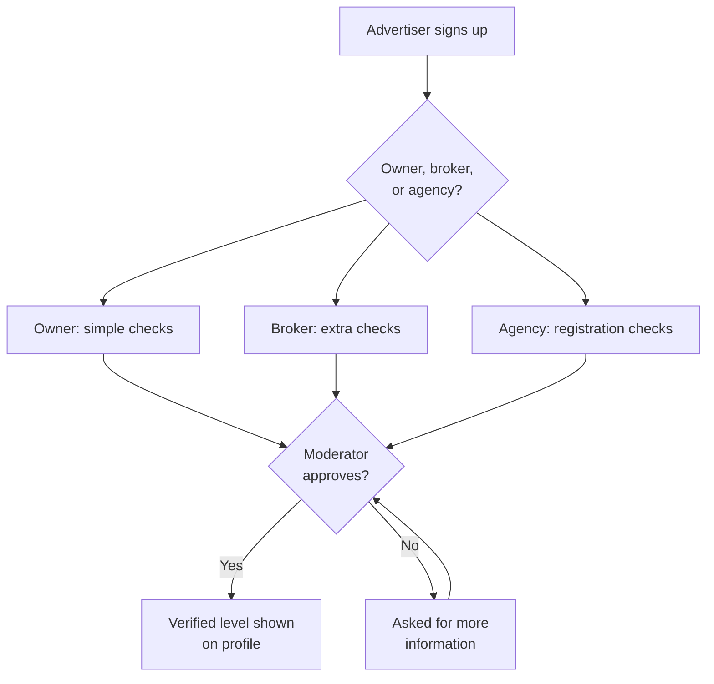
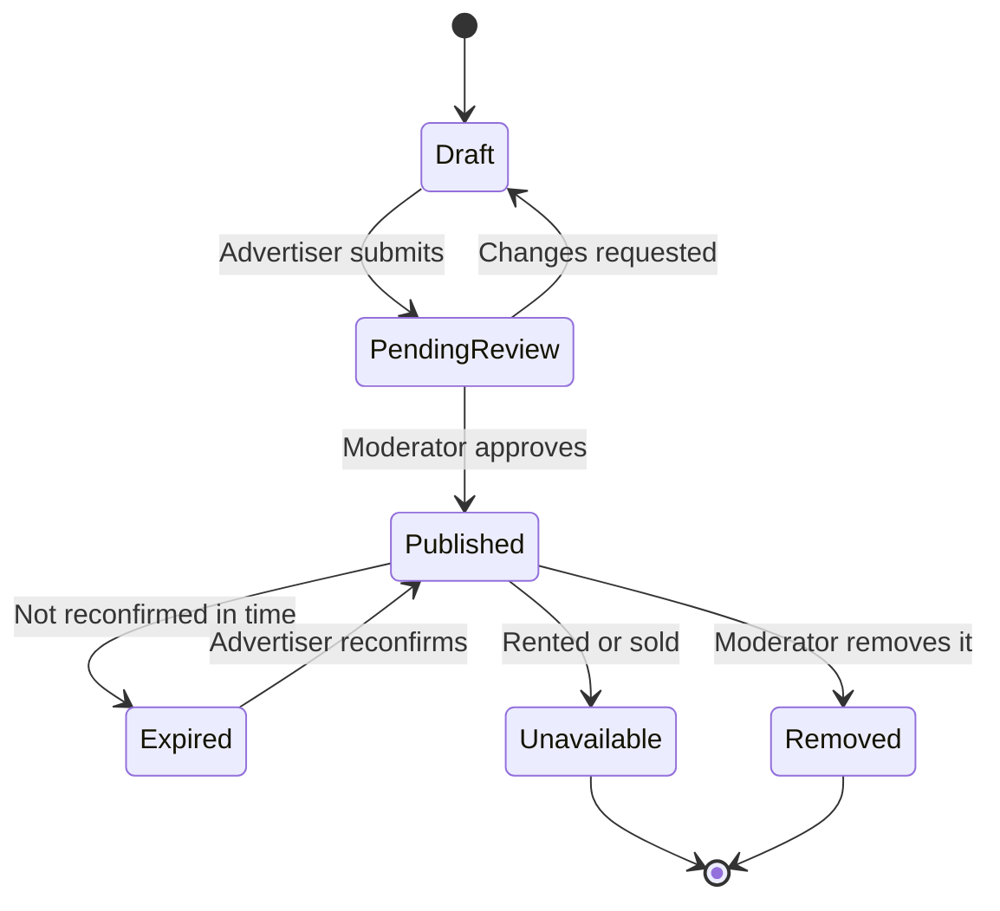
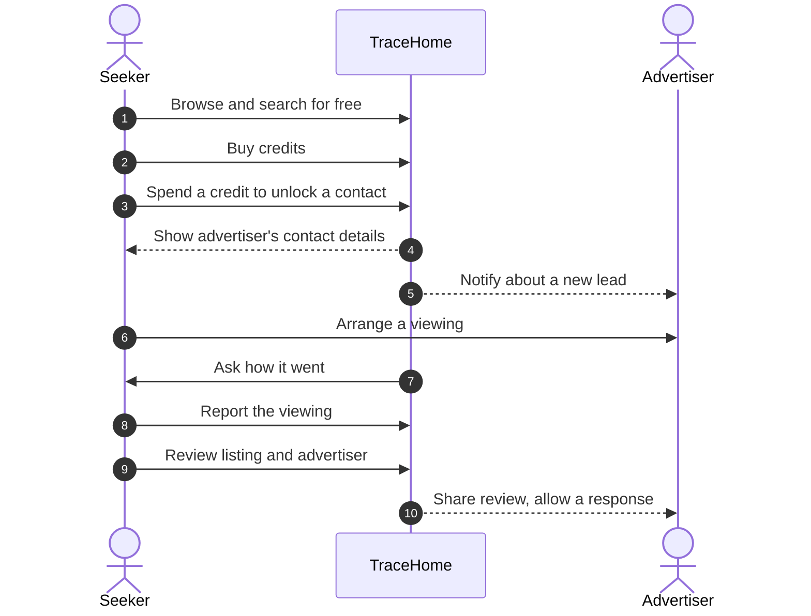
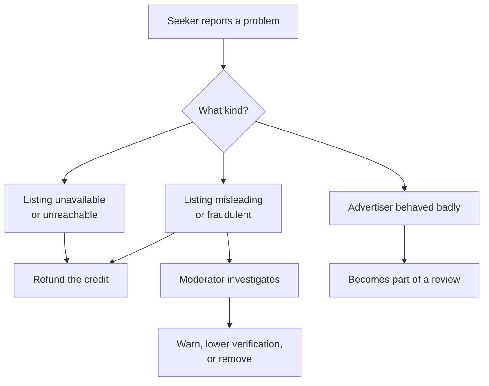
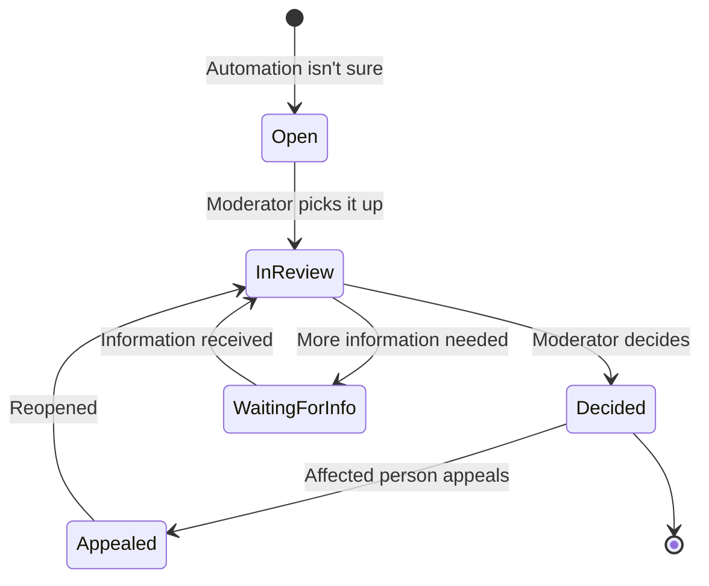
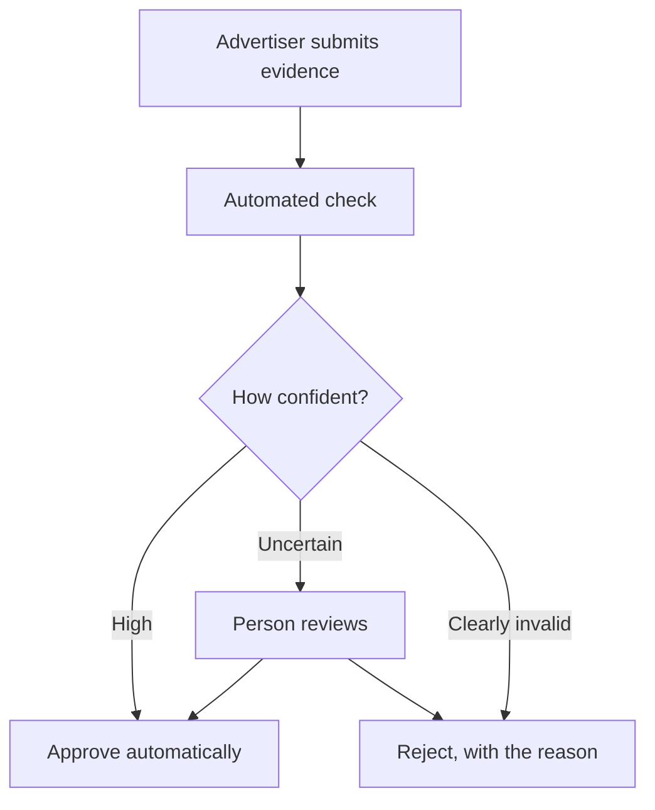
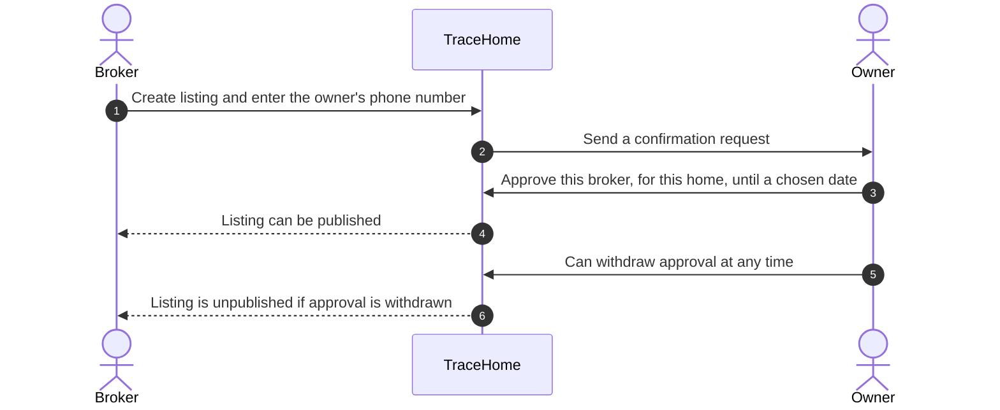
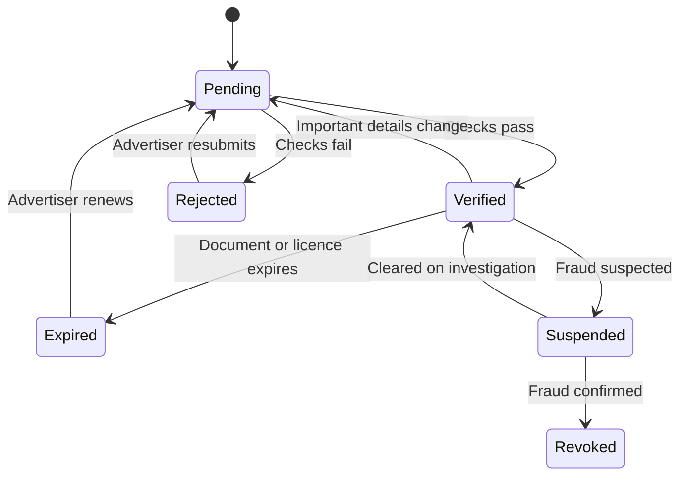
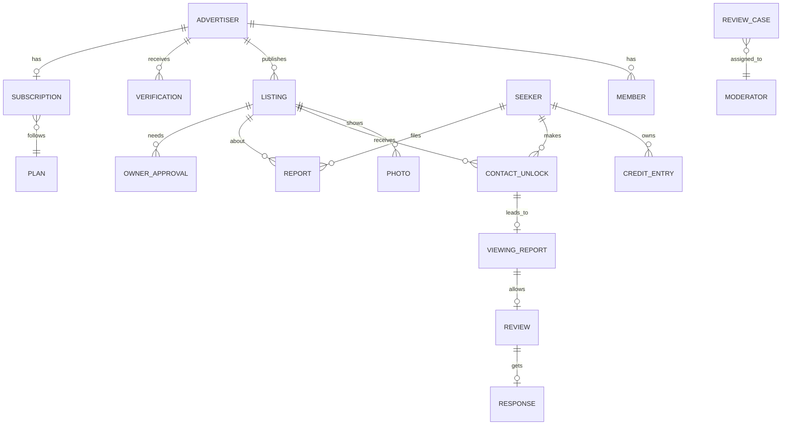

# Requirements

This document describes **what** TraceHome must do and **how well**, not how it's built. It
deliberately avoids naming technologies, so we can think about the problem without being anchored
to a solution.

Each section ends with questions for the team. Answer them alone first, then discuss together.

## 1. The problem

### Problem statement, to validate

Home seekers in Addis Ababa search Telegram groups, brokers, and word of mouth. They often find
listings that are outdated, misleadingly described, already taken, or posted by people who aren't
authorized to advertise them. They lose time, travel, and money, and they don't know whom to trust.

Advertisers have a matching problem: honest owners, brokers, and agencies struggle to stand out
from unreliable ones.

### What we need to learn

Interview at least five seekers and five advertisers. Record what you hear, not what you hoped to hear.

**Seekers**
- How do you search for a home today?
- What makes you distrust a listing or a broker?
- Tell us about a viewing that went badly. What happened?
- How do you check that a home is still available?
- Would you pay to contact an advertiser? When, and how much?

**Advertisers**
- How do you advertise today, and what does it cost?
- How many inquiries are serious?
- What would make seekers trust you more?
- Would you pay for a better way to reach serious seekers?
- What would you need from us to prove you're genuine?

### Questions for the team

- Is the main pain finding homes, trusting listings, or something we haven't seen yet?
- What will people use instead of TraceHome, and why would they switch?

## 2. Users and stakeholders

| User | Who they are | What they want |
|---|---|---|
| Seeker | Someone renting or buying a home | Genuine listings, honest advertisers, less wasted time |
| Individual owner | Rents or sells their own property | Serious seekers, simple listing, little effort |
| Independent broker | Advertises others' properties | More clients, a good reputation |
| Agency | A registered business with several agents | Manage team and listings, grow the brand |
| Agent | Works for an agency | Manage assigned listings and leads |
| Moderator | Works for TraceHome | Verify advertisers and listings, handle reports and disputes |
| External tools | An advertiser's CRM or automation tool | Receive new leads automatically |

### Questions for the team

- Which user matters most at launch, and why?
- Can one person be both a seeker and an advertiser?
- Can one person belong to several agencies?
- Should brokers need written permission from owners?

## 3. Value for each side

| User | Gets | Gives |
|---|---|---|
| Seeker | Free browsing, trust signals, refunds for bad listings | Credits for contacts, honest reviews |
| Owner | Reach serious seekers | Accurate listings, availability updates |
| Broker and agency | Leads, reputation, team tools | Subscription, verification, accurate listings |
| TraceHome | Revenue and a trusted marketplace | Verification, moderation, fair rules |

**The tension to resolve:** we charge both sides, so each side must clearly get more value than it
pays. If seekers can easily find the same contacts elsewhere, they won't pay.

## 4. Business model

### Decided

- Free for both sides at launch, with bonus credits for seekers.
- Contact unlocks use credits from day one, even while free.
- Advertisers will later pay a monthly plan, limited by listings and agents.
- Purchased credits never expire.
- Bonus credits expire after 3 months, and are spent before purchased credits.
- Downgrading pauses listings above the new limit. Nothing is deleted.
- Individual owners get a permanent free plan, with up to 4 active listings.
- Clear hidden contact details send the listing back to the advertiser with the text highlighted.
  Unclear cases go to a moderator, and repeat offenders get an account review.
- Refunds follow precise rules, and doubtful cases go to a person.
- Contact details hidden in listings are detected and handled.

### Initial ideas, to discuss

- Browsing is free.
- Seekers buy credit packages, and one credit unlocks one listing's advertiser contact.
- Reopening a contact you already unlocked costs nothing.
- Credits are refunded for listings that are unavailable, fraudulent, duplicated, or unreachable.
- Purchases are simulated until we've checked payment rules, refunds, and disputes.

### Open

| Question | Options to consider |
|---|---|
| Package sizes and prices | To be learned from interviews |
| Which listings are paused on a downgrade? | The advertiser chooses; otherwise the oldest are paused first |
| What happens when a plan payment fails? | Grace period, then features limited |

### Plans and limits

Free launch access is modelled as a plan, a "launch plan" with generous limits. When charging
starts, only the plans change, not the system.

| Plan concept | Meaning |
|---|---|
| Plan | A named package, such as Free, Starter, or Agency |
| Limits | Maximum active listings and agents |
| Subscription | Which plan an advertiser has, and its status |
| Entitlement check | Before publishing a listing or adding an agent, confirm the plan allows it |

### Credit lots

Because bonus credits expire and purchased ones don't, a balance is not just a single number. Each
grant or purchase is a **lot** with its own amount, type, and expiry date.

| Example lot | Amount | Expires |
|---|---|---|
| Welcome bonus, 5 Nov | 5 | 5 Feb |
| Purchase, 20 Nov | 10 | Never |

- Spending uses the bonus lot that expires soonest, then purchased lots.
- Seekers are reminded before bonus credits expire.
- Expiry is recorded in the ledger like any other change, so the history always adds up.

### Downgrades

| Rule | Detail |
|---|---|
| Who chooses | The advertiser picks which listings stay active; if they don't, the oldest are paused first |
| What seekers see | Paused listings disappear from search |
| Earlier unlocks | Seekers who already unlocked a paused listing keep access to its contact |
| Grace period | Proposed: 7 days' notice before pausing starts |
| Upgrading again | Paused listings can be reactivated, but must be reconfirmed as available |

### Free owner plan

Brokers might register as owners to avoid paying. The limit of 4 active listings, plus
ownership checks, makes that harder.

### Proposed refund rules

| Situation | Proposed handling |
|---|---|
| Advertiser marks the listing unavailable within 24 hours of an unlock | Automatic refund |
| Moderator removes the listing as fraudulent or duplicated | Automatic refund for everyone who unlocked it |
| Seeker reports no response, and the advertiser doesn't answer TraceHome within 48 hours | Automatic refund |
| Seeker reports wrong contact details | A person reviews it |
| A seeker requests unusually many refunds | A person reviews it |

The time limits are proposals to discuss.

## 5. Key journeys

These show the flow of the business, not of any technology.

### Advertiser joins and gets verified

### A listing's life

### A seeker finds a home

### Something goes wrong

### Questions for the team

- What exactly counts as a "reported viewing"? Can we trust it?
- How long can a listing stay published before it must be reconfirmed?
- What happens to unlocked contacts when a listing is removed?
- Should advertisers see who unlocked their contact?

## 5a. Review cases

The same pattern appears again and again: **automate clear cases, and send doubtful ones to a
person.**

| Case type | Created when |
|---|---|
| Identity check | Automated identity check isn't confident |
| Licence check | An agency submits a licence |
| Ownership check | Ownership documents are submitted |
| Refund | A refund doesn't match a clear rule |
| Hidden contact details | Detection isn't sure, or the advertiser appeals |
| Review dispute | An advertiser disputes a review |
| Report | Someone reports a listing or advertiser |

**Proposed:** one shared review system for all case types, not a separate one for each. Every case
has a type, priority, status, assigned moderator, waiting time, and decision record.

### What the AI checks must provide

| Requirement | Reason |
|---|---|
| A confidence level with every result | Decides between approving automatically and sending to a person |
| A reason a person can understand | Moderators and advertisers must know why |
| A record of every automated decision | Audits, appeals, and measuring accuracy |
| A person can overrule any automated decision | Automation will make mistakes |
| Accuracy measured against people's decisions | Shows whether the thresholds are right |
| Checks run in the background | People shouldn't wait on a screen while checks run |

## 6. Business rules

None of these rules is agreed yet. Change a status to **Agreed** only after the team decides.

| Area | Rule | Status |
|---|---|---|
| Verification | Every advertiser has a visible verification level | To discuss |
| Verification | Brokers need more checks than owners and agencies | To discuss; checks not defined |
| Listings | A listing must be approved before it's public | To discuss |
| Listings | Listings expire unless reconfirmed | To discuss; period open |
| Listings | Contact details mustn't appear in the listing itself | To discuss |
| Credits | One credit per listing contact, no repeat charge | To discuss |
| Credits | A credit can never be spent twice, or lost | To discuss |
| Credits | Every purchase, spend, and refund is permanently recorded | To discuss |
| Credits | Purchased credits never expire | Agreed |
| Plans | Publishing listings and adding agents is limited by the advertiser's plan | Agreed |
| Refunds | Clear cases are automatic; doubtful cases go to a person | Agreed |
| Listings | Hidden contact details in text or photos are detected | Agreed |
| Reviews | Only after an unlock and a reported viewing | To discuss |
| Reviews | Listing accuracy and advertiser behavior rated separately | To discuss |
| Reviews | Advertisers can respond and dispute | To discuss |
| Reviews | Overall rating shown only after enough reviews | To discuss; number open |
| Reviews | Abusive or defamatory reviews are moderated | To discuss |
| Privacy | Contact details are shown only to seekers who unlocked them | To discuss |
| Leads | Advertisers can receive leads in their own tools | To discuss |

## 6a. Trust and verification

Status: the four trust levels, automation with human review, and broker approval are decided.
Everything else in this section is a proposal to discuss.

### Two kinds of trust

The trust ladder mixes two different things. **Who** the advertiser is belongs to the account.
**Whether they may advertise this home** belongs to each listing. An agency can be fully licensed
and still post a listing it has no right to advertise.

| Applies to | Level | What's checked | Who checks it |
|---|---|---|---|
| Advertiser | Phone confirmed | The advertiser controls the phone number | Automated |
| Advertiser | Identity checked | The person is who they claim to be | Automated where possible, a person when unsure |
| Advertiser | Licensed agency | A valid business or brokerage licence | A person, unless an official online check exists |
| Listing | Advertising approved | The owner allowed this broker to advertise this home | The owner confirms through TraceHome |
| Listing | Ownership proven | The advertiser, or the owner they act for, owns the home | A person reviews ownership documents |

**Proposed:** show seekers both badges, the advertiser's level and the listing's level, with the
date each check was done.

### Automation with human review

Automation can't check everything:

| Check | Can it be automated? |
|---|---|
| Phone ownership | Yes, with a one-time code |
| Identity | Possibly. Ethiopia's Fayda national ID offers consent-based checks to approved organizations, which requires an agreement. Until then, simulate it. |
| Business licence | We found no official online check, so a person reviews it for now |
| Ownership documents | A person reviews them |

**Two kinds of error:** wrongly approving a fraudster damages seekers' trust, while wrongly
rejecting an honest advertiser loses supply. **Decided:** approving a fraudster is worse. So
automation approves only clear cases, and doubtful ones go to a person.

To keep honest advertisers from leaving while they wait, tell them exactly what's missing, show
how long review usually takes, and let them prepare listings that publish once they're verified.

### Broker approval from the owner

Proposed approach: the owner confirms through TraceHome.

| Rule | Reason |
|---|---|
| Approval is per broker, per home, and expires | Limits the damage if something goes wrong |
| The owner can withdraw approval at any time | The owner stays in control |
| The owner's name must match the ownership document, if one is provided | Stops a broker using a friend's phone |
| Moderators audit a random sample | Catches fraud that the automated steps miss |
| Several approved brokers for one home are shown as one listing | Avoids duplicate listings |

**Weakness to accept:** a broker could still give a fake owner number. Matching names, random audits,
and reputation reduce this risk, but they can't remove it completely.

### Losing a level

| Event | Effect |
|---|---|
| A document or licence expires | Level expires; the advertiser is reminded beforehand and can renew |
| Important details change, such as name or licence | Level returns to pending until rechecked |
| Fraud is suspected | Temporary suspension while a moderator investigates |
| Fraud is confirmed | Level removed, and listings unpublished |
| Owner withdraws approval | That listing's approval is removed; the advertiser keeps their level |
| Repeated complaints | Triggers a review; never an automatic penalty |

Every change records who made it, when, and why. The advertiser is notified, given the reason,
and can appeal.

### Retention and the law

Ethiopia's Personal Data Protection Proclamation (No. 1321/2024) is in force. Summaries say it
requires keeping personal data no longer than its purpose needs, gives people rights such as access
and erasure, and **may require personal data collected in Ethiopia to be stored in Ethiopia**. We
haven't read the official text, so every point here needs legal confirmation.

**Proposed principle:** store as little as possible. If an identity check can return a yes or no
answer, keep the answer, not a copy of the ID.

| Record | Proposed retention, pending legal advice |
|---|---|
| ID images, if we must keep them | Delete soon after verification, once any appeal period ends |
| Verification decisions, without the documents | Keep for several years, for disputes and audits |
| Ownership documents | Keep while listings are active, plus a dispute period |
| Audit records | Keep for years, and protect them from being changed |

**Decided for now:** everything runs on AWS, using made-up data. Personal data is kept clearly
separate from other data, so it could move to local storage later if the law requires it.

**Why this matters for architecture:** minimizing data may remove the need to archive ID images at
all. Long-term archive storage would then be for decision records, audit records, and ownership
documents. A legal requirement can add a service, and it can also remove one.

## 6b. Rules that must always hold

An **invariant** is a rule that must be true at every moment, no matter how many people act at
once, and even if something crashes halfway. Invariants decide which actions must happen as one
all-or-nothing step, and that later shapes the architecture.

Draft list to discuss. For each one, decide whether it must be true **instantly**, or whether
it's fine to become true **within seconds or minutes**.

| # | Invariant | Instantly or eventually? |
|---|---|---|
| 1 | A seeker can't spend more credits than they have | To discuss |
| 2 | A credit is never spent twice, even when a request is retried | To discuss |
| 3 | A seeker never pays twice to unlock the same listing | To discuss |
| 4 | A seeker's balance always equals the sum of their ledger entries | To discuss |
| 5 | An expired bonus credit can't be spent | To discuss |
| 6 | Contact details are visible only to seekers who unlocked them | To discuss |
| 7 | An advertiser never has more active listings or agents than their plan allows | To discuss |
| 8 | Only approved listings appear in search | To discuss |
| 9 | A broker's listing is public only while the owner's approval is valid | To discuss |
| 10 | A review exists only after an unlock and a reported viewing | To discuss |
| 11 | One seeker leaves at most one review per unlock | To discuss |
| 12 | An advertiser never sees another advertiser's private data | To discuss |
| 13 | Every unlock produces a lead for the advertiser | To discuss |
| 14 | Every automated or human decision is recorded, and the record can't be changed | To discuss |
| 15 | A removed agent loses access immediately | To discuss |

## 7. Domain model

These are the main business concepts and how they relate. They aren't database tables.

| Concept | Meaning |
|---|---|
| Advertiser | An owner, broker, or agency that publishes listings |
| Member | A person acting for an advertiser, such as an agency's agent |
| Verification | A check TraceHome performed, and its result |
| Owner approval | An owner's time-limited permission for a broker to advertise one home |
| Plan | A package with limits on listings and agents |
| Subscription | Which plan an advertiser has, and its status |
| Review case | Any decision automation sends to a person |
| Listing | A property offered for rent or sale |
| Credit entry | A permanent record of a purchase, spend, or refund |
| Contact unlock | A seeker paying to see one listing's advertiser contact; also a lead |
| Viewing report | A seeker's statement that a viewing happened, and its outcome |
| Review | Ratings of listing accuracy and advertiser behavior, with comments |
| Report | A complaint about a listing or advertiser |

### Questions for the team

- What other concepts are missing?
- Which concepts belong to an advertiser, and must stay private from other advertisers?
- Which records must never be changed or deleted?

## 8. Functional requirements

| Area | Requirement | Suggested version |
|---|---|---|
| Accounts | Seekers and advertisers can register and sign in | First |
| Advertisers | Advertisers choose a type and submit verification details | First |
| Advertisers | Agencies invite members and assign roles | First |
| Listings | Advertisers create, edit, submit, reconfirm, and close listings | First |
| Listings | Listings include photos, price, type, sub-city, and neighborhood | First |
| Moderation | Moderators approve or reject advertisers, listings, and reviews | First |
| Search | Anyone can browse and filter by area, price, type, and size | First |
| Credits | Seekers buy credits through a simulated payment | First |
| Credits | Seekers spend credits to unlock contacts and see their balance | First |
| Credits | Refunds are issued for eligible problems | First |
| Leads | Advertisers see who unlocked their listings | First |
| Leads | Advertisers can send new leads to an external tool automatically | First |
| Reviews | Eligible seekers report viewings and leave reviews | First |
| Reviews | Advertisers respond to reviews or dispute them | First |
| Reports | Anyone can report a problem with a listing or advertiser | First |
| Search | Map and radius search | Later |
| Feedback | Voice feedback | Later |
| Payments | Real payments | Later |
| Languages | Amharic interface | Later |

## 9. Quality requirements

These describe how well TraceHome must work. All of them, including the proposed numbers, are
to discuss.

| Quality | Requirement | How we'd check it |
|---|---|---|
| Correctness | A credit is never spent twice or lost, even with retries or crashes | Simultaneous and repeated requests |
| Reliability | A paid unlock always produces a lead for the advertiser, even if a connected tool is down | Make the tool unavailable, then recover |
| Isolation | One advertiser can never see another advertiser's private data | Try to access it as another advertiser |
| Privacy | Contact details reach only seekers who unlocked them | Access tests |
| Availability | Browsing works for most of the time; proposed 99.9% | Measure over time |
| Speed | Search feels instant; proposed 95% under 300 ms | Load testing |
| Recovery | Data can be restored after mistakes; targets to agree | Practice a restore |
| Auditability | We can explain every credit, verification, and moderation decision | Review records |
| Security | Access is limited to what each role needs | Role-based tests |
| Network | Works on slow mobile connections | Test on throttled networks |
| Cost | Runs within a small student budget | Track spending |

### Questions for the team

- Which quality matters most for TraceHome, and which can we relax?
- What happens to trust if a seeker pays and receives no contact?
- How much data could we lose before someone loses money?

## 10. Constraints and assumptions

| Constraint | Effect |
|---|---|
| Team of three, all learning | Prefer designs we can fully understand and explain |
| Small budget | Run only what we need, when we need it |
| One development environment | No separate production environment for now |
| Built on AWS | Required by the course, but services are chosen later |
| Ethiopian data protection law | May restrict where personal data is stored and for how long; needs legal review |
| Learning is a goal | We'll choose designs that teach us core cloud concepts |

**Assumptions to check:** most seekers use mobile phones; seekers will pay for contacts; owners will
accept verification; addresses use sub-city and neighborhood more than street names.

## 11. What could go wrong

Think about each of these before choosing any technology.

- A seeker pays, but the contact details are wrong or the advertiser never answers.
- Two requests try to spend the last credit at the same moment.
- An advertiser puts a phone number in a photo to avoid credits.
- A competitor posts fake negative reviews.
- An agency's former agent still has access.
- An advertiser's connected tool is offline for a day.
- Someone uploads harmful or stolen photos.
- Data is accidentally deleted.
- Usage suddenly grows tenfold.

For each one, ask: How likely is it? How bad is it? How would we notice? What should happen?

## 12. From requirements to architecture

Only after this document is agreed should we start choosing technology. When we do, every choice
should answer:

1. Which requirement does it serve?
2. What alternatives did we consider?
3. What tradeoff are we accepting?
4. How will we prove it works, including when it fails?

## Glossary

| Term | Meaning |
|---|---|
| Seeker | Someone looking to rent or buy a home |
| Advertiser | An owner, broker, or agency that publishes listings |
| Credit | A unit seekers spend to unlock one listing's advertiser contact |
| Unlock | Spending a credit to see a listing's contact details |
| Lead | A record that a seeker is interested in a listing |
| Verification level | What TraceHome has checked about an advertiser |
| Reconfirmation | An advertiser confirming a listing is still available |
